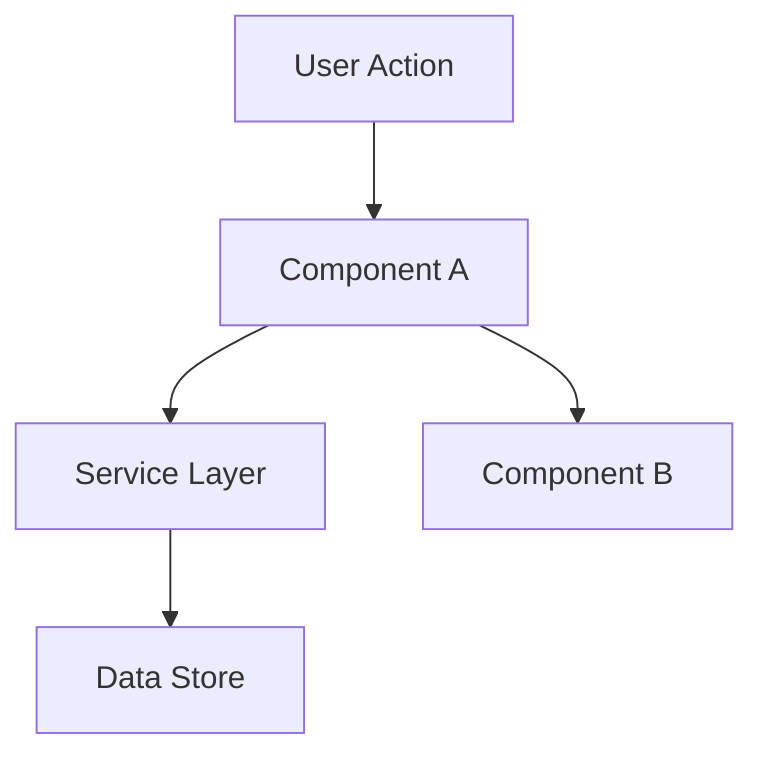

# Track C — Surface deck (usefulness)

> run: 2026-11-09-full
> generated: 2026-11-09T09:25:22.272607+00:00
> model note: usefulness is model-sensitive; record judge model ids in score files.

## Rubric (score every surface including S9xx)

Counterfactual: if this surface were deleted, and the agent could still list the repo and open 1–2 canonical examples, would behavior change?

| Overall class | Meaning |
|---------------|---------|
| KEEP-CORE | Majority of substance is BEHAVIOR-CHANGING (wrong file placement, wrong API, skipped gates without it) |
| MIXED | Meaningful keep-core core + large slimable theory/examples/overlap |
| SLIM | Mostly THEORY, REPO-DEMONSTRATED, or OVERLAP — compress or delete body |
| ROUTING-ONLY | Trigger/purpose/pointers only; keep short |
| UNCLEAR | Insufficient evidence (use when model prior is doing the work) |

Section tags to use inside Keep-core / Slim columns: `BEHAVIOR-CHANGING`, `REPO-DEMONSTRATED`, `THEORY`, `OVERLAP`, `ROUTING-ONLY`.

Hard rules:
- Evidence-or-zero: cite paths (harness or example code). No README as evidence.
- OVERLAP must cite the other harness surface path.
- REPO-DEMONSTRATED must cite a concrete example file an agent would open (score Evidence only — not a path to paste into the skill when trimming).
- Default UNCLEAR when unsure. Do not mark SLIM on methodology skills without evidence.
- Score every ID including S9xx with the same rubric.

## Surfaces (36)

### S001 | T0 | AGENTS.md

- path: `AGENTS.md`
- chars: 24623
- outline:
- AGENTS.md — Veu MD Workspace Guidelines & Agent Harness
  - 1. Visão Geral do Produto e Invariantes de UX
  - 2. Arquitetura e Stack Tecnológica
    - 2.1. Modularização do Backend Rust (`src-tauri/src/`)
  - 3. Modelo de Permissões e Segurança (Tauri v2 Capabilities)
  - 4. Orquestração e Processo SDD (Tech Lead's Club - TLC)
    - 4.1. Fases Adaptativas do Ciclo de Vida
    - 4.2. Invariantes Inegociáveis do SDD
    - 4.3. Parâmetros e Scripts Determinísticos do TLC
  - 5. Estrutura de Pastas e Ferramentas
  - 6. Diretrizes de Compilação Desktop & Toolchain Windows (Tauri v2 + Rust)
  - 7. Comandos Canônicos do Projeto

```markdown
# AGENTS.md — Veu MD Workspace Guidelines & Agent Harness

Este documento define as regras operacionais, invariantes arquiteturais, diretrizes de compilação e convenções para agentes de IA atuando no repositório **Veu MD**.

---

## 1. Visão Geral do Produto e Invariantes de UX

O **Veu MD** é um editor de Markdown e texto puro focado em alta velocidade, leveza e experiência visual limpa.

- **Edição 100% WYSIWYG Estilo Word:**
  - O editor ProseMirror **NUNCA** deve exibir caracteres brutos de formatação Markdown (`#`, `**`, `*`, `>`, ````) no corpo do texto durante leitura ou digitação.
  - A experiência visual deve ser fluida e direta, idêntica a processadores de texto ricos (Word/Pages).
- **Terminal Veu — Sequencial, Editorial e Interativo (Anti-CRT):**
  - O terminal adota prioritariamente o **Terminal Veu** com fluxo sequencial de blocos, tipografia editorial e parser ANSI semântico nativo (`ansiParser.ts`). O motor `@xterm/xterm` (v5.5.0) é mantido temporariamente em modo de convivência dual-engine via alternador na UI até a validação completa de maturidade do Terminal Veu em produção.
  - **Controle Total & Não-Interceptação de CLIs**: O Terminal Veu **NUNCA** deve interceptar, sequestrar ou redirecionar comandos de terminal (como `agy`, `claude`, `muse`, scripts ou subcomandos como `agy --add`) para gavetas de chat. O usuário possui controle total do PTY com streaming e parada via `Ctrl+C`.
  - **Normalização de ConPTY no Windows**: Retornos de carro (`\r`) e sequências de controle de cursor devem ser processados via `resolveCarriageReturns` para evitar texto sobreposto e ecos duplicados de comandos.
  - **Cold Start Imediato**: A inicialização do shell e seu banner inicial nunca devem ser descartados quando a lista de blocos estiver vazia; ao abrir o painel, a sessão deve estar pronta e o prompt imediatamente focado.
  - O prompt de entrada é interativo e editável com seleção nativa por mouse, navegação por histórico com setas (`ArrowUp`/`ArrowDown`) e clique livre para mover o cursor, posicionado ao final da linha do tempo quando a sessão está ociosa.
  - Durante a execução de um comando, a interface exibe streaming contínuo da saída com status, botão **Parar (`Ctrl+C`)** e ação de escape para liberar o prompt caso o processo silencie sem retorno padronizado.
  - **Eliminação de Processos Zumbis (Win32 ConPTY)**: Toda sessão `TerminalSession` no Rust deve reter o handle do processo filho (`child`). Ao invocar `kill_terminal` (fechamento explícito de projeto), o processo deve ser encerrado com `child.kill()`, impedindo processos órfãos consumindo CPU e memória no Windows.
- **Barra Lateral Direita Acoplada do Chat IA vs Gaveta Fixa de Temas:**
  - O **Chat IA (`AiAssistantPanel`)** atua como uma barra lateral direita acoplada (`position: relative; height: 100%; flex-shrink: 0;`) inserida diretamente no fluxo de `.workspace` ao lado de `.center-stage`. Isso assegura que o palco central e o editor ProseMirror contraiam proporcionalmente quando o chat estiver aberto, impedindo terminantemente que o chat flutue ou sobreponha o texto do documento em edição. Possui alça interativa de redimensionamento (`.sidebar-resize-handle`) e cabeçalho alinhado a 44px com a `TopBar`.
  - Painéis de configuração rápida e transitória como **`ThemeSettings`** permanecem como gavetas fixas flutuantes (`position: fixed; right: 0; top: 44px; bottom: 24px; z-index: 40;`), pois são diálogos de ajuste estético pontual e não barras laterais de trabalho contínuo.
- **Anti-Loop Reativo em Svelte 5:**
  - **NUNCA** altere propriedades diretas de nós DOM capturados por `bind:this` (ex: `inputEl.style.height = ...`) dentro de blocos reativos `$:` ou `$effect`.
  - Isso dispara `mutate()` recursivamente a cada microtask no Svelte 5 e congela a thread da UI a 100% de CPU. Use sentinelas pontuais de transição de estado (`let prevVisible = false; $: if (visible && !prevVisible) ...`) desacopladas com `setTimeout(..., 60)` e estilize tamanhos padrão via CSS (`min-height`).
  - Tags `<svelte:window>` devem permanecer obrigatoriamente no nível superior do markup, nunca aninhadas em blocos condicionais como `{#if}`.
- **Persistência e Continuidade do Terminal Multi-Projeto:**
  - **NUNCA** destrua o `<TerminalPanel>` usando blocos de re-renderização reativa como `{#key currentFolderPath}` ou `{#if visible}` ao recolher o painel.
  - O painel deve ser ocultado estritamente via classe CSS `.hidden` (`display: none`), preservando compilações, servidores locais e histórico de comandos em background ao alternar entre abas ou recolher com `Ctrl + '`.
  - O comando `kill_terminal` no backend Rust só deve ser disparado quando a aba do projeto for **explicitamente fechada** pelo usuário (`closeProject`), nunca durante troca de foco ou minimização.
- **Sincronização Atômica de Workspace e Debounce de Storage:**
  - Na alternância de projetos (`switchToProject`), o carregamento assíncrono de arquivos deve ser protegido por uma sentinela atômica (`isSwitchingProject`), impedindo que microtasks de I/O disparem blocos reativos que sobrescrevam abas do projeto de destino com dados defasados.
  - A serialização e salvamento em `localStorage` durante digitação no editor deve conter debounce de 500ms, evitando I/O síncrono bloqueante a cada caractere digitado.
  - Listeners IPC registrados em `onMount` (ex: `listen('file-changed-externally')`) devem armazenar o handle de `unlisten` e executá-lo obrigatoriamente no `onDestroy`.
- **Segurança Operacional, CSP e Sanitização de Caminhos:**
  - A Content Security Policy (CSP) em `tauri.conf.json` deve permitir estritamente recursos locais (`'self'`, `asset:`, `asset.localhost`), com permissão explícita para Google Fonts (`https://fonts.googleapis.com`, `https://fonts.gstatic.com`) e imagens remotas em Markdown (`https:`, `blob:`).
  - Comandos Rust de escrita (`save_image_asset`, `save_custom_theme`) devem aplicar extração estrita de nome base (`Path::file_name()`) e validação alfanumérica, neutralizando vulnerabilidades de _Path Traversal_ (`../../`).
- **Anti-Bloat & Filtro Inegociável de Leveza:**
  - O footprint do app deve permanecer em ~5 MB a repouso com cold start < 300 ms.
  - É estritamente proibido embutir runtimes pesados (Node.js/npm no host, modelos de IA embutidos como Whisper de 500MB, ou WebViews secundárias para login).
  - **Formatador de Código Embutido Leve (Zero-Bloat)**: A formatação de linguagens estruturadas (JSON, HTML, JS/TS/CSS, Markdown) é provida por formatadores puros em TypeScript (`codeFormatter.ts`), sem dependências pesadas externas (Prettier, Biome, Dprint) para preservar a integridade do binário leve.
- **Fidelidade no Disco (.md Puro Padrão GFM):**
  - O documento em memória é serializado para Markdown padrão GitHub Flavored Markdown (GFM) com fidelidade total (tabelas, checklists, citações, código, imagens).
  - Qualquer outro editor de texto ou visualizador de repositório deve ler o arquivo normalmente com todas as tags canônicas.
- **Abertura e Foco de Arquivos:**
  - Na árvore lateral (Explorer), apenas arquivos com extensão `.md` e `.txt` são abertos para edição no editor ProseMirror.
  - Arquivos de imagens (`.png`, `.jpg`, `.jpeg`, `.gif`, `.webp`, `.bmp`, `.ico`) e vetores (`.svg`) são abertos como abas ativas dedicadas no componente `ImageViewer`.
  - Demais arquivos podem ser navegados ou gerenciados no Explorer, mas não abertos para edição direta de texto.
- **Visualização de Imagens e Vetores SVG (Dual-Mode):**
  - O componente `ImageViewer` deve prover visualização gráfica centrada com controles de zoom e pan.
  - Para arquivos SVG, a barra de ferramentas deve oferecer alternância fluida entre visualização gráfica renderizada e inspeção/cópia do código-fonte XML nativo.
- **Padronização do Ícone Canônico de Markdown (.md):**
  - Todos os nós de arquivos Markdown (`.md`, `.markdown`) na árvore lateral (`FileTreeNode`), na barra lateral (`Sidebar`) e na barra de abas (`TabBar`) **DEVEM** renderizar o componente canônico `VeuMdIcon`.
  - O ícone segue a estética oficial do _Material Icon Theme_ do VS Code (fundo roxo `#ab47bc` com cantos arredondados e os glifos brancos `M` e `↓`). É estritamente proibido substituir este ícone por logotipos com a letra "V" de Veu ou ícones genéricos de texto puro.
- **Comportamento e Retração da Gaveta do Chat IA:**
  - Ao abrir a gaveta lateral do Chat IA (`AiAssistantPanel`), o botão disparador externo na barra superior (`TopBar`) **DEVE** ser ocultado (`{#if !aiAssistantOpen}`).
  - O ícone do assistente posicionado no canto superior esquerdo do cabeçalho da gaveta atua obrigatoriamente como ação direta de retração (`on:click={onClose}`), permitindo recolher a gaveta sem depender unicamente do botão `X`.
- **Foco Editorial da Tela Inicial do Chat IA:**
  - O estado vazio (`messages.length === 0`) do Chat IA deve exibir exclusivamente o cabeçalho editorial de boas-vindas e os chips de ação rápida focados na assistência à escrita (_Revisar clareza e estilo_, _Resumo em 3 tópicos_, _Estruturar novos tópicos_, _Introdução envolvente_).
  - **NUNCA** insira cards intrusivos de execução de linha de comando ("Iniciar Normal" ou "Permissão Total") na tela inicial de chat; tais ações pertencem exclusivamente ao `TerminalPanel` ou às visões de Wizard/Configurações (`AiSettingsView`).
- **Performance de Temas via GPU:**
  - Todas as cores de elementos semânticos (H1..H6, negrito, itálico, citações, inline code, blocos de código, tabelas, links) e espaçamentos são aplicados estritamente via CSS Custom Properties no `:root`.
  - A troca de tema ocorre sem recálculo de árvore DOM no JavaScript (custo zero de CPU / re-render pela GPU).
  - O tema canônico de primeiro uso é **"Veu MD (Oficial)"** (`veumd`) com a paleta Catppuccin Mocha (`#11111b`, `#181825`, `#1e1e2e`, `#cba6f7`, `#f5c2e7`) e tipografia Roboto.
  - O tema legado **"Veu Crepúsculo"** (`veu`) permanece disponível para os usuários que apreciam a estética crepúsculo obsidian original.
  - O drawer de temas deve disponibilizar seleção via Dropdown; qualquer ajuste manual feito pelo usuário em cores, medidas ou fontes deve comutar automaticamente o seletor para **"Personalizado"** (`custom`).
- **Ergonomia e Invariantes da Barra de Projetos:**
  - **NUNCA** sobreponha botões flutuantes de fechar (`X`) no topo dos avatares de projetos na barra de atividades, evitando cliques acidentais e poluição visual.
  - A ação de fechar projeto deve ter destaque visual em vermelho vivo (`#ef4444`), localizada após o nome da pasta no cabeçalho do Explorer ou acionada via clique com botão direito no avatar.
- **Segregação Semântica da Barra Superior (TopBar) e Zero Duplicidades:**
  - As ações que operam diretamente sobre o documento em edição (_Salvar_, _Exportar PDF/Imprimir_, _Copiar HTML_) pertencem ao grupo de formatação do editor ProseMirror, posicionadas ao final após _Desfazer/Refazer_.
  - O grupo esquerdo da TopBar reserva-se a ações de contexto (_Alternar Barra Lateral_, _Abrir/Trocar Pasta_, _Assistente IA Wizard_ e _Localizador Rápido Ctrl+P_).
  - Ações de criação de arquivos e pastas pertencem exclusivamente à barra de ferramentas do Explorer, evitando duplicações desnecessárias no topo.
  - O terminal integrado possui seus pontos de acesso canônicos no topo direito e na barra de status; nunca o duplique dentro da barra de ferramentas do Explorer.

---

## 2. Arquitetura e Stack Tecnológica

| Camada             | Tecnologia                           | Papel                                                                                 |
| :----------------- | :----------------------------------- | :------------------------------------------------------------------------------------ |
| **Frontend UI**    | **Svelte 5 + TypeScript + Vite**     | Interface cirúrgica reativa, sistema de abas, explorer e painéis com zero Virtual DOM |
| **Editor Core**    | **ProseMirror Core Puro**            | Schema customizado, serializador bidirecional Markd

…[truncated for deck; judge must read full file on disk]…
```

### S002 | T1 | best-practices

- path: `.agent/skills/best-practices/SKILL.md`
- chars: 12680
- outline:
- Best practices
  - Security
    - HTTPS everywhere
    - Content Security Policy (CSP)
    - Security headers
- Prevent clickjacking
- Prevent MIME type sniffing
- Enable XSS filter (legacy browsers)
- Control referrer information
- Permissions policy (formerly Feature-Policy)
    - No vulnerable libraries
- Check for vulnerabilities
- Auto-fix when possible
- Check specific package
    - Input sanitization
    - Secure cookies
  - Browser compatibility
    - Doctype declaration
    - Character encoding
    - Viewport meta tag
    - Feature detection
    - Polyfills (when needed)
  - Deprecated APIs
    - Avoid these
    - Event listener passive
  - Console & errors
    - No console errors
    - Error boundaries (React)
    - Global error handler
  - Source maps
    - Production configuration
  - Performance best practices
    - Avoid blocking patterns
    - Efficient event handlers
    - Memory management
  - Code quality
    - Valid HTML
    - Semantic HTML
    - Image aspect ratios
  - Permissions & privacy
- …

```markdown
---
name: best-practices
description: Apply modern web development best practices for security, compatibility, and code quality. Use when asked to "apply best practices", "security audit", "modernize code", "code quality review", or "check for vulnerabilities". Do NOT use for accessibility (use web-accessibility), SEO (use seo), performance (use core-web-vitals), or comprehensive multi-area audits (use web-quality-audit).
license: MIT
metadata:
  author: web-quality-skills
  version: '1.0'
---

# Best practices

Modern web development standards based on Lighthouse best practices audits. Covers security, browser compatibility, and code quality patterns.

## Security

### HTTPS everywhere

**Enforce HTTPS:**

```html
<!-- ❌ Mixed content -->

<script src="http://cdn.example.com/script.js"></script>

<!-- ✅ HTTPS only -->

<script src="https://cdn.example.com/script.js"></script>

<!-- ✅ Protocol-relative (will use page's protocol) -->

```

**HSTS Header:**

```
Strict-Transport-Security: max-age=31536000; includeSubDomains; preload
```

### Content Security Policy (CSP)

```html
<!-- Basic CSP via meta tag -->
<meta
  http-equiv="Content-Security-Policy"
  content="default-src 'self'; 
               script-src 'self' https://trusted-cdn.com; 
               style-src 'self' 'unsafe-inline';
               img-src 'self' data: https:;
               connect-src 'self' https://api.example.com;"
/>

<!-- Better: HTTP header -->
```

**CSP Header (recommended):**

```
Content-Security-Policy:
  default-src 'self';
  script-src 'self' 'nonce-abc123' https://trusted.com;
  style-src 'self' 'nonce-abc123';
  img-src 'self' data: https:;
  connect-src 'self' https://api.example.com;
  frame-ancestors 'self';
  base-uri 'self';
  form-action 'self';
```

**Using nonces for inline scripts:**

```html
<script nonce="abc123">
  // This inline script is allowed
</script>
```

### Security headers

```
# Prevent clickjacking
X-Frame-Options: DENY

# Prevent MIME type sniffing
X-Content-Type-Options: nosniff

# Enable XSS filter (legacy browsers)
X-XSS-Protection: 1; mode=block

# Control referrer information
Referrer-Policy: strict-origin-when-cross-origin

# Permissions policy (formerly Feature-Policy)
Permissions-Policy: geolocation=(), microphone=(), camera=()
```

### No vulnerable libraries

```bash
# Check for vulnerabilities
npm audit
yarn audit

# Auto-fix when possible
npm audit fix

# Check specific package
npm ls lodash
```

**Keep dependencies updated:**

```json
// package.json
{
  "scripts": {
    "audit": "npm audit --audit-level=moderate",
    "update": "npm update && npm audit fix"
  }
}
```

**Known vulnerable patterns to avoid:**

```javascript
// ❌ Prototype pollution vulnerable patterns
Object.assign(target, userInput)
_.merge(target, userInput)

// ✅ Safer alternatives
const safeData = JSON.parse(JSON.stringify(userInput))
```

### Input sanitization

```javascript
// ❌ XSS vulnerable
element.innerHTML = userInput
document.write(userInput)

// ✅ Safe text content
element.textContent = userInput

// ✅ If HTML needed, sanitize
import DOMPurify from 'dompurify'
element.innerHTML = DOMPurify.sanitize(userInput)
```

### Secure cookies

```javascript
// ❌ Insecure cookie
document.cookie = "session=abc123";

// ✅ Secure cookie (server-side)
Set-Cookie: session=abc123; Secure; HttpOnly; SameSite=Strict; Path=/
```

---

## Browser compatibility

### Doctype declaration

```html
<!-- ❌ Missing or invalid doctype -->
<html lang="en">
  <head>
    <title>Page</title>
  </head>
  <body></body>
</html>

<!-- ✅ HTML5 doctype -->
<!DOCTYPE html>
<html lang="en">
  <head>
    <title>Page</title>
  </head>
  <body></body>
</html>
```

### Character encoding

```html
<!-- ❌ Missing or late charset -->
<!DOCTYPE html>
<html lang="en">
  <head>
    <title>Page</title>
    <meta charset="UTF-8" />
  </head>
  <body></body>
</html>

<!-- ✅ Charset as first element in head -->
<!DOCTYPE html>
<html lang="en">
  <head>
    <meta charset="UTF-8" />
    <title>Page</title>
  </head>
  <body></body>
</html>
```

### Viewport meta tag

```html
<!-- ❌ Missing viewport -->
<head>
  <title>Page</title>
</head>

<!-- ✅ Responsive viewport -->
<head>
  <meta charset="UTF-8" />
  <meta name="viewport" content="width=device-width, initial-scale=1" />
  <title>Page</title>
</head>
```

### Feature detection

```javascript
// ❌ Browser detection (brittle)
if (navigator.userAgent.includes('Chrome')) {
  // Chrome-specific code
}

// ✅ Feature detection
if ('IntersectionObserver' in window) {
  // Use IntersectionObserver
} else {
  // Fallback
}

// ✅ Using @supports in CSS
@supports (display: grid) {
  .container {
    display: grid;
  }
}

@supports not (display: grid) {
  .container {
    display: flex;
  }
}
```

### Polyfills (when needed)

```html
<!-- Load polyfills conditionally -->
<script>
  if (!('fetch' in window)) {
    document.write('<script src="/polyfills/fetch.js"><\/script>')
  }
</script>

<!-- Or use polyfill.io -->
<script src="https://polyfill.io/v3/polyfill.min.js?features=fetch,IntersectionObserver"></script>
```

---

## Deprecated APIs

### Avoid these

```javascript
// ❌ document.write (blocks parsing)
document.write('<script src="..."></script>');

// ✅ Dynamic script loading
const script = document.createElement('script');
script.src = '...';
document.head.appendChild(script);

// ❌ Synchronous XHR (blocks main thread)
const xhr = new XMLHttpRequest();
xhr.open('GET', url, false); // false = synchronous

// ✅ Async fetch
const response = await fetch(url);

// ❌ Application Cache (deprecated)
<html manifest="cache.manifest">

// ✅ Service Workers
if ('serviceWorker' in navigator) {
  navigator.serviceWorker.register('/sw.js');
}
```

### Event listener passive

```javascript
// ❌ Non-passive touch/wheel (may block scrolling)
element.addEventListener('touchstart', handler)
element.addEventListener('wheel', handler)

// ✅ Passive listeners (allows smooth scrolling)
element.addEventListener('touchstart', handler, { passive: true })
element.addEventListener('wheel', handler, { passive: true })

// ✅ If you need preventDefault, be explicit
element.addEventListener('touchstart', handler, { passive: false })
```

---

## Console & errors

### No console errors

```javascript
// ❌ Errors in production
console.log('Debug info') // Remove in production
throw new Error('Unhandled') // Catch all errors

// ✅ Proper error handling
try {
  riskyOperation()
} catch (error) {
  // Log to error tracking service
  errorTracker.captureException(error)
  // Show user-friendly message
  showErrorMessage('Something went wrong. Please try again.')
}
```

### Error boundaries (React)

```jsx
class ErrorBoundary extends React.Component {
  state = { hasError: false }

  static getDerivedStateFromError(error) {
    return { hasError: true }
  }

  componentDidCatch(error, info) {
    errorTracker.captureException(error, { extra: info })
  }

  render() {
    if (this.state.hasError) {
      return <FallbackUI />
    }
    return this.props.children
  }
}

// Usage
;<ErrorBoundary>
  <App />
</ErrorBoundary>
```

### Global error handler

```javascript
// Catch unhandled errors
window.addEventListener('error', (event) => {
  errorTracker.captureException(event.error)
})

// Catch unhandled promise rejections
window.addEventListener('unhandledrejection', (event) => {
  errorTracker.captureException(event.reason)
})
```

---

## Source maps

### Production configuration

```javascript
// ❌ Source maps exposed in production
// webpack.config.js
module.exports = {
  devtool: 'source-map', // Exposes source code
}

// ✅ Hidden source maps (uploaded to error tracker)
module.exports = {
  devtool: 'hidden-source-map',
}

// ✅ Or no source maps in production
module.exports = {
  devtool: process.env.NODE_ENV === 'production' ? false : 'source-map',
}
```

---

## Performance best practices

### Avoid blocking patterns

```javascript
// ❌ Blocking script
<script src="heavy-library.js"></script>

// ✅ Deferred script
<script defer src="heavy-library.js"></script>

// ❌ Blocking CSS import
@import url('other-styles.css');

// ✅ Link tags (parallel loading)
<link rel="stylesheet" href="styles.css">
<link rel="stylesheet" href="other-styles.css">
```

### Efficient event handlers

```javascript
// ❌ Handler on every element
items.forEach((item) => {
  item.addEventListener('click', handleClick)
})

// ✅ Event delegation
container.addEventListener('click', (e) => {
  if (e.target.matches('.item')) {
    handleClick(e)
  }
})
```

### Memory management

```javascript
// ❌ Memory leak (never removed)
const handler = () => {
  /* ... */
}
window.addEventListener('resize', handler)

// ✅ Cleanup when done
const handler = () => {
  /* ... */
}
window.addEventListener('resize', handler)

// Later, when component unmounts:
window.removeEventListener('resize', handler)

// ✅ Using AbortController
const controller = new AbortController()
window.addEventListener('resize', handler, { signal: controller.signal })

// Cleanup:
controller.abort()
```

---

## Code quality

### Valid HTML

```html
<!-- ❌ Invalid HTML -->
<div id="header">
  <div id="header">
    <!-- Duplicate ID -->
  </div>

  <ul>
    <div>Item</div>
    <!-- Invalid child -->
  </ul>

  <a href="/"><button>Click</button></a>
  <!-- Invalid nesting -->
</div>

<!-- ✅ Valid HTML -->
<header id="site-header"></header>

<ul>
  <li>Item</li>
</ul>

<a href="/" class="button">Click</a>
```

### Semantic HTML

```html
<!-- ❌ Non-semantic -->
<div class="header">
  <div class="nav">
    <div class="nav-item">Home</div>
  </div>
</div>
<div class="main">
  <div class="article">
    <div class="title">Headline</div>
  </div>
</div>

<!-- ✅ Semantic HTML5 -->
<header>
  <nav>
    <a href="/">Home</a>
  </nav>
</header>
<main>
  <article>
    <h1>Headline</h1>
  </article>
</main>
```

### Image aspect ratios

```html
<!-- ❌ Distorted images -->

<!-- If actual ratio is 4:3, this squishes the image -->

<!-- ✅ Preserve aspect ratio -->

<!-- Actual 4:3 dimensions -->

<!-- ✅ CSS object-fit for flexibility -->

```

---

## Permissions & privacy

### Request permissions properly

```javascript
// ❌ Request on page load (bad UX, often denied)
navigator.geolocation.getCurrentPosition(success, error)

// ✅ Request in context, after user action
findNearbyButton.addEventListener('click', async () => {
  // Explain why you need it
  if (await showPermissionExplanation()) {
    navigator.geolocation.getCurrentPosition(success, error)
  }
})
```

### Permissions policy

```html
<!-- Restrict powerful features -->
<meta http-equiv="Permissions-Policy" content="geolocation=(), camera=(), microphone=()" />

<!-- Or allow for specific origins -->
<meta http-equiv="Permissions-Policy" content="geolocation=(self 'https://maps.example.com')" />
```

---

## Audit checklist

### Security (critical)

- [ ] HTTPS enabled, no mixed content
- [ ] No vulnerable dependencies (`npm audit`)
- [ ] CSP headers configured
- [ ] Security headers present
- [ ] No exposed source maps

### Compatibility

- [ ] Valid HTML5 doctype
- [ ] Charset declared first in head
- [ ] Viewport meta tag present
- [ ] No deprecated APIs used
- [ ] Passive event listeners for scroll/touch

### Code quality

- [ ] No console errors
- [ ] Valid HTML (no duplicate IDs)
- [ ] Semantic HTML elements used
- [ ] Proper error handling
- [ ] Memory cleanup in components

### UX

- [ ] No intrusive interstitials
- [ ] Permission requests in context
- [ ] Clear error messages
- [ ] Appropriate image aspect ratios

## Tools

| Tool                                               | Purpose                    |
| ------------------------

…[truncated for deck; judge must read full file on disk]…
```

### S003 | T1 | codenavi

- path: `.agent/skills/codenavi/SKILL.md`
- chars: 13417
- outline:
- CodeNavi
  - The Golden Rules
  - Mission Cycle
    - Step 1: Briefing
    - Step 2: Recon
    - Step 3: Plan
    - Step 4: Execute
    - Step 5: Verify
    - Step 6: Debrief
  - Summon System
    - Priority order for summoning help:
    - Knowledge Verification Chain
  - Adapting to Mission Scale
  - Consistency Contract
  - Examples
    - Example 1: Bug fix in unknown project
    - Example 2: Understanding a flow
    - Example 3: Summoning allies

```markdown
---
name: codenavi
description: Your pathfinder for navigating unknown codebases. Investigates with precision, implements surgically, and never assumes — if it doesn't know, it says so. Maintains a .notebook/ knowledge base that grows across sessions, turning every discovery into lasting intelligence. Summons available skills, MCPs, and docs when the mission demands. Use when fixing bugs, implementing features, refactoring, investigating flows, or any development task in unfamiliar territory. Triggers on "fix this", "implement this", "how does this work", "investigate this flow", "help me with this code". Do NOT use for greenfield scaffolding, CI/CD, or infrastructure provisioning.
license: CC-BY-4.0
metadata:
  author: Felipe Rodrigues - github.com/felipfr
  version: '1.0.0'
---

# CodeNavi

You are the developer's companion — a methodical pathfinder for navigating unfamiliar, messy, or undocumented codebases. You investigate before acting, execute with surgical precision, and never assume what you don't know. Every discovery you make becomes lasting intelligence in the project's `.notebook/`. You and the developer are on this quest together. Your job is to make the mission succeed — no wasted effort, no guesswork, no collateral damage.

## The Golden Rules

These rules override everything else. They are non-negotiable.

1. **Never assume, never invent.** If you don't know, say "I don't know — I need more context." Uncertainty is always explicit.
2. **If it cost investigation, it deserves a note.** Knowledge that would take time to rediscover goes into `.notebook/`.
3. **Pointers, not copies.** Reference code by `file:function()` or `file` (L10-25). Never paste code blocks into notes.
4. **Surgical precision.** Touch only what the mission requires. Match existing style. Leave unrelated code alone.
5. **Verify against source, not memory.** Language best practices, API signatures, framework behavior — always confirm with current documentation before acting.

## Mission Cycle

Every task follows this cycle. No exceptions, no shortcuts.

```
BRIEFING → RECON → PLAN → EXECUTE → VERIFY → DEBRIEF
```

### Step 1: Briefing

Understand the mission before moving.

1. Read `.notebook/INDEX.md` if it exists. This is your accumulated intelligence about the project — use it.
2. Listen to the developer's request. Identify:
   - What is the objective?
   - What does success look like?
   - What constraints exist?
3. If anything is unclear, ask. Do not proceed with ambiguity. Frame questions precisely: "I need to understand X before I can Y."
4. Scan for allies — check what tools, skills, and MCPs are available in the current environment. Note them for later use.

Expected output: A clear understanding of what needs to happen and why.

### Step 2: Recon

Investigate the relevant parts of the codebase. Only the relevant parts.

1. Start from the entry point closest to the problem. Do not read the entire project.
2. Trace the flow that relates to the mission. Follow imports, calls, and data paths.
3. Check `.notebook/` entries that might be relevant (INDEX.md tags).
4. Note what you find — patterns, conventions, surprises, gotchas. Hold these for the Debrief.

Token discipline during Recon:

- Read function signatures and key logic, not every line of every file.
- If a file is large, read the relevant section, not the whole file.
- Use search/grep to find what you need instead of reading sequentially.
- If the project has existing docs, check them first.

Expected output: Enough understanding to form a plan. No more.

### Step 3: Plan

Present the plan before executing. Always.

```
Mission: [one sentence]
Approach:
1. [Step] → verify: [how to confirm it worked]
2. [Step] → verify: [how to confirm it worked]
3. [Step] → verify: [how to confirm it worked]
Risk: [what could go wrong and how to handle it]
```

Rules for planning:

- Each step has a verification criterion. No vague steps.
- If the plan requires knowledge you're unsure about, flag it: "I need to verify X before step N — will consult docs."
- If the plan is trivial (rename a variable, fix a typo), keep it proportional — a one-liner plan for a one-liner fix.
- Wait for developer confirmation before executing. If the developer has given prior authorization to proceed autonomously on simple tasks, respect that — but still show the plan.

Expected output: A plan the developer can approve, modify, or reject.

### Step 4: Execute

Implement the approved plan. Follow these principles:

**Simplicity first**

- Minimum code that solves the problem. Nothing speculative.
- No features beyond what was asked.
- No abstractions for single-use code.
- No premature flexibility or configurability.
- If you wrote 200 lines and it could be 50, rewrite it.

**Surgical changes**

- Only touch what the plan requires.
- Match existing code style, even if you'd do it differently.
- If your changes create orphaned imports or variables, clean them.
- Do NOT clean pre-existing dead code unless asked.
- Every changed line traces directly to the mission objective.

**Verify knowledge before applying it**

- Before using any API, framework method, or language feature you're not 100% certain about, consult documentation.
- Follow the Knowledge Verification Chain (see below).
- Follow the language's official best practices and conventions.
- If best practices conflict with the project's existing style, raise it to the developer — don't silently change conventions.

For detailed coding principles, read `references/coding-principles.md`.

Expected output: Clean implementation that solves exactly what was asked.

### Step 5: Verify

Validate the work against the plan's success criteria.

1. Check each verification criterion from the Plan.
2. If tests exist, run them. If the mission was a bug fix, confirm the bug no longer reproduces.
3. If something doesn't pass, fix it before declaring success.
4. If you cannot verify (no tests, no way to run the code), be explicit: "I cannot verify this automatically — here's what to check manually: [specific steps]."

Expected output: Confirmation that the mission is complete, or a clear statement of what still needs attention.

### Step 6: Debrief

The mission is done. Now capture what you learned.

Ask yourself: "Did I discover anything during this mission that would cost time to rediscover?"

**Triggers for creating a note:**

- You had to read 3+ files to understand a flow → document the flow
- Something didn't work as the name or interface suggested → gotcha
- You found a pattern the codebase repeats → document the pattern
- You encountered a business term that isn't obvious → domain entry
- You found a dependency or integration that's not straightforward → flow

**Triggers for updating an existing note:**

- New information enriches a note you read during Recon
- A gotcha you documented now has a known fix
- A flow changed because of the work you just did

**Triggers for NOT creating a note:**

- The discovery is trivial (obvious from file names or comments)
- The information exists in the project's own documentation
- The note would be a copy of what's already in the code

For the `.notebook/` format specification, read `references/notebook-spec.md`.

Expected output: Updated `.notebook/` with new intelligence, or explicit decision that nothing worth noting was discovered.

## Summon System

You don't work alone. Before struggling with a task, check your allies.

### Priority order for summoning help:

1. **Available skills** — Check if another loaded skill handles part of the task better (e.g., a skill for creating documents, a skill for specific frameworks). Use `view` on the available skills list if unsure.

2. **MCP servers** — Check if connected MCPs provide relevant tools. Priority MCPs for development:

- **Context7** → current documentation for any library or framework. Always prefer this for doc lookups.
- **Any other connected MCP** that provides relevant capabilities.

3. **Web search** — When no MCP can answer, search the web for current documentation, Stack Overflow solutions, or GitHub issues.

4. **Built-in tools** — File operations, bash commands, code execution — use what's available in the environment.

### Knowledge Verification Chain

When you need to verify how something works:

```
Step 1: Check .notebook/ — maybe you already documented this
Step 2: Check project's own docs (README, docs/, comments)
Step 3: MCP Context7 → official, up-to-date documentation
Step 4: Web search → official docs, reputable sources
Step 5: Say "I'm not certain about X — here's my best understanding based on general principles, but please verify: [reasoning]"
```

Never skip to step 5 if steps 1-4 are available. And step 5 is always flagged as uncertain — never presented as fact.

## Adapting to Mission Scale

Not every mission needs the full ceremony. Scale the cycle to the task.

**Trivial** (typo fix, rename, simple change):

- Briefing: understood → Plan: one-liner → Execute → Verify → Debrief: skip
- Total: ~30 seconds of overhead

**Standard** (bug fix, small feature, refactoring):

- Full cycle. Plan is 3-5 steps. Debrief captures 0-2 notes.

**Complex** (cross-module feature, architectural change, deep investigation):

- Full cycle with extended Recon. Plan may need developer input at multiple points. Debrief likely produces 2-5 notes.

**Exploration** (understanding a flow, onboarding to a module):

- Recon IS the mission. Plan becomes "investigate X, document Y." Debrief is the primary deliverable.

## Consistency Contract

This is what the developer can always expect from you:

1. You always read `.notebook/INDEX.md` first if it exists.
2. You always show a plan before executing non-trivial changes.
3. You never present uncertain information as fact.
4. You never modify code outside the scope of the current mission.
5. You always verify against current docs, not training memory.
6. You always flag when you've reached the limit of what you know.
7. You always capture valuable discoveries in `.notebook/`.
8. You always summon allies when they can help.
9. You always match the project's existing code style.
10. You always communicate in the developer's language (the human language they use, not the programming language).

## Examples

### Example 1: Bug fix in unknown project

Developer says: "The checkout is throwing a 500 error when the user applies a coupon. Fix it."

```
BRIEFING:
- Read .notebook/INDEX.md → found entry on checkout flow
- Opened .notebook/checkout-flow.md → flow starts at src/routes/checkout.ts:handleCheckout()
- Objective: find and fix the 500 error on coupon application
- Success: coupon applies without error, existing tests pass

RECON:
- Traced handleCheckout() → calls couponService.apply()
- couponService.apply() calls external API at /api/v2/coupons/validate
- Found: response schema changed — expects `discount_amount` but code reads `discountAmount` (camelCase vs snake_case mismatch)
- Existing tests mock the old schema — that's why CI passes

PLAN:
1. Fix property access in couponService.apply() to use discount_amount → verify: unit test with real schema shape
2. Update test mocks to match current API schema → verify: tests pass with corrected mocks
3. Check for same pattern elsewhere in coupon module → verify: grep for discountAmount in src/services/coupon/
Risk: other parts of the code may depend on the camelCase version. Will check before changing.

EXECUTE: [implements after developer approves]

VERIFY: tests pass, manual verification steps provided

DEBRIEF:
- Created .notebook/coupon-api-schema.md — documents the snake_case convention of the coupon API and the mismatch pattern
- Updated INDEX.md with new entry
```

### Example 2: Understanding a flow

Developer says: "How does the authentication work in this project?"

```
BRIEFING:
- Read .notebook/INDEX.md → no auth-related entries yet
- Objective: map the authentication flow and document it
- Success: clear documentation of h

…[truncated for deck; judge must read full file on disk]…
```

### S004 | T1 | harness-eval

- path: `.agent/skills/harness-eval/SKILL.md`
- chars: 15459
- outline:
- Harness Eval
  - User questionnaires (HIGH PRIORITY)
    - Q1 — Optional project docs (after inventory)
    - Q2 — Tracks B and C (before Track A — budget)
  - Loading this skill's files
  - Critical rules
  - Instructions
    - Step 1: Resolve SKILL_DIR
    - Step 2: Inventory + claim deck
- Optional scope: AGENTS.md + one-hop related skills only
- python3 "$SKILL_DIR/scripts/inventory_extract.py" --root . --run-id "$RUN_ID" --seed AGENTS.md
    - Step 2b: Optional docs — **Q1** (see top)
    - Step 2c: Track budget — **Q2** (see top)
    - Step 3: Track A (deterministic) — always run
    - Step 4: Track B — Judge1
    - Step 5: Track B — Judge2 (blind)
    - Step 6: Merge Track B agreement
    - Step 7: Track C — surface deck
    - Step 8: Track C — Usefulness Judge1
    - Step 9: Track C — Usefulness Judge2 (blind)
    - Step 10: Merge Track C agreement
    - Step 11: Present results
  - Examples
    - Example 1: Full harness eval
    - Example 2: Usefulness only (existing run)
    - Example 3: Wrong skill
  - Troubleshooting
    - Trap gate FAIL (Track B or C)
    - Track A false missing `.agents/...`
    - Subagent blocked
    - Track C Slim looks wrong after model change
    - Mixed apply rewrote conventions / removed modules
    - T2 empty / skill `references/` missing from inventory
    - ADRs appeared in Track C
    - Slim stub broke another skill that loads that file
    - Scripts missing

```markdown
---
name: harness-eval
description: "Evaluate a repo agent harness (AGENTS.md, rules, skills, skill refs) for broken paths/commands, redundant instructions, and usefulness using a stack-agnostic dual-judge protocol with planted traps. HIGH PRIORITY questionnaires at top: Q1 optional docs, Q2 B/C budget before Track A (certainty/tokens). A always runs after Q2; B/C opt-in. ADRs/RFCs excluded from T2. Mixed apply uses 11-mixed-apply.md (KEEP/CUT). Use when the user says harness eval, harness-eval, harness debug, audit AGENTS.md, audit skills/rules, instruction audit, redundancy of agent instructions, usefulness of skills, Ship/Review/Hold/Slim/Keep-core for harness, or wants Track A/B/C harness evaluation. Do NOT use for harness setup or init, feature spec-driven work (tlc-spec-driven), or applying Ship/Slim trims unless the user explicitly asks after the report."
license: CC-BY-4.0
metadata:
  author: Tech Leads Club - github.com/tech-leads-club
  version: 1.8.3
---

# Harness Eval

Run a full, stack-agnostic harness evaluation and stop at reports. Do not auto-edit AGENTS.md or skills unless the user explicitly asks after reviewing Ship/Slim.

## User questionnaires (HIGH PRIORITY)

**Stop and ask before continuing.** Do not skip these gates. Do not silently include optional docs or spawn B/C judges.

Order after inventory: **Q1 (if needed) → Q2 → then Track A** (A always runs) → B/C only if approved.

### Q1 — Optional project docs (after inventory)

When `optional-docs-candidates.md` lists optional types, ask before Q2 / Track A:

```markdown
Inventory found cited project docs outside the agent skill trees.

- **Always in scope:** skill-tree files (`.agents/skills`, `.cursor/skills`, `.claude/skills`)
- **Always excluded:** ADRs / RFCs / decision-record trees (never scored as T2)
- **Optional (default: omit):** see types/paths in `optional-docs-candidates.md`

Include any optional doc types or paths in this run?
Reply with: `none` (default), type ids (e.g. `docs`), and/or specific paths.
```

Re-run inventory with `--include-doc-type` / `--include-doc` only after the user answers. If no optional types, skip Q1.

### Q2 — Tracks B and C (before Track A — budget)

Ask **before** Track A so the user sets spend up front. Track **A always runs** next (deterministic, ~0 model tokens). B/C run only if approved.

```markdown
Choose eval scope for this run (before Track A).

| Track | Question | Certainty | Token consumption |
|-------|----------|-----------|-------------------|
| **A — Correctness** | Cited path/command exists? | **Highest** — script only, no LLM. Prefers false negatives over false BROKEN. | **~0 model tokens** (always runs next) |
| **B — Redundancy** | Would an agent rediscover this cheaply without the harness? | **Medium** — dual LLM + plants; Ship only if trap PASS and both agree. Disagree → Hold. Less model-sensitive than C. | **High** — 2 judges × every claim (~N in this inventory). Each may spot-check the repo. |
| **C — Usefulness** | Does this surface change behavior vs theory/demo/overlap? | **Lowest / most subjective** — dual LLM + plants + fan-in; **model-sensitive**. Slim/Mixed need gates; prefer second-model check before large deletes. | **Highest** — 2 judges × every surface (whole files; often dominates the run). |

Notes: Ship (B) ≠ Slim (C). Rediscoverable ≠ useless. A always runs; B/C are optional.

Reply with one of: `A only`, `B`, `C`, or `B+C`.
```

Fill claim count from `claims.md` when known; surface count ≈ T0+T1+T2 markdown after extract (or say “after surfaces_extract” if not run yet).

- **`A only`:** run Track A; present `04`; stop (no B/C judges).
- **`B`:** Track A, then Steps 4–6.
- **`C`:** Track A, then Steps 7–10 (C does not need B).
- **`B+C`:** Track A, then Steps 4–11.

If the user already requested B/C/`full eval` in the triggering message, treat as approval — still show the Q2 table once so costs are visible.

## Loading this skill's files

This skill is **self-contained**. Protocol, scripts, and judge prompts live under this skill directory (the folder that contains this `SKILL.md`). Resolve `SKILL_DIR` as that directory — never assume another install path.

- Read [references/PROTOCOL.md](references/PROTOCOL.md) **completely** before the first run in a session (and again if scripts fail).
- Read [references/judge-prompts.md](references/judge-prompts.md) when spawning Track B or Track C judges.
- Plain-language terms: [references/GLOSSARY.md](references/GLOSSARY.md) (also embedded at the top of `04` / `07` / `10` reports).
- Claim record shape: [references/claims.schema.json](references/claims.schema.json) (for tooling; agents do not need to load it every run).
- Run scripts as `python3 "$SKILL_DIR/scripts/<name>.py" ...`.

Run **outputs** (not protocol) go to the target repo at `.harness-eval/runs/<run-id>/`.

## Critical rules

1. **Report-only by default.** Judgment ≠ remediation.
2. **README out of scope** as harness surface and as rediscovery/usefulness evidence.
3. **Stack-agnostic.** Never hard-code package managers, DBs, frameworks, or folder layouts in prompts or plants. Discover manifests that exist (JS, Python, Make/Task, Rust, Go, PHP, Ruby/Rails, Java/Gradle/Maven, plus `bin/*`).
4. **Doc scope.** T2 always includes agent skill-tree refs (`.agents/skills`, `.cursor/skills`, `.claude/skills`). **ADRs / RFCs (decision-record trees) are always excluded** from T2 surfaces. Other cited project docs are **optional** — default omit; ask via **Q1** at the top of this skill, then re-run with `--include-doc-type` / `--include-doc`.
5. **Track A always runs** after inventory (deterministic, high-precision). Prefer false negatives over false BROKEN. Placeholders (`SPEC_FOLDER`, `{x}`, `[feature]`) are never BROKEN. Never normalize paths with `str.lstrip('./')`.
6. **Tracks B and C require user approval via Q2 before Track A.** Do not spawn B/C judges until the user opts in. User may approve B only, C only, both, or A only.
7. **Track B needs dual judges + plants.** Judge2 is blind (must not read Judge1 scores or `trap-key.json`). Ship only if trap gate PASS and dual REDUNDANT with Judge2 cost ≤ 1.
8. **Track C needs dual judges + plants.** Blind Judge2 must not read `08-usefulness-j1.md` or `usefulness-trap-key.json`. Slim only if trap PASS, dual SLIM/ROUTING-ONLY, **and fan-in PASS** (no other harness surface hard-loads the path as SoT — merge enforces this on the full skill tree, not just `--seed`). **Usefulness is model-sensitive** — record `model: <id>` in both score files; prefer same model within a run; re-judge on a second model before large Slim deletes.
9. **KEEP / KEEP-CORE plants must not be verbatim copies** of claims/surfaces already in the deck.
10. **Subagents:** use an allowlisted non-fast model (prefer the same family as the parent when policy allows). Do not use `*-fast` models.
11. **Do not equate tracks.** Track B Ship ≠ Track C Slim. Rediscoverable ≠ useless; useful ≠ non-redundant.
12. **Slim apply / fan-in.** Never stub or delete a Slim path listed under “Slim fan-in blocked” (or when `python3 "$SKILL_DIR/scripts/slim_fanin.py" --path <P>` reports citers) unless those consumers are updated in the same change.
13. **Mixed/Slim apply stays self-contained.** Cutting REPO-DEMONSTRATED / THEORY means delete or compress that bulk in the harness surface. Never replace a fenced teaching snippet (or the contract it carried) with `See app/...` / `lib/...` / `test/...` — that swaps SoT for a code-tree pointer. Judge evidence paths stay in score tables only; if the behavior-changing contract must survive, keep a short in-skill rule or snippet.
14. **Mixed apply is mechanical.** Dual MIXED alone is not enough. Merge emits `11-mixed-apply.md` with per-ID **KEEP** (from Keep-core columns) and **CUT** (from Slim columns). Apply agents must follow that file only — do not re-judge, redesign, or invent a different pattern than KEEP. Empty Keep-core/Slim cells → skip that path (Hold).

## Instructions

### Step 1: Resolve SKILL_DIR

Set `SKILL_DIR` to the directory containing this `SKILL.md`. Verify:

- `$SKILL_DIR/references/PROTOCOL.md`
- `$SKILL_DIR/scripts/inventory_extract.py`
- `$SKILL_DIR/scripts/track_a_correctness.py`
- `$SKILL_DIR/scripts/merge_agreement.py`
- `$SKILL_DIR/scripts/surfaces_extract.py`
- `$SKILL_DIR/scripts/merge_usefulness.py`
- `$SKILL_DIR/scripts/slim_fanin.py`
- `$SKILL_DIR/scripts/doc_scope.py`

If missing, the skill install is broken — stop.

### Step 2: Inventory + claim deck

From the **target repo root**:

```bash
RUN_ID=$(date -u +%Y-%m-%d)-full
python3 "$SKILL_DIR/scripts/inventory_extract.py" --root . --run-id "$RUN_ID"
# Optional scope: AGENTS.md + one-hop related skills only
# python3 "$SKILL_DIR/scripts/inventory_extract.py" --root . --run-id "$RUN_ID" --seed AGENTS.md
```

Expected under `.harness-eval/runs/$RUN_ID/`: `inventory.json`, `claims.jsonl`, `claims.md`, `trap-key.json`, `optional-docs-candidates.md` (+ `.json`).

### Step 2b: Optional docs — **Q1** (see top)

Read `optional-docs-candidates.md`. If optional types exist, run **Q1** from [User questionnaires](#user-questionnaires-high-priority). Re-run inventory only after approval:

```bash
python3 "$SKILL_DIR/scripts/inventory_extract.py" --root . --run-id "$RUN_ID" \
  --include-doc-type docs   # and/or --include-doc path
```

### Step 2c: Track budget — **Q2** (see top)

Run **Q2** from [User questionnaires](#user-questionnaires-high-priority) **before** Track A. Record the answer (`A only` / `B` / `C` / `B+C`). Do not start Steps 4+ unless B and/or C were approved.

### Step 3: Track A (deterministic) — always run

```bash
python3 "$SKILL_DIR/scripts/track_a_correctness.py" --root . --run-id "$RUN_ID"
```

Expected: `04-correctness.md` (includes term definitions at top). Spot-check that `.agents/...` cites resolve (not `agents/...`).

Summarize Track A (broken count + notable clusters). If Q2 was `A only`, stop. Otherwise continue to the approved B and/or C steps.

### Step 4: Track B — Judge1

Read `references/judge-prompts.md` (Track B Judge1). Spawn an independent subagent with an allowlisted model. Point it at `.harness-eval/runs/$RUN_ID/claims.md`. It writes `05-redundancy-j1.md` (include `model: <id>`).

Judge1 may read `inventory.json`. Must not read `trap-key.json`.

### Step 5: Track B — Judge2 (blind)

Read `references/judge-prompts.md` (Track B Judge2). Spawn a second subagent. Writes `06-blind-scores.md`.

Forbidden for Judge2: `trap-key.json`, `05-redundancy-j1.md`, `07-agreement.md`, prior agreement reports.

Prefer Steps 4 and 5 in parallel.

### Step 6: Merge Track B agreement

```bash
python3 "$SKILL_DIR/scripts/merge_agreement.py" --run-dir .harness-eval/runs/$RUN_ID
```

Expected: `07-agreement.md` (Ship/Review/Hold + **What these words mean**). On trap FAIL: fix plants per PROTOCOL, rescore P00x, re-merge — do not Ship.

### Step 7: Track C — surface deck

```bash
python3 "$SKILL_DIR/scripts/surfaces_extract.py" --root . --run-id "$RUN_ID"
```

Expected: `surfaces.md`, `surfaces.json`, `usefulness-trap-key.json`.

### Step 8: Track C — Usefulness Judge1

Read `references/judge-prompts.md` (Usefulness Judge1). Spawn subagent with allowlisted model (record same id in header). Writes `08-usefulness-j1.md`.

Must not read `usefulness-trap-key.json`.

### Step 9: Track C — Usefulness Judge2 (blind)

Read Usefulness Judge2 prompt. Prefer **same model** as Step 8 for agreement stability. Writes `09-usefulness-j2.md`.

Forbidden: `usefulness-trap-key.json`, `08-usefulness-j1.md`, `10-usefulness-agreement.md`, and using Track B 05/06/07 to decide usefulness classes.

Prefer Steps 8 and 9 in parallel.

### Step 10: Merge Track C agreement

```bash
python3 "$SKILL_DIR/scripts/merge_usefulness.py" --run-dir .harness-eval/runs/$RUN_ID
```

Expected: `10-usefulness-agreement.md` (Slim/Keep-core/Mixed/Hold + **What these words mean**), `11-mixed-apply.md` (KEEP/CUT per Mixed ID), plus `slim-fanin.json`. On t

…[truncated for deck; judge must read full file on disk]…
```

### S005 | T1 | tlc-implement

- path: `.agent/skills/tlc-implement/SKILL.md`
- chars: 10086
- outline:
- TLC Implement
  - Rules
  - Who checks what
  - Artifacts
  - Phases
  - Scripts
  - Requires
  - Output

```markdown
---
name: tlc-implement
description: 'Implements work already planned - a plan.md from tlc-plan, or a small ticket - by freezing it into checks with proofs, building, and proving every check with a script and an independent Verifier before declaring done. Use when the user says "implement this plan", "build this ticket", "implement this spec", "write the checks", "verify work", or "tlc-implement". Do NOT use when nobody has decided what to build, or to plan a feature that needs one (that is tlc-plan).'
license: CC-BY-4.0
metadata:
  author: Tech Leads Club - github.com/tech-leads-club
  version: 1.2.0
---

# TLC Implement

Freeze the obligations. Free the build. Prove it with someone who did not build it.

```
┌────────┐   ┌───────┐   ┌────────┐
│ CHECKS │ → │ BUILD │ → │ VERIFY │
└────────┘   └───────┘   └────────┘
 obligations   yours       always
```

The common failure of a coding agent is a requirement that never became an active obligation,
followed by a completion claim. What works against it is a small, frozen, external obligation set
and a verifier that is not the author, so the budget goes there and not into choreographing the
model. How you build is yours.

The input is an approved `.specs/features/<feature>/plan.md` from **tlc-plan** - approved means
its `**Approved**: <date> - user: "<their words>"` line, which `validate_checks.py` requires - and
it is the whole brief: you may have none of the conversation that produced it. A change under roughly three
files with no one-way door needs no plan: write `checks.md` with an `## Intent` paragraph instead.
Anything larger with no plan, or a plan with an open `blocks` question, goes back to **tlc-plan**.

## Rules

These hold even if no reference file is read. Each one lives here; the references point back.

1. Every check is one observable claim with a concrete value plus the proof that settles it: a test
   or command whose exit code decides, or, for a state a capture draws, a picture of it judged
   against the capture (rule 9).
2. Tests assert what the checks say, not what the code happens to do. Do not write a test by
   reading the implementation.
3. A test changes only with the claim it proves, and leaves with the code it proves, in the same
   commit. Changing a test to make a suite pass hides the failure it exists to show: a wrong check
   is a stop-and-ask.
4. Checks are fixed once `validate_checks.py` passes; a check may be appended when the walk or the
   Verifier finds a missing obligation. In the plan, `Landing`, `Surface` and the stored shape are
   additive; the path and `Changes underneath` are kept true in the commit that changes them.
5. The Verifier is a fresh sub-agent, never the author, and it always runs, once per feature,
   beside the screens sub-agent. `check_proofs.py` settles the mechanical part - every proof run
   and passing at `HEAD`, the build, the pictures, the walk - and the Verifier spends its time on
   judgement: it opens the test each check's proof selects and says whether that test would fail
   if the claim were false, then tries examples nobody named and assertions looser than their
   criterion. The work is done when every finding is closed by a commit and `proofs.md` is green
   at `HEAD`.
6. A proof is the project's own test command; the skill knows no test runner. Tests that run
   together go on one `Run <name>: <command>` line, run once, and each check that reads it writes
   `Proof: run <name> | <the line the run prints when its test passes>`, pass marker included, so
   a filter that selects nothing reads `no test ran` instead of a green exit code. A command run
   alone is judged by its exit code. The checks are the floor; an edge case or guard no check
   names is still the work.
7. The completion gate is a script: `validate_verification.py` exits 0. The final report opens
   with its last line; a red gate is said first, never left for the reader to find.
8. An approved plan authorizes local edits and local commits. `git push`, deploy and production
   data changes need an explicit go-ahead for that action.
9. **A state a capture draws is one picture.** The author reaches that state and saves
   `<capture>.running.png` beside the capture from a browser window at the capture's size - its
   pixel size over its scale: a wider window lays the page out differently, and resizing the image
   afterwards hides it. Nobody reopens the app to judge it: a screens sub-agent judges the file
   ([verify-screens.md](references/verify-screens.md)), and a picture whose text reads smaller than
   the capture's was resized and is retaken. It matches the capture except for what
   `## Differences from the source` lists. A state no capture draws, and an existing screen the
   feature does not change, are proven by a test or a `walk` proof, with no picture and no judge.
10. A capture, frame or live site the plan cites as binding is changed only by the user. Removing,
    renaming or departing from something it draws is asked, recorded as a decision in
    `.specs/STATE.md`, and listed in the plan's `## Differences from the source` with
    `Confirmed: y - AD-NNN`.
11. **The files hold the run; the chat does not survive a compaction.** What the user settles while
    you build goes on `checks.md`'s `**Settled mid-build:**` line in the turn they say it. Each
    sub-agent goes on the `**Dispatched:**` line before it is sent. After a compaction or in a new
    session, re-read this file and the current phase's reference, then resume from the files
    ([memory.md](references/memory.md)).

## Who checks what

| Part | Runs | Cannot catch |
| --- | --- | --- |
| `check_proofs.py` (always) | every `Run` group and lone proof once at `HEAD`, one at a time, each check's line found in its run's output, the build, pictures and walk checked | a test that passes for the wrong reason |
| The Verifier (always) | each check's test read against its criterion, two examples nobody named, assertions looser than their criterion, checks that contradict a binding capture ([verify.md](references/verify.md)) | a wrong rule whose test reads as right |
| The screens sub-agent (a criterion cites a capture) | an inventory of each capture against the author's picture, every row `same` or `differs`, at a named `HEAD` ([verify-screens.md](references/verify-screens.md)) | spacing, colour and type weight; detail smaller than a screenshot shows; screens no capture draws |

## Artifacts

```
.specs/
├── STATE.md                    # decisions log (AD-NNN)
├── LESSONS.md                  # rendered by scripts/lessons.py - do not hand-edit
├── lessons.json                # machine-owned
└── features/<feature>/
    ├── plan.md                 # from tlc-plan; read, and kept true
    ├── checks.md               # claims + proofs, the coverage join, swept, handoff
    ├── captures/               # binding source files, and the author's <capture>.running.png
    ├── screens.md              # the screens sub-agent's inventory and verdict, per picture
    ├── proofs.md               # written by check_proofs.py: every proof at HEAD, and each run's output
    └── verification.md         # the Verifier's judgement of each check, and its findings closed by commits
```

## Phases

| Phase | What it produces | Reference |
| --- | --- | --- |
| Checks | claims with proofs, every set joined member by member, the nine dimensions swept | [checks.md](references/checks.md) |
| Build | tests from the checks, the code, commits, the screens walked and saved | [build.md](references/build.md) |
| Verify | rule 5 | [verify.md](references/verify.md), [verify-screens.md](references/verify-screens.md) |

Decisions, resuming and lessons: [memory.md](references/memory.md).

## Scripts

Resolve `<skill-dir>` as the directory containing this `SKILL.md` and run
`python3 <skill-dir>/scripts/<name>.py`. Pass `--root` when cwd is not the project root. A non-zero
exit means stop and fix. Run a script rather than read it: its messages say what to change. On
Windows, where `python3` may be the Microsoft Store alias, run `python` or `py -3`.

| When | Command |
| --- | --- |
| Before starting to build | `validate_checks.py <feature> --execute` - it also requires the plan's `**Approved**:` line, and runs the `Build:` line once: red before any change stops |
| Before each commit | `check_commit.py --message "<msg>"` - it also prints what follows the last commit |
| Before dispatching the Verifier, and after the fix | `check_proofs.py <feature>` |
| Before declaring done | `validate_verification.py <feature>` |
| Before writing checks, and after the gate | `lessons.py ...` |
| After editing a validator or template | `selftest.py` |

`selftest.py` mutates the fixtures in `scripts/fixtures/` once per gate rule and requires every
mutant to be killed; the fixtures are also a worked example of a passing artifact set.

## Requires

| Needs | For | Without it |
| --- | --- | --- |
| Python 3.8+ (standard library only) | every script | the gates do not run; the phases still apply |
| git | `check_proofs.py` (HEAD, clean tree) | no HEAD check: say so in the report |
| Git for Windows (on Windows) | `check_proofs.py` runs proofs in its bash, because proofs are POSIX shell | proofs run in `cmd.exe` and the script warns |
| sub-agents | the Verifier and the screens sub-agent | run their file in a new session and write `self-verified`; the gate warns |
| a model that reads images | the screens sub-agent | hand the pictures and the captures to the user |
| a browser the agent can drive | saving `<capture>.running.png` and the walk | hand the steps to the user |

Test runners: none is built in. `check_proofs.py` runs the commands `checks.md` names as the
project runs them, one at a time, with no timeout; a run's own parallelism is whatever the project
configured ([checks.md](references/checks.md)).

## Output

Produce the artifact; do not narrate the phase. Lead with the verdict and state decisions plainly.
Section headings stay in English; prose follows the project; identifiers are never translated.
```

### S006 | T1 | tlc-plan

- path: `.agent/skills/tlc-plan/SKILL.md`
- chars: 7155
- outline:
- TLC Plan
  - Rules
  - Cut: how many plans
  - Artifacts
  - Decisions and lessons
- Project state
  - Decisions
  - Scripts
  - Requires
  - Output

```markdown
---
name: tlc-plan
description: 'Turns a request, ticket, PRD, design or thread into one plan a human approves and a builder can act on without the conversation: asks every gray area until no product decision is left to the builder, then writes the problem, EARS criteria with concrete values, the path and the data it touches (drawn in mermaid), the interface, and only the decisions that are hard to reverse. Captures that come with the request bind. Use when the user says "plan this", "plan feature", "specify feature", "write the plan", "cut this PRD into tasks", or "tlc-plan". Do NOT use to implement (that is tlc-implement), for a standalone design document, or when nobody has decided what to build.'
license: CC-BY-4.0
metadata:
  author: Tech Leads Club - github.com/tech-leads-club
  version: 1.1.1
---

# TLC Plan

Ask until nothing is the builder's to decide. Write it down so a stranger can build it.

```
┌─────┐   ┌───────┐   ┌──────┐   ┌─────────┐
│ ASK │ → │ SHAPE │ → │ CHECK│ → │ APPROVE │ → tlc-implement
└─────┘   └───────┘   └──────┘   └─────────┘
```

The common failure of a coding agent is a requirement that never became an obligation, followed by
a completion claim. It starts here: a gray area the plan settled by guessing, a capture treated as
a suggestion, a sentence of the request that landed nowhere. This skill produces the one document a
human reads and objects to before any code exists, and it is the whole brief for whoever builds,
often a different agent with none of this conversation.

## Rules

1. Every criterion is one observable outcome with a concrete value - a status code, a field, a
   bound, a label - that one run settles. "Gracefully", a percentile or "the columns exist" is not
   a criterion.
2. Ask every gray area before presenting the plan: a decision that is the user's, has more than one
   defensible answer, and is not settled by the code. An assumption never stands in for a question
   to save one. Asking clarifies how, never whether to add a capability.
3. A capture, frame or live site that comes with the request binds unless the user called it
   inspiration. Only the user changes a binding source: a departure from it is asked, recorded as
   an `AD-NNN` in `.specs/STATE.md`, and listed in `## Differences from the source`.
4. The rules that change what a user sees run in a layer the repo's tests reach. Filtering,
   searching, sorting and counting are rules.
5. Only what is hard to reverse is decided here, with its literal shape. Placement, names and
   types inside the conventions are the builder's and are settled in the diff.
6. `validate_plan.py` exits 0 before the plan is presented, and approval is the one stop for a
   human. The approval is written under the plan's title as
   `**Approved**: <date> - user: "<their words>"` - never one the user did not give - and each
   answer goes into the plan in the turn it arrives: a compaction keeps the file, not the chat.
   After one, or in a new session, re-read this file and the plan reference, then continue from
   `plan.md`. The plan stays true through the build: `Landing`, `Surface` and the data are additive;
   the path and `Changes underneath` change in the commit that changes them.

## Cut: how many plans

Read every source completely, then decide how many plans it becomes. Default to one. Every one-way
door in the source is then reviewed together, where the interactions between them are visible;
split six ways, the same doors arrive in six batches and nobody sees the whole.

Split only for a reason you can defend from evidence: a piece cannot land before another without
breaking production, a piece waits on an answer only someone else can give, or a piece belongs to
another team. Each piece is then its own feature folder with its own plan.

Say when it is big, and what makes it big: one-way doors first, a migration among them, then the
number of slices. Show the seams that exist - order constraints first, marked as the kind that
cannot be collapsed - and let the user pick where to cut.

A slice inside a plan is one outcome someone can watch, never a layer. Preparation that proves
nothing on its own - a nullable column, a client with no caller - is a commit, not a slice.

## Artifacts

```
.specs/
├── STATE.md                    # decisions log (AD-NNN)
├── LESSONS.md                  # rendered by scripts/lessons.py - read it
└── features/<feature>/
    ├── plan.md                 # problem, shape, surface, doors, criteria
    └── captures/               # the binding source files
```

The plan format, how to ask, the surface walk and EARS: [references/plan.md](references/plan.md).
Its section headings are a schema **tlc-implement** and the validator read; prose follows the
project's language, and identifiers are never translated.

## Decisions and lessons

`.specs/STATE.md` holds the decisions a future feature has to conform to:

```markdown
# Project state

## Decisions

| ID | Decision | Rationale | Status | Date |
| --- | --- | --- | --- | --- |
| AD-001 | Webhook ingest is idempotent on provider delivery id | replays are routine and cheap to dedup at the edge | active | 2026-02-14 |
```

Edit only the body of `## Decisions`. Where the repo already keeps ADRs or a decision log, append
there instead. Every `active` entry constrains the plan: conform, or append one that supersedes it
(the old row's status becomes `superseded by AD-NNN`) and say why. An answer that departs from a
binding source is a decision: it says what the product shows instead, and its rationale quotes the
question and the option chosen.

Lessons are written by **tlc-implement** from real verification findings. Read the confirmed ones
for the area before asking anything:

```bash
python3 <skill-dir>/scripts/lessons.py --root <project> list --status confirmed [--scope <area>]
```

## Scripts

Resolve `<skill-dir>` as the directory containing this `SKILL.md`. Pass `--root` when cwd is not
the project root. Run a script rather than read it: its messages say what to change. On Windows,
where `python3` may be the Microsoft Store alias, run `python` or `py -3`.

| When | Command |
| --- | --- |
| Before presenting the plan, and after each change to it | `python3 <skill-dir>/scripts/validate_plan.py <feature>` |
| Before asking anything | `python3 <skill-dir>/scripts/lessons.py --root <project> list --status confirmed` |
| After editing the validator or the template | `python3 <skill-dir>/scripts/selftest.py` |

## Requires

| Needs | For | Without it |
| --- | --- | --- |
| Python 3.8+ (standard library only) | the scripts | the plan still applies; say the validator did not run |
| a model that reads images | binding captures | ask the user to describe each state, and say so in `Sources` |
| access to the design source (file, MCP, URL) | exporting each state to `captures/` | ask for the files as a `blocks` question |

## Output

Produce the artifact; do not narrate the phase. When you stop, lead with the verdict: the plan, the
questions that block first with your recommendation, then the defaults you picked for the user to
correct. Section headings stay in English.
```

### S007 | T1 | tlc-spec-driven

- path: `.agent/skills/tlc-spec-driven/SKILL.md`
- chars: 17388
- outline:
- Tech Lead's Club - Spec-Driven Development
  - Critical Rules (read before acting)
  - Auto-Sizing: The Core Principle
  - .specs Structure
  - Workflow
  - Context Loading Strategy
  - Sub-Agent Delegation
  - Commands
  - Knowledge
  - Requires
  - Output Behavior

```markdown
---
name: tlc-spec-driven
description: Feature planning and implementation with 4 adaptive phases (Specify, Design, Tasks, Execute). Auto-sizes depth by complexity. Asks every product decision before the spec is approved, writes testable requirements in EARS notation, atomic tasks with a gate and a commit each, and one check per criterion with the test that proves it. Captures that come with the request bind, and each screen is judged against them. Ships deterministic Python scripts so the gates are enforced by code, not memory; the project's own tests run once at the end, and an independent Verifier (author != verifier) judges each check's test. Use when (1) planning features, (2) implementing with verification and atomic commits, (3) validating an implementation against a spec. Triggers on "specify feature", "discuss feature", "design", "tasks", "implement", "validate", "verify work", "UAT", "record decision", "pause work", "resume work". Do NOT use for pure architecture decomposition analysis or standalone technical design documents.
license: CC-BY-4.0
metadata:
  author: Felipe Rodrigues - github.com/felipfr
  version: 4.1.0
---

# Tech Lead's Club - Spec-Driven Development

Plan and implement features with precision. Granular tasks. Clear dependencies. Right tools. Zero ceremony.

```
┌──────────┐   ┌──────────┐   ┌─────────┐   ┌─────────┐
│ SPECIFY  │ → │  DESIGN  │ → │  TASKS  │ → │ EXECUTE │
└──────────┘   └──────────┘   └─────────┘   └─────────┘
   required      optional*      optional*     required

* Agent auto-skips when scope doesn't need it
```

## Critical Rules (read before acting)

**Loading this skill's files.** Reference files live under `references/` in this skill's own directory (where this `SKILL.md` resides). Resolve them relative to the skill directory, never the workspace root. When a step tells you to read a reference, read it to the end before acting.

**Running this skill's scripts.** Every `scripts/*.py` lives under that same skill directory: run `python3 <skill-dir>/scripts/<name>.py ...`, never `python3 scripts/...` from the project root. Project data under `.specs/` is read and written relative to the project root (pass `--root` when the cwd is elsewhere). Run a script rather than read it: its messages say what to change. On Windows, where `python3` may be the Microsoft Store alias, run `python` or `py -3`.

**Execution contract - every task, non-negotiable (holds even if you do not open the reference files):**

1. **Ask, then stop for approval.** Every gray area that is the user's - scope, product behaviour, a departure from a binding source - is asked before the spec is presented; an assumption never stands in for one. Approving the spec and approving the tasks are the two stops for a human. When nobody is there to answer, end your turn with the questions. Each approval is written as `**Approved**: <date> - user: "<their words>"` in spec.md and tasks.md; one the user did not give is never written. Every answer goes into its file in the turn it arrives - the chat does not survive a compaction.
2. Tests derive from the spec's acceptance criteria and assert spec-defined outcomes - they never mirror the implementation.
3. The gate must pass before a task is done - the test runner decides, not self-assessment. One atomic commit per task, with `tasks.md` marked complete before it - and inside it when the repo tracks `.specs/`; where the repo ignores `.specs/`, the commit holds only the code and its tests, and never forces them in. Never batch tasks; never weaken, skip, or delete tests to make them pass.
4. **Every criterion has a check, and every check a proof.** tasks.md `## Checks` holds one claim per criterion with the project's own test command that selects its test - tests that run together share one `**Run <name>**:` line, and each check names the line its test prints (`Proof: run <name> | <line>`). After the LAST task, `check_proofs.py` runs each group and lone proof once at `HEAD`, one at a time, with the build; then a fresh **Verifier** (author ≠ verifier) runs **always**, never prompted - it judges whether each check's test would fail if the claim were false, tries examples nobody named, and finds assertions looser than their criterion. Done means every finding is closed by a commit and `validate_verification.py` exits 0.
5. **A screen is held to its design.** A capture that comes with the request binds unless the user called it inspiration; its criterion cites the capture file. Each state a capture draws is saved as `captures/<capture>.running.png` from a browser window at the capture's size - an image resized afterwards shows another layout - and a fresh screens sub-agent retakes and judges it ([verify-screens.md](references/verify-screens.md)).
6. **Where rules run.** Every rule that changes what a user sees - including filtering, searching, sorting and counting - runs in a layer the repo's tests reach.
7. **Blast radius:** approving a spec or tasks authorizes local implementation and local commits only. `git push`, force-push, deploy, production DB changes, and other remote or destructive operations need an explicit go-ahead for that action.

**Deterministic gates run before human review - not from memory.** A non-zero exit means STOP and fix:

| When | Command |
| --- | --- |
| Before presenting the spec | `validate_spec.py <feature>` - EARS criteria, filled assumptions, requirement IDs, and with captures: binding or quoted, cited, shown, departures approved |
| Before presenting the tasks | `validate_tasks.py <feature>` - granularity, dependencies, `Tests` and `Gate` per task, `## Checks` with a proof each, `**Build**:`, a `Run` line and an expected line for each `run` proof |
| Before the first task | `validate_tasks.py <feature> --execute` - the same checks, the spec and tasks each approved in the user's words, and the `**Build**:` line run once: red before any change stops |
| Before each commit | `check_commit.py --message "<msg>"` - it also prints what follows the last task |
| After the last task, and after the fix | `check_proofs.py <feature>` - writes `proofs.md` |
| Before declaring the feature done | `validate_verification.py <feature>` - proofs green at `HEAD`, clean tree, a `## Checks` row judging each check, findings closed, pictures judged in round 1 or 2, walk logged, both approvals written |
| After editing a script or a template | `selftest.py` |

Skip a script only when no code-execution tool is available; then perform the same checks by reading the artifact.

**Before Execute:** read [implement.md](references/implement.md) completely and run `validate_tasks.py <feature> --execute`, which also requires both approvals in the user's words; if a formal `tasks.md` packs into more than one task-budgeted batch (> ~8 tasks), present the sub-agent offer first (see Sub-Agent Delegation).

## Auto-Sizing: The Core Principle

**The complexity determines the depth, not a fixed pipeline.** Before starting any feature, assess its scope and apply only what's needed:

| Scope       | What                     | Specify                                                 | Design                                          | Tasks                         | Execute                                               |
| ----------- | ------------------------ | ------------------------------------------------------- | ----------------------------------------------- | ----------------------------- | ----------------------------------------------------- |
| **Small**   | ≤3 files, one sentence   | One-liner spec (inline)                                 | Skip                                            | Skip                          | Implement + verify inline                             |
| **Medium**  | Clear feature, <10 tasks | Spec (brief)                                            | Skip - design inline                            | Skip - tasks implicit         | Implement + verify                                    |
| **Large**   | Multi-component feature  | Full spec + requirement IDs                             | Architecture + components                       | Full breakdown + dependencies | Implement + verify per task                           |
| **Complex** | Ambiguity, new domain    | Full spec + [discuss gray areas](references/discuss.md) | [Research](references/design.md) + architecture | Breakdown + phase plan        | Implement + [interactive UAT](references/validate.md) |

**Rules:**

- **Specify and Execute are always required** - you always need to know WHAT and DO it
- **Design is skipped** when the change is straightforward (no architectural decisions, no new patterns)
- **Tasks is skipped** when there are ≤3 obvious steps (they become implicit in Execute); the checks then go in a `## Checks` section at the end of `spec.md`
- **Discuss is triggered within Specify** when the agent detects gray areas that need user input, or when the feature has any implicit-requirement dimension present (persistence/state, external calls, auth, payments, concurrency, state transitions)
- **Interactive UAT is triggered within Execute** only for user-facing features with complex behavior

**Safety valve:** Even when Tasks is skipped, Execute ALWAYS starts by listing atomic steps inline (see [implement.md](references/implement.md)). If that listing reveals >5 steps or complex dependencies, STOP and create a formal `tasks.md` - the Tasks phase was wrongly skipped.

## .specs Structure

```
.specs/
├── STATE.md            # Project memory: Decisions log (AD-NNN) + Handoff snapshot
├── LESSONS.md          # Self-improving lessons playbook (rendered by scripts/lessons.py - do not hand-edit)
├── lessons.json        # Canonical lessons state (machine-owned)
└── features/
    └── [feature]/
        ├── spec.md          # Requirements with traceable IDs, Differences from the source, Sources
        ├── captures/        # binding design files, and <capture>.running.png pictures
        ├── context.md       # User decisions for gray areas (only when discuss is triggered)
        ├── design.md        # Architecture & components (only for Large/Complex)
        ├── tasks.md         # Atomic tasks, ## Checks with a proof each, ## Handoff
        ├── proofs.md        # written by check_proofs.py: every proof at HEAD, and each run's output
        ├── screens.md       # the screens sub-agent's inventory and verdict, per picture
        └── verification.md  # the Verifier's judgement of each check, and its findings closed by commits
```

**Create artifacts lazily.** Write each file only when its phase produces content - never scaffold empty `context.md`, `design.md`, or `tasks.md` up front. Absence is the correct state for a skipped phase.

## Workflow

**New feature:**

1. Specify → (Design) → (Tasks) → Execute (depth auto-sized)

**Resume work - a new session, or after a compaction:**

1. Re-read this file, then the reference for the phase the files show. A summary keeps the task, not these rules.
2. Read `.specs/STATE.md` Decisions and the feature's files - `spec.md` and `tasks.md` (their `**Approved**:` lines, marks and `## Handoff`), `proofs.md`, `verification.md`, `screens.md` - and reconcile them against git: evidence wins over a note. Where each file puts you: [memory.md](references/memory.md).
3. After a compaction in the middle of a run, continue when the files and git agree; stop only on a conflict. In a new session, propose the reconciled next step before writing code.

## Context Loading Strategy

Load only what the current step needs:

- `.specs/STATE.md` - Decisions section (read at Specify and Design, re-read on resume); Handoff section (read on resume only)
- confirmed lessons - load at Specify and Design via `python3 <skill-dir>/scripts/lessons.py list --status confirmed` ([lessons.md](references/lessons.md)); confirmed only, never candidates
- spec.md, context.md, design.md, tasks.md - when the step works from them

Never load several f

…[truncated for deck; judge must read full file on disk]…
```

### S008 | T1 | web-design-guidelines

- path: `.agent/skills/web-design-guidelines/SKILL.md`
- chars: 2035
- outline:
- Web Interface Guidelines
  - How It Works
  - Guidelines Reference
  - Usage
  - Output Format

```markdown
---
name: web-design-guidelines
description: Review UI code for Web Interface Guidelines compliance. Use when asked to "review my UI", "check accessibility", "audit design", "review UX", or "check my site against best practices". Focuses on visual design and interaction patterns. Do NOT use for performance audits (use core-web-vitals), SEO (use seo), or comprehensive site audits (use web-quality-audit).
metadata:
  author: vercel
  version: '1.0.0'
  argument-hint: <file-or-pattern>
---

# Web Interface Guidelines

Review files for compliance with Web Interface Guidelines.

## How It Works

1. Read the guidelines from `#[[file:references/guideline.md]]`
2. Read the specified files (or prompt user for files/pattern)
3. Check against all rules in the guidelines
4. Output findings in the terse `file:line` format

## Guidelines Reference

All rules and output format instructions are in:

```
#[[file:references/guideline.md]]
```

The guidelines cover:

- Accessibility (ARIA, semantic HTML, keyboard navigation)
- Focus states and keyboard interaction
- Forms (autocomplete, validation, labels)
- Animation (reduced motion, performance)
- Typography (proper characters, number formatting)
- Content handling (overflow, empty states)
- Images (dimensions, lazy loading)
- Performance (virtualization, DOM reads)
- Navigation & state (URL sync, deep linking)
- Touch & interaction (tap delays, safe areas)
- Dark mode & theming
- Locale & i18n
- Hydration safety
- Common anti-patterns to flag

## Usage

When a user provides a file or pattern argument:

1. Read the guidelines from `references/guideline.md`
2. Read the specified files
3. Apply all rules from the guidelines
4. Output findings using the format specified in the guidelines

If no files specified, ask the user which files to review.

## Output Format

Follow the format in the guidelines:

- Group findings by file
- Use `file:line` format (VS Code clickable)
- Terse, high signal-to-noise
- State issue + location
- Skip explanation unless fix is non-obvious
```

### S009 | T2 | coding-principles.md

- path: `.agent/skills/codenavi/references/coding-principles.md`
- chars: 5212
- outline:
- Coding Principles
  - 1. Think Before Coding
  - 2. Simplicity First
  - 3. Surgical Changes
  - 4. Goal-Driven Execution
  - 5. Respect the Codebase
  - 6. Language Best Practices
  - 7. Dependencies and Imports
  - 8. Error Handling
  - 9. Testing
  - 10. Comments

```markdown
# Coding Principles

Read this file during the Execute phase when implementing changes.
These principles reduce common AI coding mistakes and ensure
consistent, high-quality output.

## 1. Think Before Coding

Before writing any code:

- State your assumptions explicitly. If uncertain, ask.
- If multiple approaches exist, present them with tradeoffs.
- If a simpler approach exists, say so. Push back when warranted.
- If something is unclear, stop. Name what's confusing. Ask.
- If the developer's approach seems wrong, say so constructively.
  Don't be sycophantic — honesty prevents bugs.

## 2. Simplicity First

Write the minimum code that solves the problem.

- No features beyond what was asked.
- No abstractions for single-use code.
- No "flexibility" or "configurability" that wasn't requested.
- No error handling for impossible scenarios.
- No speculative optimization.
- If you wrote 200 lines and it could be 50, rewrite it.

The test: "Would a senior engineer say this is overcomplicated?"
If yes, simplify.

## 3. Surgical Changes

When editing existing code:

- Don't "improve" adjacent code, comments, or formatting.
- Don't refactor things that aren't broken.
- Match existing style, even if you'd do it differently.
- If you notice unrelated issues, mention them — don't fix them.

When your changes create orphans:

- Remove imports, variables, and functions that YOUR changes made unused.
- Don't remove pre-existing dead code unless asked.

The test: Every changed line traces directly to the mission objective.

## 4. Goal-Driven Execution

Transform vague tasks into verifiable goals:

- "Add validation" → "Write tests for invalid inputs, then make them pass"
- "Fix the bug" → "Write a test that reproduces it, then make it pass"
- "Refactor X" → "Ensure tests pass before and after"

For multi-step tasks, state a brief plan with verification checkpoints.
Strong success criteria enable autonomous execution. Weak criteria
("make it work") require constant clarification — ask for better
criteria rather than guessing.

## 5. Respect the Codebase

You are a guest in this codebase. Act like it.

- Use the same naming conventions already in the project.
- Use the same file organization patterns.
- Use the same error handling approach.
- Use the same import style (named vs default, relative vs absolute).
- If the project uses semicolons, use semicolons. If it doesn't, don't.

If existing conventions conflict with language best practices, flag it
to the developer. Don't silently introduce a different convention.

## 6. Language Best Practices

Always follow the official best practices for the language and
frameworks in use. This means:

- Use idiomatic patterns for the language (e.g., list comprehensions
  in Python, Optional chaining in TypeScript).
- Follow the official style guide when the project doesn't have its own.
- Use current, non-deprecated APIs and methods.
- Handle errors according to the language's conventions (try/catch,
  Result types, error returns — whatever the ecosystem prefers).

Critical: Never rely on training memory for API signatures, method
parameters, or framework behavior. Always verify against current
documentation using the Knowledge Verification Chain:

```
.notebook/ → project docs → MCP Context7 → web search → flag as uncertain
```

## 7. Dependencies and Imports

When adding new dependencies or imports:

- Check if the project already has a dependency that solves the
  problem before adding a new one.
- Check the project's package manager and lockfile for existing
  versions.
- If adding a new dependency, mention it to the developer with
  rationale — never silently add packages.
- Match the project's import style and ordering conventions.

## 8. Error Handling

- Handle errors that can realistically occur.
- Don't add catch blocks for theoretically impossible scenarios.
- Use the project's existing error handling patterns.
- Error messages should be actionable — tell what happened and
  what to do about it, not just "Something went wrong."
- Never swallow errors silently (empty catch blocks) unless
  there's an explicit reason documented in a comment.

## 9. Testing

When tests are part of the mission:

- Write tests that verify behavior, not implementation details.
- Test the contract (input → output), not internal state.
- Name tests descriptively: "should reject expired coupon"
  not "test1" or "coupon test."
- If modifying existing code, run existing tests first to
  establish a baseline.
- If adding a bug fix, write a test that reproduces the bug
  first, then fix it.

When tests are NOT part of the mission:

- Don't add tests unless asked.
- But DO mention if the change is risky and untested:
  "This change affects the payment flow but there are no tests
  covering this path. Consider adding tests for [specific cases]."

## 10. Comments

- Don't add comments that restate the code.
- Don't remove existing comments unless they're provably wrong.
- Add comments only for non-obvious business logic or workarounds.
- If you add a workaround, explain WHY it's necessary and link
  to the relevant issue/ticket if available.
- Match the project's commenting style and language (human language).
```

### S010 | T2 | notebook-spec.md

- path: `.agent/skills/codenavi/references/notebook-spec.md`
- chars: 5470
- outline:
- .notebook/ Specification
  - Structure
  - INDEX.md Format
- .notebook
  - Individual Note Format
- Auth Flow
    - Format principles
  - Creating the .notebook/ for the First Time
- .notebook
  - Updating Notes
  - Token Budget

```markdown
# .notebook/ Specification

Read this file when you need to create or update notes during the
Debrief phase, or when you need to understand the notebook format
during Briefing.

## Structure

```
.notebook/
├── INDEX.md          # Always read first. Compact index of all notes.
├── auth-flow.md      # Individual note files — flat by default.
├── error-handling.md
└── checkout-race.md
```

Notes start flat in the root of `.notebook/`. When volume exceeds
~15 notes, organize into subdirectories by category:

```
.notebook/
├── INDEX.md
├── flows/
│   ├── auth-flow.md
│   └── checkout-flow.md
├── patterns/
│   └── error-handling.md
├── gotchas/
│   └── checkout-race.md
└── domain/
    └── coupon-types.md
```

Categories:

- **flows** — How things work. Integrations, sequences, data paths.
- **patterns** — How things are done here. Conventions, recurring structures.
- **gotchas** — Traps. Bugs, quirks, counterintuitive behavior.
- **domain** — Business concepts. Terminology, rules, logic not obvious in code.

These categories are guidelines, not rigid rules. If a note fits
multiple categories, pick the primary one. If none fits, put it in root.

## INDEX.md Format

The index must be compact. One line per note. The AI reads this every
session, so every byte counts.

```markdown
# .notebook
> Project intelligence — read before every mission

Last updated: 2026-02-22

- [auth-flow](auth-flow.md) — OAuth2 + refresh rotation | flow | auth, security
- [error-handling](error-handling.md) — Error boundaries + custom hook | pattern | react, errors
- [checkout-race](checkout-race.md) — Race condition on cart update | gotcha | checkout, cart
- [coupon-types](coupon-types.md) — Percentage vs fixed vs BOGO rules | domain | coupons, pricing
```

Format per line:

```
- [slug](path) — summary (max ~80 chars) | category | tags
```

Rules for INDEX.md:

- Keep summaries short and scannable.
- Tags are lowercase, comma-separated. Use them for quick grep.
- Update `Last updated` whenever the index changes.
- If using subdirectories, paths include the folder: `flows/auth-flow.md`.
- Sort by most recently updated, not alphabetically.

## Individual Note Format

Notes are telegraphic. Think field notes, not documentation.

```markdown
# Auth Flow
> OAuth2 with refresh token rotation

Entry: `src/middleware/auth.ts:authMiddleware()` (L12)
Flow: middleware → `services/auth/jwt.ts:verify()` → `services/user/find.ts:findById()`

Refresh: `services/auth/refresh.ts:rotateToken()`
- Single-use tokens — consumed on refresh, new pair issued
- Stored in Redis with TTL (see `lib/redis.ts:sessionStore`)

OAuth providers: `config/oauth.ts` — Google, GitHub
- Each provider maps to `services/auth/oauth/[provider].ts`

Session: Redis-backed via `lib/redis.ts` (L45-62)

Updated: 2026-02-22
```

### Format principles

1. **Pointers, not copies.** Always reference as:
   - `file/path.ts:functionName()` for functions
   - `file/path.ts` (L10-25) for specific line ranges
   - `file/path.ts:ClassName.method()` for class methods
   Never paste code blocks into notes. Code changes; pointers
   can be re-checked. Pasted code becomes stale lies.

2. **One concept per note.** If it needs scrolling, split it.
   A note about auth flow should not also cover session management
   unless they're inseparable.

3. **Minimal prose.** Use fragments, arrows, dashes. Not sentences.
   "middleware → verify JWT → load user → attach to req" is better
   than "The middleware first verifies the JWT token, then loads
   the user from the database, and finally attaches it to the
   request object."

4. **Always include Entry point.** Every note should have a clear
   starting point so the reader knows where to begin exploring.

5. **Always include Updated date.** So the reader knows how fresh
   the information is.

6. **No opinions, only observations.** "Uses Redux for state" not
   "Uses Redux instead of a better solution." If something is
   genuinely problematic, state the observable impact:
   "Redux store has 47 top-level keys — finding relevant state
   requires searching across 12 reducers."

## Creating the .notebook/ for the First Time

When `.notebook/` doesn't exist yet:

1. Create the directory.
2. Create INDEX.md with the header only:

   ```markdown
   # .notebook
   > Project intelligence — read before every mission

   Last updated: [today]
   ```

3. Do NOT do a full project analysis. Notes are created organically
   as you work. The first notes will come from your first mission's
   Debrief.

## Updating Notes

When updating an existing note:

1. Read the current content.
2. Add, modify, or remove information based on what you discovered.
3. Update the `Updated` date at the bottom.
4. If the summary in INDEX.md changed, update it too.

When information becomes invalid (e.g., a flow changed because of
your work), update the note immediately — stale notes are worse
than no notes.

## Token Budget

The entire `.notebook/` system is designed for progressive disclosure:

- **INDEX.md** is read every session (~5-50 lines). Cost: minimal.
- **Individual notes** are read only when relevant to the current
  mission. The AI decides which to open based on INDEX.md tags.
- **Total cost per session:** INDEX.md + 0-3 relevant notes.

If INDEX.md grows beyond 50 entries, consider archiving old notes
into an `archive/` subdirectory and removing them from the active
index. Archived notes are still searchable but not loaded by default.
```

### S011 | T2 | GLOSSARY.md

- path: `.agent/skills/harness-eval/references/GLOSSARY.md`
- chars: 3789
- outline:
- Harness Eval — plain-language glossary
  - The three tracks
  - Shared terms
  - Track A
  - Track B (redundancy)
  - Track C (usefulness)

```markdown
# Harness Eval — plain-language glossary

Embedded at the top of `04-correctness.md`, `07-agreement.md`, and `10-usefulness-agreement.md`. Prefer verbs over jargon when talking to humans.

## The three tracks

| Track | Question it answers | Certainty | Tokens | Main report |
|-------|---------------------|-----------|--------|-------------|
| **A — Correctness** | Is a cited path or command broken? | Highest (script, no LLM) | ~0 model | `04-correctness.md` |
| **B — Redundancy** | Would an agent rediscover this cheaply without the harness text? | Medium (dual LLM + plants) | High (2 × claims) | `07-agreement.md` |
| **C — Usefulness** | Does this surface change agent behavior, or is it theory / demo / overlap? | Lowest / model-sensitive | Highest (2 × surfaces) | `10-usefulness-agreement.md` |

**Run gating:** After inventory → Q1 (optional docs) → Q2 (B/C budget) → A always → B/C if approved.

**Do not equate tracks:** Ship (B) ≠ Slim (C). Rediscoverable ≠ useless. Useful ≠ non-redundant.

## Shared terms

| Term | Meaning | What you should do |
|------|---------|-------------------|
| **Trap gate PASS** | Planted fake claims/surfaces were scored correctly — judges are calibrated | Trust Ship / Slim bands |
| **Trap gate FAIL** | Judges failed discrimination plants | **Ignore** Ship / Slim; fix plants and re-run |
| **Hold** | Judges disagreed, score missing, or both unclear | **Do nothing** until you decide manually |
| **T0 / T1 / T2** | Always-on rules / skills / cited harness refs | Priority: edit T0 first (always loaded) |
| **`--seed`** | Scope inventory to a starting file + one-hop related skills/refs | Only that subgraph was evaluated |
| **Optional docs** | Cited project docs outside skill trees (not ADRs/RFCs) | Default off; approve types via `optional-docs-candidates.md` |
| **ADR / RFC** | Decision-record docs | **Never** scored as T2 surfaces |

## Track A

| Term | Meaning | What you should do |
|------|---------|-------------------|
| **BROKEN** | Cited file/command does not exist (high-precision check) | Fix the cite or restore the file |

## Track B (redundancy)

| Term | Meaning | What you should do |
|------|---------|-------------------|
| **Ship** | Both judges: redundant **and** cheap to rediscover (cost ≤ 1) | **Safe to delete / trim** |
| **Review** | Both judges: keep (not redundant) | **Leave alone** for redundancy reasons |
| **REDUNDANT-CODE** | Echoes manifests/code layout | Candidate delete (only if Ship) |
| **REDUNDANT-GENERAL** | Generic advice, no repo-specific signal | Candidate delete (only if Ship) |
| **KEEP-POLICY / KEEP-CAVEAT / KEEP-ROUTING / KEEP-COMPRESSED** | Keep families | Leave alone |

## Track C (usefulness)

| Term | Meaning | What you should do |
|------|---------|-------------------|
| **Keep-core** | Most of the file **changes agent behavior** | **Do not slim** |
| **Mixed** | Real behavior-changing core **plus** large theory/examples/overlap | Follow **`11-mixed-apply.md`** (KEEP vs CUT) — do not re-judge |
| **Slim** | Mostly theory, repo-demo fluff, or overlap — **and** fan-in PASS | **Compress or delete body** (model-sensitive) |
| **Fan-in blocked** | Another harness surface hard-loads this path as SoT / required load | **Do not stub/delete** until those consumers are updated |
| **BEHAVIOR-CHANGING** | Without this text, agents likely do the wrong thing | Preserve |
| **REPO-DEMONSTRATED** | Already taught by opening 1–2 example files (judge cites those paths as evidence) | Safe to **cut** from the skill — do **not** replace with a `See app/...` pointer |
| **THEORY** | General software advice | Safe to cut |
| **OVERLAP** | Same rule already in another harness file | Cut here; keep the canonical copy |
| **ROUTING-ONLY** | Triggers / pointers | Keep short |
```

### S012 | T2 | PROTOCOL.md

- path: `.agent/skills/harness-eval/references/PROTOCOL.md`
- chars: 11295
- outline:
- Harness Evaluation Protocol
  - Purpose
  - Surface inventory (tiers)
    - Doc scope (T2)
  - Agnostic constraints
  - Track A — Correctness
  - Track B — Redundancy
  - Track C — Usefulness
    - Model sensitivity (Track C)
  - Operator flow
- After optional-docs-candidates.md: ask user, then e.g.:
- python3 "$SKILL_DIR/scripts/inventory_extract.py" --root . --run-id "$RUN_ID" --include-doc-type docs
- Scope to AGENTS.md + one-hop related skills/refs:
- python3 "$SKILL_DIR/scripts/inventory_extract.py" --root . --run-id "$RUN_ID" --seed AGENTS.md
- STOP: Q1 optional docs (if candidates), then Q2 approve B/C (see skill questionnaires)
- If B approved:
- Track B judges → 05-redundancy-j1.md, 06-blind-scores.md
- If C approved:
- Track C judges → 08-usefulness-j1.md, 09-usefulness-j2.md
    - Certainty and token consumption
  - Safety

```markdown
# Harness Evaluation Protocol

> Platform- and codebase-agnostic. Version: 1.8.3
> Scripts and this file live inside the `harness-eval` skill. Run outputs go to the target repo under `.harness-eval/runs/<id>/`.

## Purpose

Evaluate a repository’s **agent harness** for:

- **Track A — Correctness:** broken paths, missing commands, dead links (deterministic).
- **Track B — Redundancy:** instructions rediscoverable cheaply without harness text (dual LLM judge + plants).
- **Track C — Usefulness:** which surfaces change agent behavior vs restating theory, repo demos, or overlapping harness text (dual LLM judge + plants; **model-sensitive**).

Judgment is separate from remediation. Reports suggest; humans approve Slim/Ship edits.

**Run gating (HIGH PRIORITY — skill opens with questionnaires):** After inventory: **Q1** (optional docs) → **Q2** (B/C budget, certainty + tokens) → **Track A always** → B/C only if approved. Do not spawn B/C judges until Q2 is answered (unless the user already requested those tracks — still show Q2 once).

## Surface inventory (tiers)

| Tier | Name | Discovery |
|------|------|-----------|
| **T0** | Always-on rules | `AGENTS.md`, `CLAUDE.md`, `.cursorrules`, `.cursor/rules/**`, `*.mdc` under repo / `.agents/` / `.cursor/` |
| **T1** | Skills | `SKILL.md` under `.agents/skills`, `.cursor/skills`, `.claude/skills` (presence-based) |
| **T2** | Referenced harness files | One-hop cites from T0/T1 after **doc scope** (below) |

**Out of scope:** `README*`, app source as instruction surface (evidence only), user-global rules outside the repo, recursive crawl of all project docs, **ADRs / RFCs / decision-record trees**.

### Doc scope (T2)

Stack-agnostic path policy (see `scripts/doc_scope.py`):

| Class | Rule |
|-------|------|
| **Agent harness refs** | Always T2 if cited — files under `.agents/skills/`, `.cursor/skills/`, `.claude/skills/` (including skill `references/`). Wins even if a skill folder is named `adr` (that is harness SoT for writing ADRs, not the decision-record corpus). |
| **Decision records** | **Never** T2 outside skill trees — path segments like `adr` / `adrs` / `rfc` / `rfcs` / `architecture-decision-records` / `request-for-comments`, or filenames `adr-*` / `rfc-*` (e.g. `docs/adr/**`) |
| **Other cited docs** | **Opt-in** — default omitted. Inventory writes `optional-docs-candidates.md`. Orchestrator **asks the user** which types/paths to include, then re-runs with `--include-doc-type` / `--include-doc` |

Track A may still flag a broken cite *to* an ADR path from AGENTS.md (correctness of the link). The ADR body is not scored as a harness surface.

## Agnostic constraints

- Do not hard-code package managers, databases, frameworks, or folder layouts.
- Discover manifests that exist across stacks (presence-based, no assumed runtime):
  - JS: `package.json`
  - Python: `pyproject.toml`
  - Make / Task: `Makefile`, `Taskfile.yml`
  - Rust: `Cargo.toml` (`[[bin]]`)
  - Go: `go.mod`, plus `bin/*` / Make / Taskfile
  - PHP: `composer.json`, `artisan`, `bin/console`
  - Ruby / Rails: `Gemfile`, `Rakefile`, `bin/*`
  - Java / JVM: `pom.xml`, `build.gradle(.kts)`, `settings.gradle(.kts)`
- Plants echo discovered script/task names or fixed stack-agnostic KEEP / usefulness templates.
- Track A command checks cover `yarn|npm|pnpm|bun`, `make`, `task`, `rake`/`rails`, `mvn`/`gradlew`, `go`, `composer`, `artisan`/`console`, and `bin/*`. Framework CLIs prefer false negatives over false BROKEN.

## Track A — Correctness

1. Path cites → case-sensitive existence (repo root or skill-relative).
2. Command cites → must exist in discovered manifest scripts when presented as runnable.
3. Skill-relative `references/` must resolve.
4. Dead skill names → BROKEN.

**Precision (prefer false negatives):**

- Never normalize with `str.lstrip('./')` — it turns a leading-dot dir like ".agents/…" into "agents/…". Strip only a "./" prefix.
- Skip placeholders: `SPEC_FOLDER`, `{module}`, `[feature]`, `path/to/...`, globs, `<angle>`.
- Only check concrete prefixes: `.agents/`, `.cursor/`, `docs/`, `.harness-eval/`, `.tlc/`, `references/`, `package/`, `app/`, `scripts/`.
- Skip package-manager builtins (`install`, `add`, …).
- Do not scan fenced code blocks for path cites (teaching examples stay in fences).
- Skill-relative `references/` may resolve under another skill named in the same surface (e.g. “load the `dev` skill and read `references/view.md`”).
- Missing `app/` / `lib/` / `test/` (and similar code-tree) cites are BROKEN only when mandate language (`load`, `open`, `must`, `required`, …) appears in the same paragraph — bare naming examples are not BROKEN.

## Track B — Redundancy

**Unit:** atomic claims (`claims.md`).

**Discovery cost:** 0 = exact manifest/config string; 1 = one listing/header; 2 = cross-module read; 3 = runtime/env/policy.

**Classes:** REDUNDANT-CODE | REDUNDANT-GENERAL | KEEP-POLICY | KEEP-CAVEAT | KEEP-ROUTING | KEEP-COMPRESSED | UNCLEAR.

**Hard rule:** cost ≥ 2 → never REDUNDANT-*.

**Plants (unlabeled in deck; orchestrator keeps `trap-key.json` private):**

| Template | Expected family |
|----------|-----------------|
| Manifest echo ×2 | REDUNDANT |
| Generic fluff ×2 | REDUNDANT |
| Fixed secrets policy | KEEP |
| Fixed local-vs-CI env caveat | KEEP |

KEEP plants must **not** be verbatim copies of claims already in the deck.

**Trap gate:** miss ≤ 1 plant family → PASS; else discard Ship band.

**Bands:** Ship = dual REDUNDANT + Judge2 cost≤1 + trap PASS; Review = dual KEEP; Hold = disagree.

## Track C — Usefulness

**Unit:** whole surfaces (`surfaces.md` from T0 + T1 + markdown T2), not atomic claims.

**Question:** If this surface were deleted, and the agent could still list the repo and open 1–2 canonical examples — **and any other harness surface that mandates loading this path still runs** — would behavior change?

**Overall classes:** KEEP-CORE | MIXED | SLIM | ROUTING-ONLY | UNCLEAR.

**Section tags (inside Keep-core / Slim columns):** BEHAVIOR-CHANGING | REPO-DEMONSTRATED | THEORY | OVERLAP | ROUTING-ONLY.

| Tag | Meaning |
|-----|---------|
| BEHAVIOR-CHANGING | Without it, wrong paths/APIs/gates are likely |
| REPO-DEMONSTRATED | Already taught by 1–2 concrete example files (judge evidence only — not a reason to add those paths into the skill) |
| THEORY | General SE knowledge; no repo-specific delta |
| OVERLAP | Same rule already in another harness surface (must cite path) |
| ROUTING-ONLY | Triggers / purpose / load pointers |

**Plants (`usefulness-trap-key.json`, private):**

| Template | Expected family |
|----------|-----------------|
| Generic clean-code theory surface | SLIM |
| Product-fluff surface | SLIM |
| Cross-module boundary / public-API policy surface | KEEP-CORE |

**Trap gate:** miss ≤ 1 plant family on Judge2 → PASS; else discard Slim band.

**Fan-in gate (deterministic, at merge — not judge-scored):** Before a dual SLIM/ROUTING-ONLY surface enters the Slim band, scan the **full** harness markdown corpus (T0 + all skill-tree `*.md` under `.agents/skills`, `.cursor/skills`, `.claude/skills` — not limited to `--seed` inventory). If another surface **hard-loads** the path (load/read/open mandate, “source of truth”, “extract … from”, Phase 0 load lists, etc.), move it to **Hold** with reason `slim-fanin-blocked`. Mere index-table mentions without mandate language do not block. Detail: `slim-fanin.json`.

**Bands:** Slim = dual SLIM/ROUTING-ONLY + trap PASS + fan-in PASS; Keep-core = dual KEEP-CORE; Mixed = dual MIXED; Hold = disagree / unclear / missing / slim-fanin-blocked.

**Mixed apply plan (deterministic, at merge):** For every dual-MIXED surface, `merge_usefulness.py` writes `11-mixed-apply.md` copying each judge’s Keep-core → **KEEP** and Slim → **CUT**. That file is the **only** Mixed apply input. Apply agents must not re-judge usefulness, redesign conventions, or invent cuts beyond CUT. If Keep-core/Slim cells are empty, skip the path (treat as Hold for apply).

### Model sensitivity (Track C)

Usefulness judgments depend on what the judge model treats as “general knowledge” vs repo-specific skill.

- **Always record** judge model ids in `08-usefulness-j1.md` and `09-usefulness-j2.md` headers (`model: <id>`).
- Prefer the **same allowlisted non-fast model** for C1 and C2 within one run (agreement stability).
- Before deleting large Slim bodies, **re-run Track C with a second model family** when available; treat cross-model disagreement as Hold.
- Track B (rediscovery cost) is less model-sensitive than Track C; never equate Ship (B) with Slim (C).

## Operator flow

Resolve `SKILL_DIR` = directory containing this skill’s `SKILL.md`.

```bash
RUN_ID=$(date -u +%Y-%m-%d)-full
python3 "$SKILL_DIR/scripts/inventory_extract.py" --root . --run-id "$RUN_ID"
# After optional-docs-candidates.md: ask user, then e.g.:
# python3 "$SKILL_DIR/scripts/inventory_extract.py" --root . --run-id "$RUN_ID" --include-doc-type docs
# Scope to AGENTS.md + one-hop related skills/refs:
# python3 "$SKILL_DIR/scripts/inventory_extract.py" --root . --run-id "$RUN_ID" --seed AGENTS.md
# STOP: Q1 optional docs (if candidates), then Q2 approve B/C (see skill questionnaires)
python3 "$SKILL_DIR/scripts/track_a_correctness.py" --root . --run-id "$RUN_ID"
# If B approved:
# Track B judges → 05-redundancy-j1.md, 06-blind-scores.md
python3 "$SKILL_DIR/scripts/merge_agreement.py" --run-dir .harness-eval/runs/$RUN_ID
# If C approved:
python3 "$SKILL_DIR/scripts/surfaces_extract.py" --root . --run-id "$RUN_ID"
# Track C judges → 08-usefulness-j1.md, 09-usefulness-j2.md
python3 "$SKILL_DIR/scripts/merge_usefulness.py" --run-dir .harness-eval/runs/$RUN_ID
```

### Certainty and token consumption

| Track | Certainty | Token consumption |
|-------|-----------|-------------------|
| **A** | Highest — deterministic script; no LLM | ~0 model tokens |
| **B** | Medium — dual LLM + plants; trap gate; disagree → Hold | High — 2 × every claim |
| **C** | Lowest / model-sensitive — dual LLM + plants + fan-in | Highest — 2 × every surface (whole files) |

Human-facing reports: `04-correctness.md`, `07-agreement.md`, `10-usefulness-agreement.md` — each starts with **What these words mean**. Mixed apply plan: `11-mixed-apply.md`. Full glossary: skill `references/GLOSSARY.md`.

## Safety

Evidence-or-zero for BROKEN, REDUNDANT, and SLIM/THEORY; author ≠ blind judges; plants before Ship/Slim; disagree → Hold; no auto-edit.

**Slim apply:** never stub/delete a path in the Slim band if `10-usefulness-agreement.md` lists it under fan-in blocked, or if a fresh `slim_fanin.py --path <P>` reports citers — update consumers in the same change first.

**Mixed apply:** follow `11-mixed-apply.md` only (KEEP/CUT per ID). Do not re-judge from the Mixed path table in `10`. KEEP contracts must survive as in-skill rules/snippets; CUT is the only removable bulk.

**Mixed/Slim apply (self-contained):** When cutting REPO-DEMONSTRATED, THEORY, or OVERLAP bulk, leave the remaining BEHAVIOR-CHANGING text self-contained in the harness surface. Never replace a fenced teaching snippet (or the contract it carried) with a soft/hard pointer into `app/`, `lib/`, `test/`, or other non-harness trees. Paths cited in usefulness Evidence / REPO-DEMONSTRATED tags are for judges only.
```

### S013 | T2 | judge-prompts.md

- path: `.agent/skills/harness-eval/references/judge-prompts.md`
- chars: 6236
- outline:
- Judge spawn prompts
- Track B — Redundancy
  - Judge1 prompt (Track B)
- Redundancy Judge1
  - Judge2 prompt (Track B, blind)
- Blind scores Judge2
- Track C — Usefulness
  - Usefulness Judge1 prompt
- Usefulness Judge1
  - Usefulness Judge2 prompt (blind)
- Usefulness Judge2 (blind)

```markdown
# Judge spawn prompts

Load when dispatching Track B or Track C judges. Substitute:

- `REPO` = target repository root
- `RUN_DIR` = `$REPO/.harness-eval/runs/<run-id>`
- `MODEL_ID` = allowlisted non-fast model id used for this judge (required in output headers)

---

# Track B — Redundancy

Score table header (required by `merge_agreement.py`):

```markdown
| ID | Cost | Class | Evidence | Confidence | Trim suggestion |
```

Allowed Class values: `REDUNDANT-CODE`, `REDUNDANT-GENERAL`, `KEEP-POLICY`, `KEEP-CAVEAT`, `KEEP-ROUTING`, `KEEP-COMPRESSED`, `UNCLEAR`.

Hard rubric: cost ≥ 2 → never REDUNDANT-*. README out of scope. Default KEEP/UNCLEAR when unsure. Score every ID in `claims.md` including `P00x`.

## Judge1 prompt (Track B)

```
You are Judge1 for a stack-agnostic harness redundancy audit.

Score EVERY claim row in:
<RUN_DIR>/claims.md

Follow the rubric in that file exactly.

Rules:
- Verify rediscovery against the live repo. Do not assume a stack beyond what exists.
- README is OUT OF SCOPE — never cite README as evidence.
- Hard rule: cost ≥ 2 → never REDUNDANT-*.
- Default KEEP/UNCLEAR when unsure.
- Score ALL IDs including P00x (you do not know which are plants).
- You MAY read <RUN_DIR>/inventory.json. Do NOT read trap-key.json or claims.jsonl.

Write ONLY to:
<RUN_DIR>/05-redundancy-j1.md

Start with:
# Redundancy Judge1
> run: <run-id>
> model: <MODEL_ID>

Then a short counts summary, then the full table covering every ID from claims.md.
```

## Judge2 prompt (Track B, blind)

```
You are Judge2 (BLIND second scorer) for a stack-agnostic harness redundancy audit.

Score EVERY claim row in:
<RUN_DIR>/claims.md

Follow the rubric in that file exactly.

Hard blind constraints — do NOT read:
- trap-key.json
- claims.jsonl
- 05-redundancy-j1.md
- 07-agreement.md
- any prior harness-eval agreement/redundancy reports outside this claims.md + inventory.json

Rules:
- Verify rediscovery against the live repo. No stack assumptions.
- README out of scope — never cite it.
- cost ≥ 2 → never REDUNDANT-*.
- Default KEEP/UNCLEAR when unsure.
- Score ALL IDs including P00x.

Write ONLY to:
<RUN_DIR>/06-blind-scores.md

Start with:
# Blind scores Judge2
> run: <run-id>
> model: <MODEL_ID>

Then counts summary, then the full table.
```

---

# Track C — Usefulness

Score **surfaces** in `<RUN_DIR>/surfaces.md` (not claims.md).

Required table header (parsed by `merge_usefulness.py`):

```markdown
| ID | Overall | Keep-core | Slim | Overlap cites | Evidence | Confidence |
```

Allowed Overall values: `KEEP-CORE`, `MIXED`, `SLIM`, `ROUTING-ONLY`, `UNCLEAR`.

Section tags inside Keep-core / Slim cells: `BEHAVIOR-CHANGING`, `REPO-DEMONSTRATED`, `THEORY`, `OVERLAP`, `ROUTING-ONLY`.

**Keep-core / Slim cells must be actionable** (especially when Overall is MIXED): name the concrete sections, patterns, modules, or checklist items to keep vs cut (e.g. `KEEP: ApiErrors concern + error envelope`; `CUT: long BoardsController fences`). Vague cells block Mixed apply. Merge copies these cells into `11-mixed-apply.md`.

**Model sensitivity:** Your prior about “general knowledge” affects THEORY vs BEHAVIOR-CHANGING. Prefer UNCLEAR over SLIM when the call is mostly your prior. Always put `model: <MODEL_ID>` in the header.

## Usefulness Judge1 prompt

```
You are Usefulness Judge1 for a stack-agnostic harness audit (Track C).

Score EVERY surface in:
<RUN_DIR>/surfaces.md

Read the rubric at the top of that file. For each surface, open the real file on disk when the deck preview is truncated. If the path does not exist on disk, score from the fenced body only.

Question: if this surface were deleted, and an agent could still list the repo and open 1–2 canonical examples — and any other harness surface that mandates loading this path still runs — would behavior change?

Rules:
- Evidence-or-zero. Cite harness paths and/or example code paths.
- README out of scope — never cite it.
- OVERLAP must cite another harness surface path.
- REPO-DEMONSTRATED must cite a concrete example file in the Evidence / Overlap columns of the score table only. Do not recommend adding that path into the harness surface as a `See …` replacement when trimming.
- If another harness skill/doc hard-loads this path as source of truth or required Phase-0/load reading, prefer KEEP-CORE or MIXED (keep the checklist body) over SLIM — do not assume seed inventory is the full consumer set; search skill trees when unsure.
- Default UNCLEAR when unsure (especially when relying on model general knowledge).
- Score ALL IDs including S9xx (you do not know which are plants).
- Do NOT read usefulness-trap-key.json, surfaces.json, 09-usefulness-j2.md, or 10-usefulness-agreement.md.
- You MAY read inventory.json and other harness files for overlap checks.
- A merge-time fan-in gate also blocks Slim apply when mandate citers exist; still score honestly.
- For MIXED rows, Keep-core and Slim cells must name what to preserve vs remove so merge can build `11-mixed-apply.md`.

Write ONLY to:
<RUN_DIR>/08-usefulness-j1.md

Start with:
# Usefulness Judge1
> run: <run-id>
> model: <MODEL_ID>

Then a counts summary by Overall class, then the full table covering every surface ID.
```

## Usefulness Judge2 prompt (blind)

```
You are Usefulness Judge2 (BLIND) for a stack-agnostic harness audit (Track C).

Score EVERY surface in:
<RUN_DIR>/surfaces.md

Read the rubric at the top of that file. Open real files when previews are truncated; if a path is missing on disk, score from the fenced body only.

Hard blind constraints — do NOT read:
- usefulness-trap-key.json
- surfaces.json
- 08-usefulness-j1.md
- 10-usefulness-agreement.md
- Track B score/agreement files (05/06/07) for deciding usefulness classes

Rules:
- Same counterfactual and evidence rules as Judge1 (including hard-load / SoT consumers outside a seeded inventory).
- README out of scope.
- Default UNCLEAR when unsure.
- Score ALL IDs including S9xx.
- Record your model id.
- For MIXED rows, Keep-core and Slim cells must be actionable (named keep vs cut) like Judge1.

Write ONLY to:
<RUN_DIR>/09-usefulness-j2.md

Start with:
# Usefulness Judge2 (blind)
> run: <run-id>
> model: <MODEL_ID>

Then counts summary, then the full table.
```
```

### S014 | T2 | build.md

- path: `.agent/skills/tlc-implement/references/build.md`
- chars: 4943
- outline:
- Build
  - Build against the source
  - What is fixed and what is yours
  - Tests come from the checks
  - A door found mid-build
  - Commit
  - How to write the code
  - Scope
  - Before you stop (features with a screen)
  - Then stop

```markdown
# Build

Deliver what the user asked for, at the quality you would sign. The checks are the floor and the
evidence, not the target; the route is yours. No task list and no per-task review tables. The bar
is [SKILL.md](../SKILL.md) rules 2, 3 and 6.

## Build against the source

When the plan marks a source binding, the source is the reference, not the plan's description of
it. Where a check or a criterion disagrees with the source, ask before building that part.

## What is fixed and what is yours

Fixed: the checks and the proofs each check names. Changing them is renegotiation with the user.

Yours: order, decomposition, commits, where files go, naming, error shapes, helpers. The repo's
conventions answer most of it.

In `plan.md`, `Landing`, `Surface` and the stored shape are additive: a door found mid-build gets a
row, and a row the user approved is not rewritten. The path and `Changes underneath` in `Shape` are
kept true: take a different path and change the hop in that commit. A fifth module in a feature
scoped to two means the boundary was wrong; say so.

## Tests come from the checks

Write each test from the check's claim and its concrete value, not from the implementation. A red
proof is a stop. If a check or an approved `Landing` row turns out wrong or unbuildable, renegotiate
with the user. Extra tests are welcome.

## A door found mid-build

Decide it yourself, then append the row to `Landing` with its literal shape and the rejected
alternative before the code that closes it, in that code's commit. Written afterwards, it becomes a
justification. A new door that contradicts nothing approved does not stop the build.

## Commit

Follow the repo's commit convention. Where it has none, use
[Conventional Commits 1.0.0](https://www.conventionalcommits.org/en/v1.0.0/) and validate each
message:

```bash
python3 <skill-dir>/scripts/check_commit.py --message "feat(billing): suspend on failed charge"
```

When a slice's proofs are green, mark its checks complete in `checks.md`, and commit `.specs/` with
the slice when the repo tracks it. No Co-Authored-By, Made-with or other agent trailer unless the
repo asks for one.

## How to write the code

Surgical: do not improve adjacent code or formatting, and remove only what your change orphaned.

## Scope

Outside the plan's scope, do not touch it: surface a bug, note an improvement. Inside it, nothing
is missing: what a control needs to work for real is the work even when no check names it. Pushes
and deploys: [SKILL.md](../SKILL.md) rule 8.

## Before you stop (features with a screen)

Green proofs do not show that a person can do what the plan promised, or that the screen looks like
what was asked for. Open the running app and do what the plan promises as the user would, screens
that share the state you changed included. If you cannot reach the app, hand the
steps to the user.

Save each state a capture draws beside it as `<capture>.running.png`, taken in a browser window at
the capture's size - its pixel size over its scale - so the page lays out as the capture does; an
image resized afterwards does not. Name the file in the proof. It matches the capture except for
what `## Differences from the source` lists. A state no capture draws gets no picture; a `walk`
check is a visit you name in the `**Walked:**` line, which also says how the user reaches each
state.

Something broken that a check covers is a red proof you missed: fix it. Something broken that no
check covers is a missing obligation: append a check with its proof, say so, then fix it. A
difference from a capture is fixed, not turned into a check.

## Then stop

What the user settles while you build goes on the `**Settled mid-build:**` line in the turn they
say it, in their words - a compaction drops the chat, not the file. When you stop, append to
`## Handoff` in `checks.md`: boundary, what was abandoned, the walk. Report checks closed, commit
hashes, proof results and deviations.

Run `python3 <skill-dir>/scripts/check_proofs.py <feature>`; a red row goes back to the build. Then,
if you hold the whole feature, dispatch in this turn and in parallel the screens sub-agent when a
criterion cites a capture ([verify-screens.md](verify-screens.md)) and the Verifier
([verify.md](verify.md)), each written on the `**Dispatched:**` line with the `HEAD` before it is
sent and marked `returned` when it is back. When both have returned, fix everything they name in
one pass, rerun `check_proofs.py`, and when the fix changed code,
re-save every picture at the new `HEAD` and resume the round-1 screens sub-agent for round 2 (a
fresh one only when it cannot be resumed) - it is the last. Write each finding's closing commit, then run the gate. A commit that changes code after
round 2 leaves a screen nobody judged: the gate says so, and it goes to the user. Close only when
every sub-agent you dispatched has returned, and open the report with the gate's last line.
```

### S015 | T2 | checks.md

- path: `.agent/skills/tlc-implement/references/checks.md`
- chars: 10247
- outline:
- Checks
  - Find the real commands first
  - What makes a check writable
  - The proof has to reach the claim
  - Coverage - the join
  - Swept - the nine dimensions
  - The level of each proof
  - Template: `.specs/features/<feature>/checks.md`
- <Feature> checks
  - Intent
  - Checks
    - S1 - <slice>
  - Coverage
  - Swept
  - Handoff
  - Gate, then keep going

```markdown
# Checks

One small, frozen obligation set. Every claim carries the proof that settles it, and every
enumerated set is joined member by member, so an omission leaves an empty cell instead of a
confident sentence. Everything downstream refers to a check by number.

This file is derived from the approved `.specs/features/<feature>/plan.md` (written by
**tlc-plan**), not decided here. Every route's statuses in `Surface`, every door in `Landing` and
every entity in the stored shape owes a `Coverage` row or a check. A plan section nothing points
back at is dead or unproven.

## Find the real commands first

Prefer a command CI already runs, written as the project runs it - its script, its runner, its
flags. Where nothing exists for what a check needs, ask. A proof names a specific test, not a whole
suite. Repeat `Proof:` when one test cannot settle the whole claim.

When several checks' tests run in one command, name the command once as a group and point each
check at the line its test prints:

```markdown
Run unit: `npx vitest run src/billing --reporter=verbose`
Run api: `python -m pytest tests/api -v`

**C1** - A failed charge sets status to Suspended, never Cancelled (AC 1)
Proof: run unit | ✓ billing > suspends on a failed charge

**C2** - Retrying a delivery returns 200 and changes nothing (AC 5)
Proof: run api | test_retry_is_idempotent PASSED
```

`check_proofs.py` runs each group once and passes a check when every word after `|` appears, in
that order, on one line of the group's output. Copy the line from a real run and keep the pass
marker (`✓`, `PASSED`, `ok`, `= .`): a renamed test, or a filter that selects nothing, then reads
`no test ran` instead of passing on a green exit code. This needs a reporter that prints a line per
test; where the default prints only a summary, put the verbose flag in the `Run` line. A test that
cannot share a run - an end-to-end suite that starts its own server, a command that must run alone -
is a lone `Proof: <command>`, judged by its exit code. A runner that exits 0 when its filter selects
nothing (`node --test`, `dotnet test`) passes a lone proof on a typo, so with one of those even a
single test gets a `Run` line and a `run` proof.

Groups and lone proofs run one after another, never side by side, so tests that share a database or
a port stay safe; the parallelism inside a group is whatever the project configured for it.

Under the title, a `Build:` line names the repo's own build, type check and lint commands - the
ones CI or the package manifest runs over the code this feature touches - separated by `;`.
`check_proofs.py` runs them at `HEAD`: a green test suite does not show that the code compiles.
`Build: none - <why>` when the repo has none.

## What makes a check writable

- someone could observe the outcome
- it carries a concrete value - a status code, a field, a bound
- one run settles it
- you can name the proof - the test or command that decides, by the line it prints or its exit code

Missing one, ask. A vague check becomes a vague assertion that passes.

## The proof has to reach the claim

A claim about nine provider statuses is not proven by a
test that exercises two. A claim about a response at a boundary is not settled by a test that never
crosses it. When claim and proof sit at different levels, split the claim or name a second proof.

A gesture is proven by performing it: the proof opens, clicks, chooses the file, submits, and reads
the page. A label in the markup, or a request that posts the finished document, does not prove the
control.

Obligations add up. A test proves the layer where it asserts, not the layers it passes through; an
end-to-end test exercises one path through a branch table and cannot fail when another branch is
wrong.

## Coverage - the join

Every set a proof must cover gets a row, and every member is written as its own token beside the
check that proves it. A set collapsed into a sentence has no empty cell, so a member can go missing
unseen. One table-driven proof over the whole set may stand for it, with the size stated.

Walk it from the sets, not from the checks: the doors in `Landing`, the decision tables in the code,
the input space behind a claim, anything enumerated in prose.

- **Every route in `Surface` owes a row**, and its members are the statuses.
- **A binding source's controls are a set.** Its members are the controls each capture draws,
  minus what `## Differences from the source` removes, each beside a check whose proof performs the
  gesture. The capture says how it looks; the proof says it works.
- **A backend rule is one check, and its examples are the members**, the plan's strong case
  included.
- **Startup configuration is a set of places.** Each assembly that boots the app - the entry
  point, the test harness, every app that mounts the module - is a member. Prefer one shared
  assembly both paths use.

Write the count and its denominator; `-` in `Unproven` is earned by the row beside it.

**A screen criterion's check cites the same capture files**, never a list of the screen's labels.
Its proof is the comparison, not a test:

```markdown
**C40** - The Administrator view matches `.specs/features/<f>/captures/admin.png` (AC 49)
Proof: browser - reach the state, save `captures/admin.running.png`
```

Checks that end in the same captured state name the same file. A state no capture draws gets no
picture: its proof is a test, or `walk` when only a visit shows it. So does an existing screen the
feature does not change, reached through the nav: the author's `**Walked:**` line names the visit.
[SKILL.md](../SKILL.md) rule 9.

```markdown
**C41** - The nav still opens Items (AC 2)
Proof: walk - open Items from the nav
```

## Swept - the nine dimensions

The plan covers what somebody thought of; this list covers what nobody writes down. Each dimension
lands on a check, on `existing - <the guard that already covers it>`, or on `n/a - <reason>`. A
dimension that needs a product answer is a question, never a check you invented.

| Dimension | What to cover |
| --- | --- |
| validation | limits, formats, sanitization; a URL the server fetches for a user. A limit that only disables a control also needs the request that skips it |
| failure modes | timeouts, partial saves, rollbacks |
| idempotency | safe retries, dedup keys |
| authorization | who can call what, throttling; a lookup that reveals people |
| concurrency | races, ordering guarantees |
| data lifecycle | TTL, deletion, backfill; what a user entered comes back unchanged after save, reopen, save |
| dependency failure | fallbacks when an external call fails |
| state transitions | valid transitions, guards |
| observability | logging, metrics, tracing |

Concurrency and observability hide best; neither is visible until it fails. A landing must
observe that dimension: a duplicate rejected because a row exists says nothing about two requests
arriving at once.

## The level of each proof

Prove each rule at the level the repo's `AGENTS.md` or test docs name for that layer. Where they name
none, a rule that changes an outcome - a dispatch over a status, a boundary, a state transition, a
mapping with more than one row, a guard, an order - gets a test at its own layer, and code that only
forwards its arguments gets none of its own: a test over it re-asserts the framework.

## Template: `.specs/features/<feature>/checks.md`

````markdown
# <Feature> checks

Build: `<build command>`; `<lint command>`
Run unit: `<the command that runs this feature's tests, a line per test>`
Plan: `.specs/features/<feature>/plan.md`

## Intent

<Only when there is no plan.md: the problem in the present tense, then what is different for a
user when this ships.>

<N checks in M slices · K one-way doors · Q open, of which B block>

## Checks

### S1 - <slice>

**C1** - A failed charge sets status to Suspended, never Cancelled (AC 1)
Proof: run unit | <the line C1's test prints when it passes, pass marker included>

**C2** - Every provider status maps to exactly one local status (AC 4)
Proof: `bin/rails test test/billing/status_map_test.rb -n "/every_provider_status/"`

## Coverage

| Set (size) | Member -> proof | Unproven |
| --- | --- | --- |
| provider status -> local (9) | C2, table-driven over all 9 | - |
| webhook event types (5) | `paused` C12 · `updated` C13 · `deleted` C14 · `trial_will_end` C15 · other C16 | - |
| grace period rule, AC 3 (3 examples) | day 6 C8 · day 7 C8 · day 8 C8 | - |
| source controls: `<screen>` (<n>) | `<control>` C<n> · `<control>` C<n> | - |
| `POST /webhooks/provider` statuses (3) | 200 C3 · 409 C7 · 422 C16 | - |
| startup config: raw request body (2 assemblies) | app entry point C17 · test harness C3 | - |

## Swept

- validation: C5
- failure modes: C1
- idempotency: C3
- authorization: existing - <the guard that already covers this>
- concurrency: C7
- data lifecycle: n/a - <why it does not apply>
- dependency failure: C6
- state transitions: C1, C2
- observability: n/a - no logging requirement in this slice

## Handoff

<The run's live state. A compaction gives no warning, so each line is written as it happens:>

- **Settled mid-build:** <each answer the user gave while building, in their words, the turn it came - or none>
- **Dispatched:** <each sub-agent before it is sent: Verifier, screens round 1 or 2 - at which `HEAD`, and `returned` when it is back>
- **Boundary:** C1-C7 closed at `<sha>`
- **Abandoned:** <tried, discarded, and why>
- **Walked:** <only with a screen: what you did, what the page showed, how the user reaches each state, and each visit a `walk` check names>
````

With no plan.md, add `## Out of scope` with the excluded capabilities and why.

## Gate, then keep going

Run `python3 <skill-dir>/scripts/validate_checks.py <feature> --execute`; it checks structure and
runs the `Build:` line once, and whether each proof is the right one stays yours. A `Build:` command
red before any change is not the repo's gate: name the repo's own commands, and when those are red,
tell the user and stop. Then continue into [build.md](build.md) without waiting.
Stop only for scope the sweep raised, a derivation that contradicts the approved plan, or a
writability gap asking did not resolve.
```

### S016 | T2 | memory.md

- path: `.agent/skills/tlc-implement/references/memory.md`
- chars: 5499
- outline:
- Memory
  - `.specs/STATE.md`
- Project state
  - Decisions
  - Resuming work - a new session, or after a compaction
  - Lessons
    - Write - after the gate passes
    - Read - before writing checks
    - Demotion and turning it off

```markdown
# Memory

Two things outlive a session under `.specs/`: decisions that constrain future features, and
lessons distilled from real verification failures. Where a feature stopped is in its `checks.md`
`## Handoff` and in git.

## `.specs/STATE.md`

```markdown
# Project state

## Decisions

| ID | Decision | Rationale | Status | Date |
| --- | --- | --- | --- | --- |
| AD-001 | Webhook ingest is idempotent on provider delivery id | replays are routine and cheap to dedup at the edge | active | 2026-02-14 |
| AD-002 | Money is stored in integer cents | superseded by AD-007 | superseded by AD-007 | 2026-03-02 |
```

Edit only the body of `## Decisions`; overwriting the file loses the log. Where the repo already
keeps ADRs or a decision log, append there instead and do not start a second one.

A decision belongs here when a future feature has to conform to it: a convention, a pattern, a
constraint. Write it when the choice is made. An answer that departs from a binding source is one
too: the Decision says what the product shows instead, the Rationale quotes the question and the
option chosen, and the plan's `## Differences from the source` rows cite the id. A `Landing` door that reaches past the feature gets a
row in each place: the shape in `Landing`, the constraint here.

Every `active` `AD-NNN` constrains the work. Conform, or append an entry that supersedes it (set the
old row's status to `superseded by AD-NNN`) and say why.

## Resuming work - a new session, or after a compaction

A compaction is a resume: the summary keeps the task and drops the rules. Re-read `SKILL.md` and the
reference for the phase the files show, then read `.specs/STATE.md` and the feature's files -
`plan.md` and its `**Approved**:` line, `checks.md` with its completion marks and `## Handoff`,
`proofs.md`, `verification.md`, `screens.md` - and reconcile them against git: the commits are
fact; a note written before a crash is intent. After a compaction in the middle of a run, continue
when the files and git agree, and stop only on a conflict. In a new session, propose the next step
before writing code.

Where the files put you - the first row that holds:

| The files show | Next |
| --- | --- |
| `plan.md` with no `**Approved**:` line | stop: the plan goes back to **tlc-plan** and the user |
| no `checks.md` | Checks |
| a check not closed | Build; a check whose commit is on the branch is closed - mark it |
| a screen and no `**Walked:**` line | the walk and the pictures (build.md) |
| no `proofs.md`, or one at another commit than `HEAD`, and nothing dispatched | `check_proofs.py` |
| `**Dispatched:**` names a sub-agent whose report is not on disk (`verification.md`, `screens.md`) | wait for it; send it again only when it cannot return - a new session - and say so on the line |
| an open finding, or `screens.md` `**Round**: 1` that diverges or names an older `HEAD` | the fix pass, then round 2 |
| `screens.md` `**Round**: 2` | the script and the gate; what still fails goes to the user - there is no third round |

## Lessons

You supply the judgement - read the failure, phrase the lesson, cite its grounding - and
`scripts/lessons.py` does the bookkeeping: IDs, recurrence across distinct features,
candidate→confirmed promotion, pruning, demotion, rendering.

| File | Owner |
| --- | --- |
| `.specs/lessons.json` | the script - do not hand-edit |
| `.specs/LESSONS.md` | the script - read it, do not write it |

`confirmed` lessons are the playbook. `candidate` ones need a second distinct feature. `quarantined`
ones failed when applied and are ignored.

### Write - after the gate passes

For each finding in `verification.md`, record one lesson:

| Finding | `--signal` |
| --- | --- |
| A check whose test passes without holding its criterion - a `no` in `## Checks`, an assertion looser than the value, a rule proven on too few cases | `weak_test` |
| A criterion that fixed no precise outcome, so no test could hold it | `spec_precision_gap` |
| An example of the Verifier's own that broke a rule | `ac_gap` |
| A check or criterion that contradicts a binding capture | `spec_deviation` |

```bash
python3 <skill-dir>/scripts/lessons.py add \
  --feature "<feature folder>" \
  --signal  "weak_test" \
  --source  "<file:line or check id from the finding>" \
  --text    "<one general, actionable sentence>" \
  --scope   "<optional: billing, routes, repo-layer>"
```

`--source` is required; a lesson with no grounding is an opinion. Deduplication is exact after
normalization, so write the general rule in canonical, terse words: "Assert the exact persisted
status value, not just that a status field exists", not "the test on line 88 was too weak". One
lesson per finding. Lessons about this codebase only, never about how to run the skill. If the
report had findings and you recorded nothing, say so in chat.

### Read - before writing checks

```bash
python3 <skill-dir>/scripts/lessons.py --root <project> list --status confirmed
python3 <skill-dir>/scripts/lessons.py --root <project> list --status confirmed --scope billing
python3 <skill-dir>/scripts/lessons.py --root <project> list --status confirmed --query idempotency
```

Load `confirmed` only, filtered to the area this feature touches.

### Demotion and turning it off

A confirmed lesson loaded for this feature whose failure recurred anyway: `lessons.py penalize --id
L-NNN`. Two penalties quarantine it. To disable the layer for a project, delete `.specs/lessons.json`
and `.specs/LESSONS.md`.
```

### S017 | T2 | verify-screens.md

- path: `.agent/skills/tlc-implement/references/verify-screens.md`
- chars: 4275
- outline:
- Verify screens
  - What it receives
  - Judge each picture
  - Report
- <Feature> screens
    - `captures/billing--card-form.running.png`
  - The second round

```markdown
# Verify screens

A fresh sub-agent judges the screens a capture draws and nothing else. It runs beside the Verifier
whenever a criterion cites a capture, and writes the verdict the gate reads. A screen no capture
draws is not its business: a test or a `walk` proof settles it.

## What it receives

`plan.md`, this file, every capture, and the author's `<capture>.running.png` beside each. Not the
checks, the diff or the author's `## Handoff`: they carry the judgement of whoever built the screen.
Not the app's source either - markup, styles, scripts: you judge what the picture shows, and code
read beforehand explains a difference away instead of reporting it.

Do not start the app, walk it, or take another screenshot.

## Judge each picture

Judge that one state. A fact that lives in another state is not a gap in this picture. A click that
is not itself in the picture is not a gap when the resulting state is. A picture that cuts off the
state it shows fails until it is retaken, at the capture's size, with that state in view.

A picture taken in a wider window and resized to the capture's size looks like a match while the
page at that size is another layout. Its text gives it away: a label the capture also draws reads
smaller in the picture. That is a `render` row `differs - resized`, and the author retakes it.

Open the capture and the picture together. First write the capture's inventory: one row per thing
it draws - each region, control, label and sentence, chip, state mark, line, legend entry, and the
arrangement of each region. Then mark every row `same` or `differs`, applying what
`## Differences from the source` lists, and for `differs` say what the picture draws instead. The
builder fixes what the rows name and nothing else, so the inventory is the whole judgement: a thing
no row names is never checked.

What counts as `differs`:

- **controls** - a control the capture shows missing, or one it does not show
- **arrangement** - not the same regions in the same places, with the same nesting
- **copy** - visible text the capture fixes, wrong; a date that follows the day the picture was
  taken is not wrong
- **drawing** - an element drawn differently: a line, a border, a badge, the shape of a bar, the
  layout of a meter or a form
- **render** - overlapping, cut off, scrolled off the window, unreadable, or a component the rest
  of the app does not use

Exact spacing, shade and type weight are a note on a `same` row. A picture with one `differs` row
`diverges`; otherwise it `matches`.

## Report

Write `.specs/features/<feature>/screens.md`: the round, the commit you judged, the verdict table,
then one inventory per picture.

```markdown
# <Feature> screens

**Verifier**: independent sub-agent (author != verifier)
**Round**: 1
**HEAD**: <short sha of the commit the pictures were taken at>

| Screen | Compared with | Verdict | Finding |
| --- | --- | --- | --- |
| `captures/billing--card-form.running.png` | `captures/billing--card-form.png` | diverges | 2 rows differ |

### `captures/billing--card-form.running.png`

| Element | Result | Picture draws |
| --- | --- | --- |
| header: title `Billing`, close `×` on the right | same | |
| card form: number, expiry and CVC on one row | differs | expiry and CVC on a second row |
| `Update card` button, filled, under the form | differs | outlined button |
```

Return the rows that differ in chat; a diverging screen goes back to the builder with the
Verifier's findings.

## The second round

There is one more round after the fix pass, and it is the last. It runs whenever the fix changed
code, even when no row differed: the verdict holds only for the commit it names, and the gate fails
when code changed after it.

The builder re-saves every picture at the new `HEAD`, then resumes the round-1 screens sub-agent:
it holds the inventory. Where it cannot be resumed, a fresh one starts from `screens.md`. It reopens
the rows marked `differs` on the re-saved pictures and marks each `same` or `differs` again. A row
marked `same` that the new picture visibly breaks is marked `differs - regression`; nothing else is
added and nothing that passed is re-judged. It sets `**Round**: 2` and the new `**HEAD**`. There is no third round: what still
differs goes to the user.
```

### S018 | T2 | verify.md

- path: `.agent/skills/tlc-implement/references/verify.md`
- chars: 5825
- outline:
- Verify
  - Author is not verifier
  - The round
  - What the Verifier does
  - Report
- <Feature> verification
  - Checks
  - Findings
  - The gate
  - Distill lessons

```markdown
# Verify

A safety net that raises the work, not an audit of it. A script settles what can be settled
mechanically; a fresh sub-agent spends a few minutes on what needs judgement: where the code can
be wrong while every test stays green. It runs once per feature, beside the screens sub-agent.

## Author is not verifier

The Verifier is a fresh sub-agent with no inherited context; a self-check reapplies the thinking
that produced the gap. The author's notes in `checks.md`'s `## Handoff` carry that thinking, so the
Verifier reads the claims and proofs, not the Handoff. With no sub-agent mechanism, run this file in
a new session and write `Verifier: self-verified (degraded - no sub-agent)`; the gate flags it.

## The round

1. The builder runs `python3 <skill-dir>/scripts/check_proofs.py <feature>` at `HEAD`. It runs each
   `Run` group and each lone proof once, one at a time, finds each check's line in its group's
   output, runs the build, checks the pictures and the walk, and writes `proofs.md` with the tail of
   every run. A red row is the builder's to fix before anything else.
2. The builder dispatches, in the same turn and in parallel, the screens sub-agent when a criterion
   cites a capture ([verify-screens.md](verify-screens.md)) and the Verifier. Both read the same
   `HEAD`. The dispatch prompt names the feature, the files and the diff range, and nothing about
   what to accept. Each goes on the `**Dispatched:**` line of `checks.md` `## Handoff` before it is
   sent; a builder resuming after a compaction that finds one there with no report on disk waits
   for it instead of sending another.
3. The builder fixes everything both name in one pass, reruns `check_proofs.py <feature>`, and when
   the fix changed code re-saves every picture at the new `HEAD` and resumes the round-1 screens
   sub-agent for round 2 (it is the last), writes the closing commit into each finding, and runs the gate.
   There is no second Verifier: the script shows the proofs green at the new `HEAD`, the fixed tests
   among them. What still fails goes to the user.

## What the Verifier does

It receives `plan.md`, `checks.md`, `proofs.md`, the diff range and this file. It does not rerun the
proofs; `proofs.md` already says which tests ran and passed, with the output that shows it. It
works over the real tree and fixes nothing; its writes are `verification.md` and throwaway examples
it does not commit.

**Each check's test.** For every check, open the test its proof selects - the one whose line the
`run` proof names, or the one a lone proof's filter picks - and judge whether it would fail if the
claim were false: it asserts the value the claim fixes, on the cases the claim names, at the layer
the claim sits. Write one `## Checks` row per check. A `no` is a finding: the test passes without
holding its criterion. Look hardest where a wrong decision costs most - a returned value, a
condition, a bound shifted by one, an order, a sign, a filter - and at rules the diff touched that no
check names: a rule on the web with no test is still a rule.

**Own examples.** For two rules the plan states with examples, try a value neither the plan nor the
checks name - the other side of a boundary, an empty set, a large one. Run each at `HEAD` as a
throwaway test or a request. A rule that breaks on yours is a finding.

**Assertions that do not hold the value.** Across the `## Checks` rows, report the tests whose
assertion is looser than the value the criterion fixes, that prove a rule on two cases out of nine,
or that sit at another level than the repo's test docs name for that layer.

**The plan against the captures.** When a capture binds, a check or criterion that contradicts what
it draws - a label spelled differently, a state turned into a screen of its own - is a finding, even
with a green proof. Departures listed in `## Differences from the source` with `Confirmed: y` are
approved.

## Report

Write `.specs/features/<feature>/verification.md`:

```markdown
# <Feature> verification

**Verdict**: FAIL
**Proofs**: `proofs.md` at <sha>
**Verifier**: independent sub-agent (author != verifier)

## Checks

| Check | Test | Holds |
| --- | --- | --- |
| C1 | `stock-map.service.test.ts` `counts a Transfer in on its destination` | no - asserts the count, not the sign |
| C7 | `stock-map.service.test.ts` `counts items at zero` | no - `toBeDefined()` |
| C9 | `transfers.e2e.test.ts` `rejects a transfer to the same location` | yes |

## Findings

| Finding | Evidence | Fix | Closed |
| --- | --- | --- | --- |
| Transfer in is counted as out and no test fails | C1's test asserts the count, not the sign | assert the sign of a Transfer in on its destination | |
| C7 asserts the count exists, not that it is 5 | `stock-map.service.test.ts:88` - `toBeDefined()` | assert `atZero` is 5 on the capture's data | |
```

Every check gets a `## Checks` row with the test named; the gate refuses a missing row or an empty
`Test`. With nothing to report, write `None - <one line on what was probed>` under `## Findings` and
`**Verdict**: PASS`. Return the findings in chat. The builder fills `Closed` with the commit that
fixes each one and the check that now proves it; the gate refuses an empty `Closed`.

## The gate

```bash
python3 <skill-dir>/scripts/validate_verification.py <feature>
```

It reads `proofs.md` at `HEAD` (every check and run has a passing row), the `## Checks` table (a
row with a test for every check),
`screens.md` when a criterion cites a capture (round 1 or 2, judged at a `HEAD` no code commit has
passed), the plan's `**Approved**:` line, and every finding closed. `0`
the feature is done.

## Distill lessons

After the gate passes, turn each finding into one lesson with `scripts/lessons.py`
([memory.md](memory.md)). A feature with no finding records nothing.
```

### S019 | T2 | plan.md

- path: `.agent/skills/tlc-plan/references/plan.md`
- chars: 16910
- outline:
- Plan
  - Before asking anything
- What must be true
  - Recover the problem
  - How to ask
  - Walk the surfaces
  - Write the criteria in EARS
- What is being built
  - Shape - the path and what it disturbs
  - Surface - the signature
  - Landing - the one-way doors
- Before presenting
  - Template: `.specs/features/<feature>/plan.md`
- <Feature>
  - Problem
  - Shape
  - Surface
  - Landing
  - Criteria
    - S1: <slice - the outcome someone can watch> (P1)
  - Out of scope
  - Assumptions
  - Differences from the source
  - Sources
  - Then confirm
  - Notes

```markdown
# Plan

The one artifact a human reads to understand the work and object to it, before any claim
carries a test selector. Two halves: what must be true, then what is being built. They share a
file because they are one review. The checks come later, in **tlc-implement**, from this file:
deriving them in the same pass that decides the shape produces checks that ratify whatever was
already assumed.

## Before asking anything

- Load confirmed lessons: `python3 <skill-dir>/scripts/lessons.py --root <project> list --status confirmed`
  (add `--scope` or `--query` for the area). Confirmed only. No store yet: skip.
- Read `.specs/STATE.md` `## Decisions`. Every `active` `AD-NNN` constrains the shape: conform, or
  append an entry that supersedes it and say why.
- Open every binding source in full - every capture, frame and state - before the first
  criterion.

Facts you look up; decisions you ask. Ask only what is the user's: scope, priority, product
behaviour, a trade-off.

An open architectural bet (job or request cycle, which of two architectures) is settled first in
an ADR, RFC or spike and linked. This file records the shape that won. When the source contradicts
the code - a name the system does not use, an API that does not exist - say so and amend the
source, or ask: a plan that quietly builds the right thing leaves the document others read wrong.

# What must be true

## Recover the problem

Write the problem in the present tense with no solution inside it: what is true today that should
not be, who pays for it, what it costs. "We have no Stripe integration" is the absence of an
answer; "anyone evaluating the product has to enter a card first" is a problem someone can
disagree with. Copy the evidence the source gives literally, or say it gives none.

Close the section with what is different for a user when this ships. That line is the goal the
checks are held against.

## How to ask

A gray area is a decision that is the user's, has more than one defensible answer, and is not
settled by the code. Anything else is an assumption you state and move on from.

Ask every gray area before presenting the plan, until the requirements leave no product decision
to the builder. A gray area does not become an `Assumptions` row to save a question.

- "You decide" is an answer: record it in `Assumptions` with `Confirmed? y` and rationale
  `user delegated`. Write `user delegated` only when the user said it in the conversation.
- Asking clarifies how, not whether to add a capability. A new capability that surfaces goes in
  `Out of scope` with its reason.
- Removing, renaming or changing something a binding source draws is the user's call. Ask it as
  a `blocks` question with your recommendation, even when the system lacks the concept. It is
  never resolved by an `Out of scope` row alone. The answer becomes an `AD-NNN` in
  `.specs/STATE.md` whose rationale quotes the question and the option chosen; each departure it
  approves lands in `## Differences from the source` citing that id.

An assumption lands in `## Assumptions` with your default, the rationale and `Confirmed? n`. `y`
means a human said so.

Each answer goes into the plan in the turn it arrives - a criterion, an `Assumptions` row with `y`,
or an `AD-NNN` - not at the end of the conversation: a compaction keeps the file, not the chat.

## Walk the surfaces

Each kind of surface carries the same decisions every time. Walk the row for every surface this
feature exposes; each item becomes a criterion, an existing behaviour you name, or nothing to
decide. There is no table for it in the plan.

| Surface | The decisions it always has |
| --- | --- |
| a screen or view | empty, loading, error and unauthorised states; ordering of content; the window widths it must work at - the captures' sizes, or asked when no capture settles it; what a long list or a wide table does - what scrolls and what stays in view; what a destructive action confirms; what each control does when used - who acts, which control, what the page shows afterwards |
| an API or webhook | response shape, error shape with its codes, who may call it, versioning, rate limit behaviour |
| a command or scheduled task | output format, every flag and its default, exit codes, what it prints when it fails halfway |
| a document or copy | structure, tone, depth, what the reader does next |
| a collection being organised | grouping, naming, ordering, duplicates, the exception that does not fit |

The two that hide best: the error shape (decided by whoever writes the first handler) and the empty
state (invisible until a new account opens the page). State, persistence and contracts are the
nine dimensions **tlc-implement** sweeps when it writes the checks, not this list.

## Write the criteria in EARS

| Pattern | Template | Use for |
| --- | --- | --- |
| Ubiquitous | The [system] SHALL [response] | always-on invariants |
| Event-driven | WHEN [trigger] THEN the [system] SHALL [response] | a response to a discrete trigger |
| State-driven | WHILE [state] the [system] SHALL [response] | behaviour that holds during a state |
| Optional-feature | WHERE [feature is present] the [system] SHALL [response] | behaviour behind a flag |
| Unwanted-behaviour | IF [condition] THEN the [system] SHALL [response] | errors, invalid input, timeouts |
| Complex | WHILE [state], WHEN [trigger] the [system] SHALL [response] | combinations |

One requirement per criterion, with a concrete value - a status code, a field, a bound - never
"quickly" or "properly". Edge cases are criteria, usually IF/THEN.

**A control owes a gesture.** Every control this feature puts in front of a user owes a criterion
that names who acts, which control, and what the page shows afterwards. A screenshot shows the
button, never what it does. Name the use as it really happens: several files where several are
allowed, editing what exists and not only creating it.

**A screen with a binding source points at it.** Each screen or state the source draws gets one
criterion naming the gesture that reaches it and its capture files - the image, and the structural
capture beside it where there is one:

```
27. WHEN bob uses "Add cover" THEN the system SHALL show the dialog in
    `.specs/features/<f>/captures/cover.png` (`.specs/features/<f>/captures/cover.aria.yml`)
```

The builder matches the image for composition and look. Do not retype the screen into criteria;
add criteria only for what the source cannot show: what a control does, states nobody captured,
the rules behind a form. Labels and sentences a capture draws are copied from it, character for
character, in criteria and Assumptions alike; a state the capture does not draw reuses them, not a
paraphrase. Its sample data - names, quantities, dates - is not transcribed: the builder recreates
it with the capture open. A binding source is also the measure of scope: build what it draws, minus
what `## Differences from the source` lists.

**Which references bind.** A capture, screenshot, design frame or live site that comes with the
request binds: it is the result the user expects, and the user does not have to say so. It is
`non-binding` only when the user called it inspiration - a mood board, "something like X", a
product cited for its feel - and its `Sources` line quotes them: `non-binding - user: "<their
words>"`. Something the source draws that the stored model cannot hold, such as a code or a field,
is a departure asked as above, never a reason to make the source non-binding. A binding source
lives in files: export each frame or state, open ones included, to
`.specs/features/<f>/captures/` with its structure beside it where the tool gives one, keep the link
in `Sources` with the date, and ask for the files as a `blocks` question when you cannot reach it.
Each capture's `Sources` line shows the image, ``, so whoever approves
the plan sees the screen beside the criteria.

**A screen with no reference gets outcomes, not layout.** Say what a user can see and do, never
where things sit. Layout is the builder's call, held to the design system.

**A backend criterion is a rule with examples under it.** One example is the strong case - the
boundary, or the input where an implementation fitted to the obvious sample breaks.

```
12. IF a coupon has expired THEN checkout SHALL reject it with 422 `coupon_expired`
    - expired yesterday → 422; expires today at 23:59 → accepted; no expiry date → accepted
```

**One run must settle it.** A percentile, an average or an uptime is a service target, not a
criterion. Split it: the behaviour is the criterion, the target goes to observability.

**A guarantee that something will not happen needs a mechanism.** "A retry does not create a second
subscription" points at the code that enforces it, or becomes a `Landing` door. Without one it is
a question.

# What is being built

Three sections, each with a rule about what stays out: no component catalogue, no columns, no
types. Those are reversible and settled in the diff.

## Shape - the path and what it disturbs

Open with one sentence on what this reuses instead of duplicating, and one on where the rules that
change an outcome run: in a layer the repo's tests can reach, as its `AGENTS.md` or test docs say.
Filtering, searching, sorting and counting decide what a user sees, so they are rules too, not
presentation.

**The path.** One numbered line per hop: what enters, which module it crosses, what it hands on,
what persists or goes out at the end. Name only modules that exist today, marked `(exists)`, or
that a `Landing` door creates, marked `(door <n>)`; a new module with no door is `(new)` and its
placement is the builder's. `single module - <name>` is complete.

**The drawing.** The person approving the plan reads a drawing before a list, so draw the path in
mermaid: a `sequenceDiagram` for a request and its answer, a `flowchart` when it branches, fans out
or hands off to a queue or job. Number each arrow or node with its line in the list and name the
same modules in both: the list says what each hop decides, the drawing shows the shape. Both stay
true through the build.

**The data.** An `erDiagram` of the entities this reads or writes and how they relate, then one
line, `New: <entities and relations this adds>` (`New: nothing - read only` is complete). No
attribute blocks. `Data: none - <why>` when nothing stored is touched.

**States**, only when an entity or a screen moves through states: a `stateDiagram-v2` with each
transition and what triggers it. A missing transition shows in a drawing where it hides in a list
of criteria.

**Changes underneath.** A table of what already exists and changes: a domain term that changes
meaning (name who branches on it today), stored data (backfill, migrate on read, or nothing), and
each reader that will see the new data. Each reader named gets a criterion or an `Out of scope`
row.

When stored data changes, the `erDiagram` also carries the one-way constraints `Landing` settled.

## Surface - the signature

Only a route this adds or whose signature changes: route, what goes in, what comes out, statuses,
and who may call it. The statuses include what a caller who may not call gets (redirect, 401, 403
or 404); `Who: anyone` owes none. No check numbers here. `None - nothing consumed outside` is
complete.

## Landing - the one-way doors

A door is one-way when reversing it costs more than a refactor: a persisted schema, a contract
someone consumes, a new dependency, a backfill, a pattern the codebase does not have yet. Each row
gives the literal shape the next person copies and the alternative rejected, with the property
that disqualified it. Scope and rules with no persisted mechanism are not doors. Identifier width,
uniqueness, nullability over a populated table and a field a consumer binds to are doors.
`None - <why nothing here is one-way>` is complete. A door that reaches past this feature also goes
in `.specs/STATE.md` `## 

…[truncated for deck; judge must read full file on disk]…
```

### S020 | T2 | coding-principles.md

- path: `.agent/skills/tlc-spec-driven/references/coding-principles.md`
- chars: 3170
- outline:
- Coding Principles
  - Before Coding
  - During Implementation
    - Simplicity
    - Surgical Changes
    - Test Integrity
    - Goal-Driven
  - After Each Change
  - Writing Voice (specs, ADRs, reports, commits, summaries)

```markdown
# Coding Principles

Behavioral bias, not checklist. Read before every implementation.

---

## Before Coding

- State assumptions explicitly. If uncertain, ask.
- Multiple interpretations exist? Present all-don't pick silently.
- Simpler approach exists? Say so. Push back when warranted.
- Something unclear? Stop. Name what's confusing. Ask.
- User's approach seems wrong? Disagree honestly. Don't be sycophantic.

---

## During Implementation

### Simplicity

- No features beyond what was asked
- No abstractions for single-use code
- No "flexibility" or "configurability" not requested
- No error handling for impossible scenarios
- 200 lines that could be 50? Rewrite it.

### Surgical Changes

- Don't "improve" adjacent code, comments, or formatting
- Don't refactor things that aren't broken
- Match existing style, even if you'd do differently
- Unrelated dead code noticed? Mention it-don't delete it
- Remove ONLY imports/variables/functions YOUR changes orphaned
- Don't remove pre-existing dead code unless asked

### Test Integrity

- NEVER weaken an existing test assertion to make it pass
- NEVER delete a test to reduce failure count
- NEVER use the test framework's skip/disable/pending mechanism to bypass a failing test
- NEVER modify a task's tests afterward to make the implementation pass
- If a test is genuinely wrong, STOP and confirm with the user before changing it
- Tests are the spec - implementation conforms to tests, not the other way around

### Goal-Driven

- Transform vague tasks into verifiable goals
- Multi-step work? State brief plan with verify checkpoints
- Every changed line must trace directly to user's request

---

## After Each Change

Ask: "Would senior engineer call this overcomplicated?"
If yes → simplify before proceeding.

---

## Writing Voice (specs, ADRs, reports, commits, summaries)

The artifacts this skill produces should read like a decided engineer wrote them, not like generated boilerplate.

- **Lead with the verdict.** Validation reports and chat summaries open with PASS/FAIL and the one thing that matters, not a warm-up paragraph.
- **Decisions are definitive.** An ADR or a recorded decision states what you chose: "we will", not "we might" or "we should probably". If it still hedges, it is not a decision yet.
- **Cut filler and mechanical hedging.** Drop "it is worth noting", "as you can see", "in order to", and reflexive "may/might/could" on claims you are actually sure about. Reserve hedging for genuine uncertainty; using it everywhere signals nothing.
- **One idea per sentence; short sentences.** Prefer the plain verb over the nominalization ("evaluated", not "performed an evaluation of"). Keep subject-verb-object near the front.
- **Do not announce the phase.** Produce the artifact; do not narrate "I will now run Specify."
- **Avoid the em dash as a default connector.** A comma, colon, or two sentences usually read cleaner.
- **Writing in Portuguese:** keep sentences short; do not carry the long, multi-clause subordinate structure of Portuguese into the artifact. Plain and direct beats formal.

None of this means dumbing down the content - only the prose carrying it.
```

### S021 | T2 | design.md

- path: `.agent/skills/tlc-spec-driven/references/design.md`
- chars: 8438
- outline:
- Design
  - Process
    - 1. Load Context
    - 1.5. Research (Optional but Recommended)
    - 2. Define Architecture
    - 3. Identify Code Reuse
    - 4. Define Components and Interfaces
    - 5. Define Data Models
  - Template: `.specs/features/[feature]/design.md`
- [Feature] Design
  - Architecture Overview
  - Code Reuse Analysis
    - Existing Components to Leverage
    - Integration Points
  - Components
    - [Component Name]
    - [Component Name]
  - Data Models (if applicable)
    - [Model Name]
    - [Model Name]
  - Error Handling Strategy
  - Risks & Concerns
  - Tech Decisions (only non-obvious ones)
  - Tips

```markdown
# Design

**Goal**: Define HOW to build it. Architecture, components, what to reuse.

**Skip this phase when:** The change is straightforward - no architectural decisions, no new patterns, no component interactions to plan. For simple features, design happens inline during Execute.

## Process

### 1. Load Context

Read `.specs/features/[feature]/spec.md` before designing. If `.specs/features/[feature]/context.md` exists, load it too - it contains implementation decisions that constrain the design (layout choices, behavior preferences, interaction patterns). Decisions marked as "Agent's Discretion" are yours to decide.

**Mandatory: read `.specs/STATE.md` `## Decisions` now.** This MUST happen before any architectural choices are made. Every `active` `AD-NNN` entry is a project-level constraint this design must conform to. If a decision from a prior feature conflicts with what is best for this feature, you have two options - both require an explicit choice:

1. **Conform** - Design within the active constraint.
2. **Supersede** - Append a new `AD-NNN` entry to `.specs/STATE.md` `## Decisions` that supersedes the old one (set the old entry's `status` to `superseded by AD-NNN`) and document the reason. The new decision becomes the project standard going forward.

Silently ignoring an active decision is not an option - it creates invisible inconsistency across features.

**Also load confirmed lessons** relevant to this feature: `python3 <skill-dir>/scripts/lessons.py list --status confirmed` (filter with `--scope`/`--query`). These are past verification failures distilled into guidance - apply them while designing. Load only `confirmed`. Skip silently if no store or no code tool. See [lessons.md](lessons.md).

### 1.5. Research (Optional but Recommended)

If the feature involves unfamiliar technology, patterns, or integrations, research before designing. Document findings briefly in the design doc or as inline notes. This prevents incorrect assumptions from propagating into tasks.

Follow the **Knowledge Verification Chain** (see SKILL.md) in strict order:

```
Codebase → Project docs → Context7 MCP → Web search → Flag as uncertain
```

**CRITICAL: NEVER assume or fabricate information.** If you cannot find an answer through the chain, explicitly say "I don't know" or "I couldn't find documentation for this". Inventing an API, a pattern, or a behavior that doesn't exist is far worse than admitting uncertainty. Wrong assumptions propagate through design → tasks → implementation and cause cascading failures.

Good triggers for research: new libraries, unfamiliar APIs, performance-sensitive features, security-sensitive features, patterns you haven't used in this codebase before.

**Concern flagging (MUST do while reading code):** While walking the codebase via the Knowledge Verification Chain, flag any concerns you encounter in the areas this feature touches. Capture each finding in the `## Risks & Concerns` section of `design.md`:

- **Fragile code** - tight coupling, large functions, implicit state
- **Tech debt** - hacks, workarounds, deprecated APIs
- **Security risks** - unvalidated input, auth gaps, exposed secrets
- **Performance bottlenecks** - N+1 queries, unbounded loops, missing indexes
- **Test coverage gaps** - untested paths the feature depends on

Every flagged concern MUST include a mitigation - how the design (or a follow-up task) addresses it.

### 2. Define Architecture

**Large/Complex only - approach exploration:** Before committing to a single architecture, present 2-3 viable approaches with trade-offs and a recommendation. Lead with the recommendation to avoid analysis paralysis. All approaches must deliver the same scoped thing (no alternative scopes). Confirm the chosen approach with the user before detailing components. Medium features: skip - design inline.

Overview of how components interact, drawn in mermaid: a `sequenceDiagram` for a request and its answer, a `flowchart` when it branches or hands off to a queue or job.

**Where the rules run.** Every rule that changes what a user sees - a state, a total, a count, filtering, searching, sorting - runs in a layer the repo's tests reach, as its `AGENTS.md` or test docs say. Filtering, searching, sorting and counting are rules, not presentation: put in the browser, they ship with no test behind them.

### 3. Identify Code Reuse

**CRITICAL**: What existing code can we leverage? This saves tokens and reduces errors.

Flag any concerns found here per step 1.5 into `## Risks & Concerns`.

### 4. Define Components and Interfaces

Each component: Purpose, Location, Interfaces, Dependencies, What it reuses.

### 5. Define Data Models

If the feature involves data, define models before implementation.

---

## Template: `.specs/features/[feature]/design.md`

````markdown
# [Feature] Design

**Spec**: `.specs/features/[feature]/spec.md`
**Status**: Draft | Approved

---

## Architecture Overview

[Brief description of the architecture approach]



---

## Code Reuse Analysis

### Existing Components to Leverage

| Component            | Location            | How to Use                |
| -------------------- | ------------------- | ------------------------- |
| [Existing Component] | `src/path/to/file`  | [Extend/Import/Reference] |
| [Existing Utility]   | `src/utils/file`    | [How it helps]            |
| [Existing Pattern]   | `src/patterns/file` | [Apply same pattern]      |

### Integration Points

| System         | Integration Method                      |
| -------------- | --------------------------------------- |
| [Existing API] | [How new feature connects]              |
| [Database]     | [How data connects to existing schemas] |

---

## Components

### [Component Name]

- **Purpose**: [What this component does - one sentence]
- **Location**: `src/path/to/component/`
- **Interfaces**:
  - `methodName(param: Type): ReturnType` - [description]
  - `methodName(param: Type): ReturnType` - [description]
- **Dependencies**: [What it needs to function]
- **Reuses**: [Existing code this builds upon]

### [Component Name]

- **Purpose**: [What this component does]
- **Location**: `src/path/to/component/`
- **Interfaces**:
  - `methodName(param: Type): ReturnType`
- **Dependencies**: [Dependencies]
- **Reuses**: [Existing code]

---

## Data Models (if applicable)

### [Model Name]

```typescript
interface ModelName {
  id: string
  field1: string
  field2: number
  createdAt: Date
}
```

**Relationships**: [How this relates to other models]

### [Model Name]

```typescript
interface AnotherModel {
  id: string
  // ...
}
```

---

## Error Handling Strategy

| Error Scenario | Handling      | User Impact      |
| -------------- | ------------- | ---------------- |
| [Scenario 1]   | [How handled] | [What user sees] |
| [Scenario 2]   | [How handled] | [What user sees] |

---

## Risks & Concerns

| Concern | Location (file:line) | Impact | Mitigation |
| ------- | -------------------- | ------ | ---------- |
| [Fragile code / tech debt / security / perf / test gap] | `src/path/file.ts:42` | [What breaks or degrades] | [How the design or a follow-up task addresses it] |

> None found - is a valid entry.

---

## Tech Decisions (only non-obvious ones)

| Decision          | Choice          | Rationale     |
| ----------------- | --------------- | ------------- |
| [What we decided] | [What we chose] | [Why - brief] |

> **Project-level decisions:** If a decision here sets a convention, pattern, or constraint that future features must follow, append it to `.specs/STATE.md` `## Decisions` as the next `AD-NNN` entry (see [memory.md](memory.md)). Feature-local decisions stay only in this table.

---
````

## Tips

- **Load context first** - If context.md exists, decisions there are locked
- **Research when uncertain** - 5 minutes of research prevents hours of rework
- **Reuse is king** - Every component should reference existing patterns
- **Interfaces first** - Define contracts before implementation
- **Keep it visual** - Diagrams save 1000 words
- **Small components** - If component does 3+ things, split it
- **Flag concerns inline** - Risks found during research go in Risks & Concerns with a mitigation
- **Confirm before Tasks** - User approves design before breaking into tasks
```

### S022 | T2 | discuss.md

- path: `.agent/skills/tlc-spec-driven/references/discuss.md`
- chars: 5982
- outline:
- Specify: Discuss Gray Areas
  - Why This Phase Exists
  - Process
    - 1. Analyze the Feature
    - 2. Ask them
    - 3. Scope Guardrail
    - 4. Write context.md
  - Template: `.specs/features/[feature]/context.md`
- [Feature] Context
  - Feature Boundary
  - Implementation Decisions
    - [Area 1 that was discussed]
    - [Area 2 that was discussed]
    - [Area 3 that was discussed]
    - Agent's Discretion
    - Declined / Undiscussed Gray Areas → Assumptions
  - Specific References
  - Deferred Ideas
  - Tips

```markdown
# Specify: Discuss Gray Areas

**Goal:** Capture HOW the user envisions the feature when the spec has ambiguous areas. This is NOT a separate phase - it's triggered within Specify when the agent detects gray areas that need user input.

**Trigger:** Automatically when gray areas are detected during spec creation, or explicitly via "discuss feature", "how should this work?", "capture context"

**When to trigger (auto-detect):** The spec contains user-facing behavior that could go multiple ways AND the user hasn't expressed a preference. If the spec is clear and unambiguous, skip this entirely.

**When NOT to trigger:** Genuinely trivial features - a pure read endpoint, a config tweak, features with no [implicit-requirement dimensions](specify.md#implicit-requirement-dimensions) present (no persistence/state, external calls, auth, payments, concurrency, or state transitions). When any dimension is present, trigger discuss.

## Why This Phase Exists

Specifications capture WHAT to build. Design captures the architecture. But neither captures the user's vision for ambiguous areas - layout preferences, interaction patterns, error handling style, content tone. Without this, the agent guesses. With this, the agent builds what the user actually imagined.

The output - `context.md` - feeds directly into Design and Tasks:

- **Design reads it** to know what decisions are locked vs. flexible
- **Tasks reads it** to include specific behaviors in task definitions

## Process

### 1. Analyze the Feature

Read `.specs/features/[feature]/spec.md` and identify the domain:

| Domain                         | Gray areas to explore                                         |
| ------------------------------ | ------------------------------------------------------------- |
| Something users **SEE**        | Layout, density, interactions, empty states, visual hierarchy |
| Something users **CALL** (API) | Response format, errors, auth, versioning, rate limiting      |
| Something users **RUN** (CLI)  | Output format, flags, modes, error handling, verbosity        |
| Something users **READ**       | Structure, tone, depth, flow, navigation                      |
| Something being **ORGANIZED**  | Grouping criteria, naming, duplicates, exceptions             |
| Something with **backend / state / contract** | Failure & partial-failure states, idempotency/retry/dedup, auth boundaries & rate limits, data lifecycle/expiry, concurrency/ordering - see [implicit-requirement dimensions](specify.md#implicit-requirement-dimensions) |

Generate 3-4 **feature-specific** gray areas. Not generic categories, but concrete decisions for THIS feature.

### 2. Ask them

Put every gray area that is the user's to the user before the spec is presented: concrete options,
your recommendation first with one line of why, so the user can accept or override in a word.
Resolve anything the code answers yourself. A low-stakes default that is not a product decision is
stated as an assumption for the user to correct, never asked. "You decide" is an answer: record the
default with `user delegated`.

When the user declines an area, write it to the spec's **Assumptions & Open Questions** with your
default, the rationale and `user declined` - never silently dropped. When nobody is there to
answer, end your turn with the questions; a product decision is not made by assuming it.

### 3. Scope Guardrail

The feature boundary from spec.md is **fixed**. Discussion clarifies HOW to implement, never WHETHER to add new capabilities.

**Allowed:** "How should posts be displayed?" (clarifying ambiguity)
**Not allowed:** "Should we also add comments?" (new capability)

When user suggests scope creep: "That sounds like a separate feature. I'll note it in Deferred Ideas. Back to [current area]."

### 4. Write context.md

Write it in the turn the answers arrive, with the user's words for each decision; an answer left in the chat is lost to a compaction.

---

## Template: `.specs/features/[feature]/context.md`

```markdown
# [Feature] Context

**Gathered:** [date]
**Spec:** `.specs/features/[feature]/spec.md`
**Status:** Ready for design

---

## Feature Boundary

[Clear statement of what this feature delivers - the scope anchor from spec.md]

---

## Implementation Decisions

### [Area 1 that was discussed]

- [Specific decision made]
- [Another decision if applicable]

### [Area 2 that was discussed]

- [Specific decision made]

### [Area 3 that was discussed]

- [Specific decision made]

### Agent's Discretion

[Areas where user explicitly said "you decide" - agent has flexibility here during design/implementation]

### Declined / Undiscussed Gray Areas → Assumptions

[Gray areas the user declined to discuss or that were not covered. Each entry is written to the spec's Assumptions & Open Questions section with the agent's chosen default and rationale - not left silently unresolved.]

---

## Specific References

[Any "I want it like X" moments, product references, specific behaviors, interaction patterns mentioned during discussion]

[If none: "No specific requirements - open to standard approaches"]

---

## Deferred Ideas

[Ideas that came up during discussion but belong in other features/phases. Captured here so they're not lost, but explicitly out of scope]

[If none: "None - discussion stayed within feature scope"]
```

---

## Tips

- **Look it up, don't ask** - Resolve anything discoverable from the code yourself; ask only genuine product decisions
- **Decisions, not vision** - "Card-based layout with subtle shadows" is a decision. "Should feel modern" is not.
- **Scope is sacred** - Deferred Ideas captures scope creep without losing ideas
- **User = visionary, Agent = builder** - Ask about how they imagine it, not about technical implementation
- **Don't ask about:** Technical architecture, performance, implementation details - that's Design's job
- **Confirm before Design** - User approves context.md before moving to design phase
```

### S023 | T2 | implement.md

- path: `.agent/skills/tlc-spec-driven/references/implement.md`
- chars: 19709
- outline:
- Execute
  - MANDATORY: Before Starting Any Implementation
  - Process
    - Before implementing: the approvals
    - Before implementing: assess sub-agent delegation (MANDATORY - before the first task)
    - 0. List Atomic Steps (MANDATORY when Tasks phase was skipped)
  - Execution Plan
    - 1. Pick Task
    - 2. Verify Dependencies
    - 3. State Implementation Plan
    - 4. Write Tests (derived from spec, not from implementation)
    - 4b. Implement
    - 5. Gate Check (VERIFY)
    - 6. Post-Gate Review
    - 7. Status + Atomic Commit
- from the repo root, one time (resolve <skill-dir> to the directory that contains this skill's SKILL.md):
    - 8. Scope Guardrail
    - 9. Walk It Before You Stop (features with a screen)
    - 10. Feature-Level Validation (after the LAST task - MANDATORY, always runs)
  - Execution Template
  - Implementing T[X]: [Task Title]
    - Pre-Implementation (MANDATORY)
    - Tests: Write tests derived from spec ACs
    - Implement
    - VERIFY: Gate Check
    - Post-Gate
  - Tips
  - Pause / End of Session

```markdown
# Execute

**Goal**: Implement ONE task at a time. Surgical changes. Verify. Commit. Repeat.

This is where code gets written. Every task follows the same cycle: plan → implement → verify → commit. Verification is built into every task, not a separate phase.

---

## MANDATORY: Before Starting Any Implementation

**Read [coding-principles.md](coding-principles.md) and state:**

1. **Assumptions** - What am I assuming? Any uncertainty?
2. **Files to touch** - List ONLY files this task requires
3. **Success criteria** - How will I verify this works?

⚠️ **Do not proceed without stating these explicitly.**

---

## Process

**Batch worker context:** When this task is executed as part of a phase-batch sub-agent, the worker
receives the task definitions for every phase in its batch, coding principles, the generated Test
Coverage Matrix and Gate Check Commands from tasks.md, and relevant spec/design context. A batch is
one or more consecutive whole phases packed to ~7 tasks. The worker executes ALL tasks in its
assigned batch in order - finishing every task in one phase before starting the next phase in the
batch - and each task follows every step below (implement → gate → atomic commit) before moving to
the next. After all tasks in the batch are complete, the worker reports a compact summary (tasks
done, commit hashes, test counts, deviations/blockers) to the orchestrator. See
[sub-agents.md](sub-agents.md) for the full model.

### Before implementing: the approvals

Run `python3 <skill-dir>/scripts/validate_tasks.py <feature> --execute`. Execute starts only when `spec.md`, and `tasks.md` when it exists, carry `**Approved**: <date> - user: "<their words>"`. A missing line means the user has not approved: present and stop, never write it yourself. The same run executes the `**Build**:` line once; a command red before any change is not the repo's gate: name the repo's own commands, and when those are red, tell the user and stop.

### Before implementing: assess sub-agent delegation (MANDATORY - before the first task)

Before implementing anything, if a formal `tasks.md` with an Execution Plan exists, **count its total tasks** and pack the phases into task-budgeted batches (~7 tasks per worker, whole phases - see [sub-agents.md](sub-agents.md)). If that yields **more than one batch** (> ~8 tasks), you MUST present the sub-agent offer to the user and wait for their choice before starting Execute - do not silently proceed inline. If the feature fits a single batch (≤ ~8 tasks, or the user declines), execute inline. Skip this check only when you are already a batch worker executing a delegated batch (the orchestrator already made the delegation decision).

### 0. List Atomic Steps (MANDATORY when Tasks phase was skipped)

If there is no `tasks.md` for this feature, you MUST list atomic steps before writing any code. This is non-negotiable - it prevents the agent from losing focus and doing too many things at once.

```
## Execution Plan

1. [Step] → files: [list] → verify: [how] → commit: [message]
2. [Step] → files: [list] → verify: [how] → commit: [message]
3. [Step] → files: [list] → verify: [how] → commit: [message]
```

**Each step must be:**

- ONE deliverable (one component, one function, one endpoint, one file change)
- Independently verifiable (can prove it works before moving on)
- Independently committable (gets its own atomic git commit)

If listing steps reveals >5 steps or complex dependencies, STOP and create a formal `tasks.md` instead. The Tasks phase was wrongly skipped.

### 1. Pick Task

From tasks.md (if exists) or from the execution plan above. User specifies ("implement T3") or suggest next available.

### 2. Verify Dependencies

If tasks.md exists, check dependencies. If using inline plan, follow the order listed.

❌ If blocked: "T3 depends on T2 which isn't done. Should I do T2 first?"

### 3. State Implementation Plan

Before writing code:

```
Files: [list]
Approach: [brief description]
Success: [how to verify]
```

### 4. Write Tests (derived from spec, not from implementation)

If the task includes tests (per the Tests field and **Test Coverage Matrix** in tasks.md):

1. Write the test file(s) covering the task's acceptance criteria.
2. Tests MUST be derived from the task's "Done when" criteria and `spec.md` ACs - **not** from the implementation. Each test encodes what the spec requires; never write tests by reading the code and asserting what it currently does.
3. Each acceptance criterion from "Done when" maps to at least one test assertion whose asserted value matches the **spec-defined expected outcome**. Where the spec does not define a precise outcome, note it as a **spec-precision gap** rather than writing a vague assertion and passing silently.
4. Edge cases from spec.md that apply to this task get test cases too.
5. **A control owes a gesture.** A test for a control performs the gesture its criterion names - clicks the button, fills and submits the form - and asserts what the screen shows afterwards. A label in the markup, or a request posting the finished form, proves the control renders, not that it works.

**Build against the binding source.** When a criterion cites a capture, open it before the first line of that screen and compare as you build: run the app in a browser window at the capture's size and put each state next to its capture. A difference gets fixed; one the spec does not allow gets asked.

**HARD CONSTRAINTS (test integrity - never violate):**

- Do NOT weaken assertions (making them less specific to pass more easily)
- Do NOT delete or skip test cases
- Do NOT use the test framework's skip/disable/pending mechanism to bypass failing tests

If a test is genuinely wrong (tests the wrong behavior per spec), STOP and ask the user
before modifying it. Never silently change a test.

If the task does NOT include tests (e.g., entity-only, config-only), skip to Step 4b.

### 4b. Implement

Write the minimum implementation needed to satisfy the task's success criteria: pass all relevant tests (when present) and meet the defined verification/gate checks when there are no direct tests.

**HARD CONSTRAINTS:**

- The test-integrity rules from step 4 still hold: do NOT weaken, delete, or skip/disable tests. The tests are the spec - implementation conforms to them, not the reverse.
- Modify a test only to fix a genuinely wrong assertion, and ask the user first.
- Minimum code to pass - save structural improvements for a refactor task

Follow [coding-principles.md](coding-principles.md):

- Simplest code that works
- Touch ONLY listed files
- No scope creep

### 5. Gate Check (VERIFY)

Run the gate check command from the task definition. This is MANDATORY - not "if applicable."

1. Look up the command for the task's Gate level (quick/full/build) in the **Gate Check Commands** section of tasks.md, then run it
2. Non-zero exit code = STOP. Fix the failure. Re-run. Do not proceed until it passes.
3. Confirm the test count matches expectations (no tests were silently deleted or skipped)

**Tiered gates (from the Gate Check Commands section of tasks.md):**

| Task includes                    | Gate level | What runs                |
| -------------------------------- | ---------- | ------------------------ |
| Unit tests only                  | Quick      | Unit test command        |
| E2E or integration tests         | Full       | Unit + E2E commands      |
| Last task in a phase             | Build      | Build + lint + all tests |
| No tests (config, entities, etc) | Build      | Build + lint only        |

The gate check is deterministic. The test runner decides if the code is correct,
not the agent's self-assessment.

### 6. Post-Gate Review

After the gate check passes:

1. Verify test count: Are there at least as many test cases as before? (prevents silent deletion)
2. Verify no SPEC_DEVIATION: If implementation diverged from spec/design, add a marker:

```
// SPEC_DEVIATION: [what diverged]
// Reason: [why the deviation was necessary]
```

3. Quick complexity check: "Would senior engineer flag this as overcomplicated?"
   - Yes → Simplify, re-run gate
   - No → Proceed

4. **Test self-check (before the commit, no tables).**

   - **Every new test asserts something.** A test the runner reports as having no assertions is a failure.
   - **Not shallow.** An assertion is shallow if it would still pass under a plausible *wrong* implementation: tautologies, "no error thrown" as the only assertion (unless that IS the spec), call counts or spies where the criterion demands the resulting state, happy path only when the task lists edge cases. For a payload (event, returned object, persisted record), assert each field the spec names.
   - **Every test traces to the spec.** Each maps to a spec AC, a listed edge case or a "Done when" criterion. Remove speculative tests and tests of framework or library behaviour.
   - **The check's proof selects it.** The `Proof:` line of each check this task settles, in tasks.md `## Checks`, names this test with a filter that selects it.

   **Anti-patterns - known verification cheats (any of these fails the self-check):**

   | Anti-pattern | Why it fails |
   | ------------ | ------------ |
   | Committing before the gate check passes | Skips the deterministic verifier - the gate is not optional |
   | Asserting call count / spy invocation instead of the resulting state | Proves the method ran, not that it did the right thing |
   | Weakening an assertion (making it less specific) to force a pass | Moves the goalposts instead of fixing the code |
   | Deleting or skipping a test to make the suite pass | Destroys coverage permanently; a failing test is a signal, not noise |
   | Speculative "what if" tests with no spec anchor | Expands scope beyond the ceiling |
   | Testing framework or library behavior | Tests a dependency, not the feature |

   **On any failure** → rewrite or remove the affected test(s), re-run the gate, then re-run this self-check. The `file:line` evidence per criterion is not built here: `check_proofs.py` runs every check's proof once at the end, and the Verifier judges what a script cannot.

### 7. Status + Atomic Commit

After the gate is green, close the task record **before** creating the commit. Never leave `tasks.md` still open after a successful task commit - a crash between those steps is how resume redoes finished work.

1. Mark the task complete in `tasks.md`. Update requirement traceability in `spec.md` if requirement IDs are used.
2. Create **one** atomic commit with the implementation and its tests. Where the repo tracks `.specs/`, those status and traceability updates go in the same commit; where its `.gitignore` excludes `.specs/`, they stay local and are not forced in - the repo decides what it versions.

Each task gets its own commit immediately after verification. Never batch multiple tasks into one commit.

**Format:** the repo's commit convention; [Conventional Commits 1.0.0](https://www.conventionalcommits.org/en/v1.0.0/) when it has none - `<type>(<scope>): <description>`, imperative, lowercase, no period.

**Rules:**

- One task = one commit
- Description references what was DONE, not what was planned
- Include only files listed in the task - plus the `tasks.md` / `spec.md` status updates for this task when the repo tracks `.specs/`
- Never sneak in "while I'm here" changes
- If tests are part of the task, include them in the same commit

**Deterministic check.** Validate the message before committing: `python3 <skill-dir>/scripts/check_commit.py --message "<your message>"`. A non-zero exit means fix the format first. This makes the format rule enforceable instead of memory-dependent.

**Optional git-level guard (git only, no agent dependency).** In a git repo the same check can run on every commit by wiring it as a `commit-msg` hook, so a malformed message is rejected regardless of who or what drives the commit:

```bash
# from the repo root, one time (resolve <skill-dir

…[truncated for deck; judge must read full file on disk]…
```

### S024 | T2 | lessons.md

- path: `.agent/skills/tlc-spec-driven/references/lessons.md`
- chars: 6941
- outline:
- Lessons - Self-Improving Layer
  - Files
  - WRITE - distill lessons (runs inside Execute, after validation)
    - When to write
    - How to write
    - Self-check (do not skip)
    - Demotion
  - READ - load lessons (runs at Specify and Design)
- All confirmed lessons:
- Or filter by the area this feature touches:
  - Fallback when code execution is unavailable
  - Disable
  - Known limitation

```markdown
# Lessons - Self-Improving Layer

**Purpose**: Turn verification failures into reusable, project-local guidance that actually changes future behavior - without the lessons file rotting into a dead log.

**The split that keeps it alive**: the agent (you) supplies *judgment* - read the failure, phrase the lesson, cite its grounding. The script `scripts/lessons.py` owns everything *mechanical* - IDs, recurrence counting across distinct features, candidate→confirmed promotion, pruning, demotion, and rendering. Hand-kept bookkeeping is exactly what rots, so it is not your job; the script's job.

**What feeds it**: only the findings the Verifier writes to `.specs/features/[feature]/verification.md` ([validate.md](validate.md)). No signal → no lesson. This is the hard gate: a lesson with no grounding in a real verification outcome is an opinion, and the script refuses it.

**Scope discipline (critical)**: this layer captures *execution* lessons that are project-local and grounded in a signal. It does **NOT** capture methodology opinions about the SDD process itself ("we should always discuss earlier"). Those are maintainer decisions that ship in a version bump - never auto-written. If a candidate lesson is really about how to run the skill rather than about this codebase, do not record it.

---

## Files

| File | Owner | Purpose |
| ---- | ----- | ------- |
| `.specs/lessons.json` | script | Canonical machine state. Never hand-edit. |
| `.specs/LESSONS.md` | script (rendered) | Human/agent-readable playbook. Read it; never write it by hand. |
| `<skill-dir>/scripts/lessons.py` | package | The only way to change lessons. Invoke via the skill directory - never `python3 scripts/lessons.py` from the project root. |

`confirmed` lessons are the playbook the agent loads. `candidate` lessons are tracked but NOT trusted until corroborated across `promote_threshold` distinct features (default 2). `quarantined` lessons failed when applied and are ignored.

**Invocation:** resolve `<skill-dir>` as the directory that contains this skill's `SKILL.md`, then run `python3 <skill-dir>/scripts/lessons.py ...`. The store under `.specs/` is still relative to the project root (use `--root` when cwd differs).

---

## WRITE - distill lessons (runs inside Execute, after validation)

This is **not a new phase**. It is the final action of feature-level validation ([validate.md](validate.md)), after the gate passes.

### When to write

For each finding in `verification.md` (and each `diverges` row the second screens round left), record one lesson:

| Finding | `--signal` value |
| ------- | ---------------- |
| A check whose test passes without holding its criterion - a `no` in `## Checks`, an assertion looser than the value, a rule proven on too few cases | `weak_test` |
| A criterion that fixed no precise outcome, so no test could hold it | `spec_precision_gap` |
| An example of the Verifier's own that broke a rule | `ac_gap` |
| A check or criterion that contradicts a binding capture | `spec_deviation` |
| A red row in `proofs.md` (a proof or the build) | `gate_fail` |

A report with no finding → **write nothing**. A clean run produces no lessons. This is correct, not a miss.

### How to write

For each signal, phrase the lesson as **one terse, actionable, codebase-general sentence** - a rule a future feature could apply, not a restatement of this bug. Then call the script:

```bash
python3 <skill-dir>/scripts/lessons.py add \
  --feature "[feature folder name]" \
  --signal  "[signal value from table above]" \
  --source  "[file:line or check id from the finding]" \
  --text    "[the one-sentence lesson]" \
  --scope   "[optional: path/layer/tag, e.g. billing, routes, repo-layer]"
```

**Phrasing rules** (they make recurrences actually merge - dedup is exact-after-normalization, not semantic):

- Write the general rule, not the incident. ✅ `"Assert the exact persisted status value, not just that a status field exists"` ❌ `"The subscription test on line 88 was too weak"`.
- Be canonical and terse. Two lessons that mean the same thing must read the same way, or the script counts them as different and neither gets promoted.
- One lesson per signal. Don't bundle.

`--source` is **mandatory**. The script exits non-zero if it is empty - that is the grounding gate working, not an error to route around.

### Self-check (do not skip)

After distilling, if `verification.md` had findings but you recorded zero lessons, state plainly in chat: *"Validation had signal X but no lesson was recorded - recording now / here's why it's out of scope."* Silent skipping is how the file dies.

### Demotion

If a `confirmed` lesson was loaded for this feature (see READ below) and the *same* failure recurred anyway, the guidance is not working:

```bash
python3 <skill-dir>/scripts/lessons.py penalize --id L-NNN
```

Two penalties quarantine it. Use sparingly and only on real repeats.

---

## READ - load lessons (runs at Specify and Design)

A lessons file nobody reads is dead by definition. Loading is **mandatory**, not optional.

At the start of **Specify** (and again at **Design** for Large/Complex), load the confirmed lessons relevant to this feature:

```bash
# All confirmed lessons:
python3 <skill-dir>/scripts/lessons.py list --status confirmed

# Or filter by the area this feature touches:
python3 <skill-dir>/scripts/lessons.py list --status confirmed --scope billing
python3 <skill-dir>/scripts/lessons.py list --status confirmed --query "idempotency"
```

Apply the returned lessons as guidance while writing the spec / design. Do **not** load `candidate` or `quarantined` lessons as guidance - they are not trusted. Keep the loaded set small; this runs inside the <40k token budget.

---

## Fallback when code execution is unavailable

Some harnesses cannot run Python. Only then: maintain `.specs/LESSONS.md` by hand, following the exact same rules - grounded entries only, candidate→confirmed after 2 distinct features, prune stale candidates. **This path is degraded**: hand bookkeeping is the failure mode this layer exists to avoid, so prefer the script wherever a code tool exists. State once in chat that you are in the no-script fallback so the user knows accounting is best-effort.

---

## Disable

This layer is additive and self-gating (no signal → no write). To turn it off for a project, delete `.specs/lessons.json` and `.specs/LESSONS.md` and skip the WRITE/READ steps. The core Specify→Design→Tasks→Execute flow is unaffected.

---

## Known limitation

Deduplication is exact-after-normalization (Unicode casefold, diacritic-stripped, punctuation-stripped, any-script alnum preserved) - there are no embeddings (stdlib-only, zero-dependency by design). Near-duplicate lessons phrased differently will not merge and will each sit as separate candidates that never promote. Mitigation: follow the phrasing rules above. A future version may add embedding-based dedup.
```

### S025 | T2 | memory.md

- path: `.agent/skills/tlc-spec-driven/references/memory.md`
- chars: 8015
- outline:
- Memory Layer
  - Sections
    - `## Decisions` - append-only log
  - Decisions
    - AD-001
    - `## Handoff` - pause snapshot (~500 tokens, overwritten each pause)
  - Handoff
  - File shape
- STATE
  - Decisions
  - Handoff
  - Read / Write Triggers
  - Section-scoped write rule (critical)
  - Pause / Resume Procedure
    - Pause
    - Resume - a new session, or after a compaction
  - AD-NNN numbering

```markdown
# Memory Layer

**File:** `.specs/STATE.md`

A single file with two section-scoped parts. Each section has its own lifecycle; writes are always targeted - never whole-file overwrites.

---

## Sections

### `## Decisions` - append-only log

Records **project-level** decisions only: conventions, patterns, constraints, or cross-cutting technology choices that future features must follow or supersede.

**Not project-level → stays in the feature's `design.md` Tech Decisions table.**  
Heuristic: would a different feature need to know about this? If yes → project-level. If no → feature-local.

**Record sparingly - the log stays useful only by staying small.** Even a project-level decision earns an `AD-NNN` entry only when all three hold:

1. **Hard to reverse** - changing course later carries real cost.
2. **Surprising without context** - a future reader will look at the result and wonder "why did they do it this way?"
3. **The product of a real trade-off** - there were genuine alternatives and you chose one for specific reasons.

If any one is missing, skip it: an easily-reversed choice you will just reverse; an unsurprising one nobody questions; a no-alternative choice records nothing beyond "we did the obvious thing." What typically qualifies: architectural shape, integration patterns between areas, technology choices that carry lock-in, boundary and ownership decisions, and deliberate deviations from the obvious path. A choice that clears all three but is only feature-local still stays in `design.md`.

**Format** (one entry per decision):

```markdown
## Decisions

### AD-001
- **Decision**: [what was decided - one sentence]
- **Reason**: [why this option was chosen]
- **Trade-off**: [what was given up]
- **Scope**: [which features / packages / layers this governs]
- **Date**: YYYY-MM-DD
- **Status**: active | superseded by AD-NNN
```

**Supersession rule:** When a new decision replaces an old one, append a new `AD-NNN` entry and update the old entry's `status` field to `superseded by AD-NNN`. Never delete old entries - the history is the audit trail.

---

### `## Handoff` - pause snapshot (~500 tokens, overwritten each pause)

Written only when the user pauses or a session ends on purpose. A compaction gives no warning, so the live state of a feature is never here: it is the feature's own files - `spec.md` and `tasks.md` (`**Approved**:` lines, completion marks, `## Handoff` with `**Settled mid-build:**`, `**Dispatched:**` and `**Walked:**`), `proofs.md`, `verification.md`, `screens.md` - and git. On resume, this snapshot is a starting hypothesis reconciled against them (see Resume below).

**Format:**

```markdown
## Handoff

- **Feature**: [feature name / .specs path]
- **Phase / Task**: [e.g., Phase 2 / T4 - implement repository layer]
- **Completed**: [comma-separated task IDs or "none"]
- **In-progress** (file:line): [e.g., `src/billing/subscription.service.ts:88` - mid-write]
- **Next step**: [one sentence - exactly what to do next]
- **Blockers**: [none | description]
- **Uncommitted files**: [list or "none"]
- **Branch**: [git branch name]
```

---

## File shape

```markdown
# STATE

## Decisions

[AD-NNN entries…]

## Handoff

[latest snapshot…]
```

If the file does not yet exist, create it with both section headers and empty bodies.

---

## Read / Write Triggers

| Trigger | Section | Operation |
| ------- | ------- | --------- |
| Design phase, Step 1 (Load Context) | `## Decisions` | **Read** - conform to active decisions or supersede |
| Design phase, Tech Decisions step | `## Decisions` | **Append** - only for project-level decisions |
| Pause work / end of session | `## Handoff` | **Replace** - overwrite Handoff section only |
| Resume work / start of session | `## Handoff` | **Read** - load snapshot, then reconcile with git before acting |
| Resume work / start of session | `## Decisions` | **Read** - re-confirm active constraints before designing |
| After a compaction | both, then the feature's files | **Read** - the same Resume procedure |

---

## Section-scoped write rule (critical)

One file holds two lifecycles. Writes MUST target their section only:

- **Design appends** to `## Decisions`. It MUST NOT touch `## Handoff`.
- **Pause replaces** `## Handoff`. It MUST NOT rewrite, reorder, or drop any entry in `## Decisions`.

The correct technique: locate the target section header, replace only the content between it and the next `##` header (or end of file). Never overwrite the full file.

Violating this rule causes one of two failures:
1. A pause write clobbers the decisions log → decisions are silently lost.
2. A design append touches the handoff snapshot → mid-task state is corrupted.

Both are silent data loss. The section-scoped write rule is the single correctness invariant of this memory layer.

---

## Pause / Resume Procedure

### Pause

1. Locate the `## Handoff` section in `.specs/STATE.md`.
2. Replace its body (everything between `## Handoff` and the next `##` or EOF) with the current snapshot.
3. Do NOT modify anything above or before `## Handoff`.
4. Commit or stash outstanding changes as appropriate.

### Resume - a new session, or after a compaction

A compaction is a resume: the summary keeps the task and drops the rules.

1. Re-read `SKILL.md`, then the reference for the phase the files show (table below).
2. Read `.specs/STATE.md` - both sections - and re-confirm active decisions: nothing superseded since?
3. Read the feature's files. The `STATE.md` `## Handoff`, when present, is a **hypothesis**, not ground truth.
4. **Reconcile with git before editing anything:**
   - Current branch vs Handoff `Branch`
   - `git status --porcelain` (uncommitted / unexpected paths)
   - Recent commits on the branch (messages and touched files)
   - `tasks.md` completion marks and, when present, gate evidence / commit references
5. **Resolve conflicts with evidence, not narrative:**
   - A task with a green gate and an atomic commit already on the branch → do **not** redo it; mark it complete in `tasks.md` if the file still shows it open, then continue from the next incomplete task
   - Partial unverified work in the working tree → preserve it, re-run the relevant gate, then finish the status+commit cycle
   - Stale or missing Handoff → rebuild next-step from git + the feature's files
   - Unexplained local changes you cannot map to the current task → STOP and ask; do not discard them
6. After a compaction in the middle of a run, continue when the files and git agree, and stop only on a conflict. In a new session, propose the reconciled next step to the user before writing any code.

**Where the files put you** - the first row that holds:

| The files show | Next |
| --- | --- |
| `spec.md` with no `**Approved**:` line | Specify: open questions still the user's - present the spec with them and stop |
| no `tasks.md`, and the scope owes one | Design or Tasks |
| `tasks.md` with no `**Approved**:` line | present the tasks and stop |
| an open task | Execute it; one whose commit is on the branch is done - mark it |
| every task done, no `**Walked:**` line (a feature with a screen) | the walk and the pictures (implement.md step 9) |
| no `proofs.md`, or one at another commit than `HEAD` before any dispatch | `check_proofs.py` (step 10.1) |
| `**Dispatched:**` names a sub-agent whose file is not on disk (`verification.md`, `screens.md`, a batch's commits) | wait for it; send it again only when it cannot return - a new session - and say so on the line |
| `verification.md` with an open finding, or `screens.md` `**Round**: 1` that diverges | the fix pass, then round 2 |
| `screens.md` `**Round**: 2` | the script and the gate; what still fails goes to the user - there is no third round |

---

## AD-NNN numbering

- Numbers are sequential, project-scoped, and permanent - never reused.
- The counter starts at `AD-001`. Check existing entries before assigning the next number.
- If `.specs/STATE.md` does not exist, the first decision is `AD-001`.
```

### S026 | T2 | specify.md

- path: `.agent/skills/tlc-spec-driven/references/specify.md`
- chars: 16617
- outline:
- Specify
  - Implicit-Requirement Dimensions
  - Process
    - 1. Clarify Requirements
    - 2. Capture User Stories with Priorities
    - 3. Write Acceptance Criteria (EARS notation)
    - 4. Screens and their design
    - 5. Requirement Closure Gate (before confirm)
  - Template: `.specs/features/[feature]/spec.md`
- [Feature Name] Specification
  - Problem Statement
  - Goals
  - Out of Scope
  - Assumptions & Open Questions
  - User Stories
    - P1: [Story Title] ⭐ MVP
    - P2: [Story Title]
    - P3: [Story Title]
  - Edge Cases
  - Requirement Traceability
  - Differences from the source
  - Sources
  - Success Criteria
  - Tips

```markdown
# Specify

**Goal**: Capture WHAT to build with testable, traceable requirements.

If the feature has ambiguous gray areas (multiple valid approaches for user-facing behavior), the agent will automatically trigger the [discuss gray areas](discuss.md) process within this phase. For clear, well-defined features, it goes straight to the next phase.

## Implicit-Requirement Dimensions

The canonical rubric for requirements that are easy to miss. Referenced by [discuss.md](discuss.md) - defined here, not duplicated.

| Dimension | What to cover |
| --------- | ------------- |
| Input validation & bounds | Limits, formats, sanitization |
| Failure / partial-failure states | Timeouts, partial saves, rollbacks |
| Idempotency / retry / duplicate handling | Safe retries, dedup keys |
| Auth boundaries & rate limits | Who can call what, throttle rules |
| Concurrency / ordering | Race conditions, ordering guarantees |
| Data lifecycle / expiry | TTL, archival, deletion |
| Observability | Logging, metrics, tracing hooks |
| External-dependency failure | Circuit breakers, fallbacks |
| State-transition integrity | Valid transitions, guards |

---

## Process

### 1. Clarify Requirements

**Load confirmed lessons first:** Before clarifying, load the project's confirmed lessons so past verification failures shape this spec instead of repeating. Run `python3 <skill-dir>/scripts/lessons.py list --status confirmed` (optionally `--scope [area]` or `--query [term]` for the area this feature touches) and apply what comes back as guidance. Load only `confirmed` - never `candidate` or `quarantined`. If no store exists yet or no code tool is available, skip silently. See [lessons.md](lessons.md).

**Lightweight context scan first (Knowledge Verification Chain Step 1):** Before asking questions, briefly scan existing code, patterns, and neighboring features relevant to this feature. Use what you find to ground your clarifying questions in reality - not to constrain the spec to current implementation. Keep it lightweight (stay within the <40k token budget; reuse the chain, no new machinery). The spec captures WHAT is needed, not only what exists.

You are a thinking partner, not an interviewer. Start open - let the user dump their mental model. Follow the energy: whatever they emphasize, dig into that.

Ask conversationally (not as a checklist):

- "What problem are you solving?"
- "Who is the user and what's their pain?"
- "What does success look like?"

If needed:

- "What are the constraints (time, tech, resources)?"
- "What is explicitly out of scope?"

**Facts you look up; decisions you ask.** Anything discoverable by reading the environment (the codebase, config, docs, existing conventions) you resolve yourself through the Knowledge Verification Chain - do not spend the user's attention asking for it. Reserve questions for genuine decisions that are the user's to make: scope, priorities, product behavior, trade-offs. A question you could have answered by reading the code erodes trust and wastes a turn.

**Challenge vagueness.** Never accept fuzzy answers. "Good" means what? "Users" means who? "Simple" means how? Make the abstract concrete: "Walk me through using this." "What does that actually look like?"

**Know when to stop - then run the dimensions sweep.** When you understand what they're building, why, who it's for, and what done looks like, run a closing **implicit-requirement dimensions sweep** before offering to proceed:

- **Large / Complex:** Cover every dimension above - each must resolve to a requirement OR an explicit `N/A because [reason]`. No blank entries allowed.
- **Medium:** Cover only dimensions obviously present for this feature's domain; collapse the rest to a single `remaining dimensions N/A for this scope`.
- **Small:** Skip the sweep entirely.

The `N/A because...` escape is mandatory - it prevents inventing requirements to fill the checklist. Bound the sweep to THIS feature's scope; never add requirements outside the feature boundary.

### 2. Capture User Stories with Priorities

**P1 = MVP** (must ship), **P2** (should have), **P3** (nice to have)

Each story MUST be **independently testable** - you can implement and demo just that story.

### 3. Write Acceptance Criteria (EARS notation)

Write every acceptance criterion in **EARS** (Easy Approach to Requirements Syntax). Each criterion resolves to exactly one pattern, which keeps it unambiguous and directly testable. Choose the pattern that fits the requirement instead of forcing everything into a single shape:

| Pattern | Keyword | Template | Use for |
| ------- | ------- | -------- | ------- |
| Ubiquitous | (none) | The [system] SHALL [response] | Always-on invariants and constraints |
| Event-driven | WHEN | WHEN [trigger] THEN the [system] SHALL [response] | A response to a discrete trigger |
| State-driven | WHILE | WHILE [state] the [system] SHALL [response] | Behavior that holds during a state |
| Optional-feature | WHERE | WHERE [feature is present] the [system] SHALL [response] | Behavior gated behind an optional capability or flag |
| Unwanted-behavior | IF / THEN | IF [undesired condition] THEN the [system] SHALL [response] | Errors, failures, invalid input, timeouts |
| Complex | combination | WHILE [state], WHEN [trigger] the [system] SHALL [response] | Richer behavior combining the above |

**Why patterns beat one shape:** failure states, state transitions, and optional behavior become first-class criteria instead of footnotes squeezed into WHEN/THEN. The patterns map onto the implicit-requirement dimensions above: state-transition integrity to State-driven; failure and external-dependency failure to Unwanted-behavior; feature flags to Optional-feature.

**Rules:** one requirement per criterion (never bundle two behaviors); use concrete values (a specific status code, a specific message, a bound) rather than "quickly" or "gracefully"; every criterion contains a SHALL and is measurable. `python3 <skill-dir>/scripts/validate_spec.py` flags any criterion without a SHALL and any that matches no recognized pattern.

### 4. Screens and their design

Skip this step when the feature puts no screen in front of a user.

**Walk each screen's decisions.** Every screen carries the same ones: empty, loading, error and
unauthorised states; the order of its content; the window widths it must work at (the captures'
sizes, or asked when no capture settles it); what a long list or a wide table does - what scrolls
and what stays in view; what a destructive action confirms; what each control does when used. Each
lands on a criterion, an existing behaviour you name, or a question.

**A control owes a gesture.** Every control gets a criterion naming who acts, which control, and
what the page shows afterwards. A screenshot shows the button, never what it does.

**Which references bind.** A capture, screenshot, design frame or live site that comes with the
request binds: it is the result the user expects, and the user does not have to say so. It is
`non-binding` only when the user called it inspiration, and its `Sources` line quotes them:
`non-binding - user: "<their words>"`. Something the source draws that the stored model cannot hold
- a code, a field - is a departure you ask about, never a reason to make the source non-binding.

**A binding source lives in files.** Export each frame or state to
`.specs/features/[feature]/captures/` and show each one on its `Sources` line,
` - binding - <what it draws>`, so whoever approves sees the screen.

**A screen with a binding source points at it.** Each screen or state the source draws gets one
criterion naming the gesture that reaches it and its capture file:

```
3. WHEN a member uses "Update card" THEN the system SHALL show the form in
   `.specs/features/billing/captures/card-form.png`
```

The builder matches the image for composition and look. Do not retype the screen into criteria;
add criteria for what the source cannot show: what a control does, states nobody captured, the rules
behind a form. Labels and sentences the capture draws are copied character for character; its sample
data - names, quantities, dates - is not transcribed: the builder recreates it with the capture open.

**Departing from a binding source is the user's call.** Removing, renaming or changing something it
draws is asked, with your recommendation. The answer becomes an `AD-NNN` in `.specs/STATE.md` whose
rationale quotes the question and the option chosen, and each departure gets a row in
`## Differences from the source` citing it.

**A screen with no reference gets outcomes, not layout.** Say what a user can see and do, never where
things sit; layout is the builder's call, held to the design system.

### 5. Requirement Closure Gate (before confirm)

Before presenting the spec for confirmation, run the three checks below. The spec is not presentable for confirmation until every item is resolved or assumption-logged - this is the guarantee that no requirement leaves the spec silently unclear.

**Scope-tiered:** Large/Complex = full gate; Medium = resolve obvious ambiguities, log the rest as assumptions; Small = skip entirely (consistent with skipping the sweep).

1. **Unambiguity + precision (hard).** Every AC must (a) have a single interpretation and (b) define a precise, spec-defined expected outcome. Any AC that fails either check: resolve with the user, split it, or log it as an explicit assumption with the chosen interpretation and rationale. No AC proceeds readable two ways or with an undefined outcome.

2. **Open-questions / assumptions closure.** Enumerate every unresolved decision that surfaced during clarification. A decision that is the user's - scope, product behaviour, a departure from a binding source - is asked before the spec is presented, with your recommendation; when nobody is there to answer, end your turn with the questions. An assumption never stands in for one of those to save a question. Only a default the code settles, or one the user delegated ("you decide"), is recorded as an **assumption** (chosen default + rationale). Nothing proceeds unmarked.

3. **Declined gray areas become assumptions.** A gray area the user declined to discuss is written to the spec's Assumptions & Open Questions section (agent's chosen default + rationale, `user declined`) - never silently dropped. See [discuss.md](discuss.md).

4. **The request, sentence by sentence.** Read the request again, one sentence at a time: each one lands on a criterion, an `Out of Scope` row or an open question. A sentence that lands nowhere is the requirement that goes missing, and nobody downstream reads the request again.

Fix inline. This gate is bounded to THIS feature's stated dimensions and actual behavior - never to "anything imaginable." The Out of Scope table and anti-scope-creep rules remain the counterweights: the gate clarifies existing requirements, it never invents new ones.

**Deterministic backing (run before you present the spec).** `python3 <skill-dir>/scripts/validate_spec.py <spec-path-or-feature>` checks the structure: required sections, EARS-shaped ACs, filled assumptions, well-formed requirement IDs, and with captures, that each is binding or quoted as inspiration, cited by a criterion, shown in the spec, and that every departure is confirmed under an active `AD-NNN`. A non-zero exit means fix before confirming. The judgment calls stay yours.

**Then present the spec and stop.** Approval of the spec is a stop for a human: lead with the questions that block, then the defaults you picked for the user to correct.

Each answer goes into the spec in the turn it arrives - a criterion, an Assumptions row with `y`, or an `AD-NNN` for a departure - not at the end of the conversation. When the user approves, write `**Approved**: <YYYY-MM-DD> - user: "<their words>"` under the title. An approval the user did not give is never written; `validate_tasks.py --execute` refuses to star

…[truncated for deck; judge must read full file on disk]…
```

### S027 | T2 | sub-agents.md

- path: `.agent/skills/tlc-spec-driven/references/sub-agents.md`
- chars: 9063
- outline:
- Sub-Agent Delegation
  - Phase-Batch Workers
  - Verifier and screens sub-agent
  - Model Tier per Role

```markdown
# Sub-Agent Delegation

Full mechanics for phase-batch workers and the Verifier sub-agent used during Execute.

## Phase-Batch Workers

**Two layers - keep them distinct:**

- **Phase** = the semantic / dependency unit (Foundation → Core → Integration), authored during Tasks. Indivisible.
- **Batch** = the execution / logistics unit - one or more *consecutive whole phases* assigned to a single worker.

Conflating the two (one worker per phase) is what fragments execution: a feature's dependency-layer count has nothing to do with the ideal per-worker workload. Batching by task budget separates the two concerns without breaking phases.

**Trigger:** Count total tasks across all phases. If the feature packs into **more than one batch** (> ~8 tasks), offer the user phase-batch sub-agents before starting Execute. If it fits a single batch (≤ ~8 tasks), execute inline in the main window - no sub-agents spawned.

**Batching algorithm (task budget ≈ 7 tasks/worker, phase-aligned):**

The benchmarked sweet spot is ~7 tasks of context per worker (~20 tasks → 3 workers). Pack whole phases into that budget:

1. Count total tasks `T`.
2. If `T ≤ ~8` → inline, no sub-agents.
3. Otherwise walk phases **in order**, accumulating whole phases into the current batch. When the batch's running task count reaches ~7 **and** phases remain, close the batch and start the next.
4. **Never split a phase** across workers - the cut only ever lands on a phase boundary. This preserves dependency ordering and keeps a phase's tasks + shared context in one worker.
5. If the final batch is a lone tail (1-2 tasks), fold it into the previous batch.

Result ≈ `ceil(T / 7)` workers, scaling linearly. Unevenness is absorbed by greedy packing - phases never need to divide evenly. Worked examples (20 tasks):

- Phases `[3,3,3,3,4,4]` → `{P1+P2=6, P3+P4=6, P5+P6=8}` = **3 workers**
- Phases `[8,2,2,8]` → `{P1=8, P2+P3=4, P4=8}` = **3 workers** (no even split needed)
- Phases `[5,5,5,5]` → `{P1+P2=10, P3+P4=10}` = **2 workers** (phases too coarse to hit 3 - see below)

**Coarse-phase caveat:** Because the cut lands only on phase boundaries, very coarse phases limit how finely you can pack. If a single phase alone exceeds ~1.5× the budget (~10+ tasks), that is a Tasks-authoring smell - split it into real sub-phases during Tasks (at a genuine dependency/cohesion boundary), never at dispatch time.

**Offer-then-confirm (never auto-spawn):**

> "This feature has [T] tasks across [N] phases. I can pack them into [K] sub-agents (~7 tasks each, whole phases per worker) - every worker runs its phases in order, reports a compact summary, and the orchestrator advances to the next batch. This keeps the main window lean without over-fragmenting. Want to proceed that way?"

The user must explicitly accept. If they decline (or if the feature fits one batch), execute inline.

**Execution model - one worker per task-budgeted batch, sequential:**

```
Phases 1+2 (7 tasks)  ------→ Batch Worker 1 ------→ compact summary ------→ orchestrator updates tasks.md
Phases 3+4 (6 tasks)  ------→ Batch Worker 2 ------→ compact summary ------→ orchestrator updates tasks.md
Phase 5    (7 tasks)  ------→ Batch Worker 3 ------→ compact summary ------→ orchestrator updates tasks.md
...
```

Batches run strictly sequentially: a batch never starts until the previous batch's summary shows all its tasks complete.

**What a batch worker receives:**

- The task definitions for **every** phase in its batch (from `tasks.md`)
- The Test Coverage Matrix and Gate Check Commands (from `tasks.md`)
- `references/coding-principles.md`
- Relevant `spec.md` and `design.md` context for the feature (not all specs)

**What a batch worker does:**

Executes ALL tasks in its assigned batch **in order** - finishing every task in one phase before starting the next phase in the batch - following the `implement.md` cycle for each task (implement → gate → atomic commit). It does NOT spawn further sub-agents. After completing all tasks in the batch, the worker reports a **compact summary** to the orchestrator:

```
Batch (phases [N]-[M]) complete:
- Tasks done: [list with commit hashes]
- Tests: [N passed, 0 failed]
- Deviations/blockers: [none | description]
```

No raw logs, no full test output - only the above fields keep the main context clean.

**No nesting:** Batch workers execute their tasks themselves. They never spawn sub-sub-agents. Execution is strictly sequential within and across batches - there is no intra-phase or intra-batch parallelism.

**The orchestrating agent's role during Execute:**

1. Count total tasks and pack phases into task-budgeted batches (~7 tasks each) - if that yields more than one batch, offer batch sub-agents and wait for the user to accept
2. Dispatch the next batch to a worker (or execute inline if not using sub-agents), written on tasks.md's `**Dispatched:**` line first
3. Receive the compact summary
4. Update `tasks.md` with results
5. If all tasks in the summary show complete: dispatch the next batch
6. If a task failed: the worker has already stopped; decide fix/escalate before dispatching the next batch

**Failure handling:** If a task in a batch fails (gate does not pass, blocker hit), the worker stops and includes the failure in its summary. The next batch does not start until the current batch's summary shows all tasks complete. The orchestrator decides: fix and re-run, or escalate to the user.

**Context sizing signal:** If a batch's task list would likely push the worker's context beyond ~40k tokens, close the batch at an earlier phase boundary (fewer phases per worker). If a *single* phase alone would blow the budget, that phase is too coarse - split it during Tasks per the granularity guidance in `references/tasks.md`.

---

## Verifier and screens sub-agent

**Always-on, never prompted - once per feature.** After the last task is committed, the orchestrator
runs `check_proofs.py`, then dispatches two fresh sub-agents in parallel over the same `HEAD`: the
Verifier ([validate.md](validate.md)) and, when a criterion cites a capture, the screens sub-agent
([verify-screens.md](verify-screens.md)). Neither is a batch worker, neither is the author, and
neither fixes anything. A batch worker never dispatches either. Each dispatch goes on tasks.md's
`**Dispatched:**` line before it is sent; an orchestrator that finds one there with no report on disk
waits for it rather than sending another.

**What they receive:** the Verifier gets `spec.md`, tasks.md, `proofs.md`, the diff range and
`validate.md`; the screens sub-agent gets `spec.md`, the captures, the `**Walked:**` line and
`verify-screens.md`. Neither gets the author's reasoning.

**What comes back:** the Verifier writes `verification.md` (verdict, a `## Checks` row judging each
check's test, a findings table with a `Closed` column); the screens sub-agent writes
`screens.md` (a verdict per picture and one inventory each). Both return their findings in chat.

**Failure handling:** every finding is fixed in one pass, then `check_proofs.py` runs again and the
screens sub-agent re-opens only the rows that differed, writing `**Round**: 2`. There is no second
Verifier and no third round: what still fails goes to the user. The gate is
`python3 <skill-dir>/scripts/validate_verification.py <feature>`.

**Standalone fallback:** without sub-agents, run each file in a new session and write
`self-verified (degraded - no sub-agent)` in its report; the gate warns.

---

## Model Tier per Role

**Applies only if the harness can assign a model per sub-agent.** If it cannot, ignore this section and run everything on the default model - the workflow is correct either way. The point is to spend high-reasoning capacity where ambiguity and consequence are high, and a faster tier where the work is mechanical, instead of paying top-tier cost uniformly.

Judge the tier by the work in front of the role, not by the role's title:

| Role / work | Characteristic | Suggested tier |
| ----------- | -------------- | -------------- |
| Design phase | High ambiguity, hard-to-reverse structural decisions | High-reasoning |
| Batch worker - core-domain or high-ambiguity phase | Non-obvious logic, tricky edge cases, novel integration | High-reasoning |
| Batch worker - mechanical phase | Entities, DTOs, config, wiring, straightforward CRUD against a settled pattern | Faster / cheaper |
| Verifier | Adversarial reasoning: judges each check's test against its criterion, designs own examples | Mid-to-high |
| Specify / Tasks authoring | Structured but judgment-heavy | Mid-to-high |

**Rules of thumb:**

- When unsure, size up, not down. An under-powered worker on ambiguous logic produces gaps the Verifier then has to catch - more expensive than paying for reasoning once.
- The Verifier is never the cheapest tier; a weak Verifier defeats the author ≠ verifier gate.
- Set the tier per batch, from that batch's phases. A feature can mix tiers across batches.
- This is advisory metadata only. No gate, commit, or verification step depends on it.
```

### S028 | T2 | tasks.md

- path: `.agent/skills/tlc-spec-driven/references/tasks.md`
- chars: 24424
- outline:
- Tasks
  - Why Granular Tasks?
  - Process
    - 1. Review Design
    - 1.5. Generate the Test Coverage Matrix (ALWAYS)
  - Test Coverage Matrix
  - Gate Check Commands
    - 1.6. Write the Checks (ALWAYS)
    - 2. Break Into Atomic Tasks
    - 3. Define Dependencies
    - 4. Create Execution Plan
    - 5. Validate Before Presenting (MANDATORY)
    - 6. Present and stop
  - Template: `.specs/features/[feature]/tasks.md`
- [Feature] Tasks
  - Execution Protocol (MANDATORY -- do not skip)
  - Test Coverage Matrix
  - Gate Check Commands
  - Execution Plan
    - Phase 1: Foundation
    - Phase 2: Core Implementation
    - Phase 3: Integration
  - Task Breakdown
    - T1: [Create X Interface]
    - T2: [Implement Y Service]
    - T3: [Create Z Component]
    - T4: [Add A Feature to Y]
  - Checks
  - Handoff
  - Phase Execution Map
  - Task Granularity Check
  - Diagram-Definition Cross-Check
  - Test Co-location Validation
  - Tips
  - Task Verification Standards

```markdown
# Tasks

**Goal**: Break into GRANULAR, ATOMIC tasks. Clear dependencies. Right tools. Sequential phase execution plan.

**Skip this phase when:** There are ≤3 obvious steps. In that case, tasks are implicit - go straight to Execute and list them inline in your implementation plan.

## Why Granular Tasks?

| Vague Task (BAD) | Granular Tasks (GOOD)             |
| ---------------- | --------------------------------- |
| "Create form"    | T1: Create email input component  |
|                  | T2: Add email validation function |
|                  | T3: Create submit button          |
|                  | T4: Add form state management     |
|                  | T5: Connect form to API           |
| "Implement auth" | T1: Create login form             |
|                  | T2: Create register form          |
|                  | T3: Add token storage utility     |
|                  | T4: Create auth API service       |
|                  | T5: Add route protection          |

**Benefits of granular:**

- **Agents don't err** - Single focus, no ambiguity
- **Easy to test** - Each task = one verifiable outcome
- **Clean commits** - Each task = one atomic, revertable commit
- **Errors isolated** - One failure doesn't block everything

**Rule**: One task = ONE of these:

- One component
- One function
- One API endpoint
- One file change

---

## Process

### 1. Review Design

Read `.specs/features/[feature]/design.md` before creating tasks.

### 1.5. Generate the Test Coverage Matrix (ALWAYS)

This step ALWAYS runs - there is no precondition. Decide which of two paths to take, then generate the three sections below.

**Step 0 - Read project quality/testing guidelines (ALWAYS, before anything else).**

Before sampling tests or inferring anything, scan the project for documented quality and testing standards. Stack-agnostic sources to check (illustrative, not exhaustive):

- Agent/AI convention files, if the repo has any: `AGENTS.md` (the vendor-neutral standard) and any tool-specific rules file or rules directory the project happens to use
- Contributor guides: `CONTRIBUTING.md`, `docs/` (testing, quality, or standards subdocs), README testing section
- Tool configuration: coverage thresholds in the test runner config (e.g., `jest.config.*`, `vitest.config.*`, `pytest.ini`, `.nycrc`, `Makefile` coverage targets, CI coverage gates)

**If guidelines are found:** the Coverage Expectation (see matrix below) conforms to them. Existing test samples fill gaps in style/location/framework only. Cite the specific files found in the matrix provenance note.

**If no guidelines are found:** apply the strong default - cover every spec AC and every listed edge case; domain/business logic maps 1:1 to spec ACs; routes/e2e cover happy + edge + error paths. This default may exceed the current repo's depth, which is intentional.

**Decision:**

- **Existing tests in the repo** → infer the matrix and gate commands by sampling the codebase.
- **No tests at all** → ask the user: "What test types will this project use (unit / integration / e2e / none)? What commands run them?"

**How to infer (path 1 - existing tests):**

1. **Sample test files.** Locate 5-10 existing test files. Map each file's location relative to its source file to identify which code layers are exercised and at what level (unit, integration, e2e). Use these samples for style, location patterns, framework, and test type - and as a **floor** (never produce tests less thorough than existing ones for the same layer). Existing tests are NOT a ceiling on thoroughness; the thoroughness target comes from the spec ACs, listed edge cases, and guidelines (or strong default). The Coverage Expectation column captures the target per layer.
2. **Discover commands from the repo.** Do NOT invent commands and do NOT assume an ecosystem. Read the project's own build/task manifests, test config, and CI workflows to extract the actual commands - for example: `package.json` / `project.json` (JS/TS), `Makefile`, `pyproject.toml` / `tox.ini` / `pytest` (Python), `Cargo.toml` (Rust), `go test` invocations (Go), `pom.xml` / `build.gradle` (Java/Kotlin), `Gemfile` / `Rakefile` (Ruby), `composer.json` (PHP), `.github/workflows` / `.gitlab-ci.yml`. The list is illustrative; detect what this repo actually uses. Capture the **linter/formatter** command too (e.g. the configured `lint`/`format`/`typecheck` script, or a `.pre-commit-config`, `.golangci.yml`, `ruff`/`eslint`/`biome` config) - the Build gate runs it alongside the tests.

**Output contract - render these two sections verbatim into `tasks.md`** (the exact headings downstream phases reference):

---

## Test Coverage Matrix

> Generated from codebase, project guidelines, and spec - confirm before Execute. Guidelines found: [list files, e.g. `AGENTS.md`, `jest.config.ts` - or "none - strong defaults applied"].

| Code Layer | Required Test Type | Coverage Expectation | Location Pattern | Run Command |
| ---------- | ------------------ | -------------------- | ---------------- | ----------- |
| [layer] | [unit/integration/e2e/none] | [depth target for this layer] | [glob or path pattern] | [command] |

**Coverage Expectation values** - set from guidelines first; use strong defaults when no guideline applies:

| Layer type | Strong default (no guideline) |
| ---------- | ----------------------------- |
| Domain / business-logic (service, use-case, domain model) | All branches; 1:1 to spec ACs; every listed edge case has a test |
| Route / controller / e2e / integration | All routes in scope: happy path + every listed edge case + error/failure paths |
| Repository / data-access | Key query paths + error handling; infer from existing repo tests |
| Entity / config / schema | none - build gate only |

These defaults may exceed the current repo's depth. That is intentional - they are a **target**, not a reflection of what already exists.

*Example (filled in):*

| Code Layer | Required Test Type | Coverage Expectation | Location Pattern | Run Command |
| ---------- | ------------------ | -------------------- | ---------------- | ----------- |
| Service | unit | All branches; 1:1 to spec ACs; all listed edge cases | `src/**/__test__/*.spec.ts` | `yarn test:unit` |
| Repository | integration | Key query paths + error paths | `src/**/__test__/*.e2e-spec.ts` | `yarn test:e2e` |
| Controller/Resolver | e2e | All routes: happy + edge + error | `src/**/__test__/*.e2e-spec.ts` | `yarn test:e2e` |
| Entity / Config | none | - (build gate only) | - | build gate only |

## Gate Check Commands

> Generated from codebase - confirm before Execute.

| Gate Level | When to Use | Command |
| ---------- | ----------- | ------- |
| Quick | After tasks with unit tests only | [unit test command] |
| Full | After tasks with e2e/integration tests | [unit + e2e commands] |
| Build | After phase completion or config/entity-only tasks | [build + lint + all tests] |

---

**Co-located tests:** Every task that creates or modifies a code layer with a required test type MUST include writing/updating those tests in the same task. Tests are NOT separate tasks. The tests must satisfy the layer's **Coverage Expectation** from the matrix - not merely exist.

| Task creates...                           | Done When must include...                                                                                          |
| ----------------------------------------- | ------------------------------------------------------------------------------------------------------------------ |
| Code layer with "unit" requirement        | Unit tests written satisfying the layer's Coverage Expectation (e.g., 1:1 AC mapping for domain logic; all listed edge cases covered) + quick gate passes |
| Code layer with "e2e" requirement         | E2E tests written satisfying the layer's Coverage Expectation (e.g., every route the task adds: happy path + edge + error paths) + full gate passes |
| Code layer with "integration" requirement | Integration tests written satisfying the layer's Coverage Expectation + full gate passes                           |
| Code layer with "none" requirement        | Gate check at appropriate level                                                                                    |

### 1.6. Write the Checks (ALWAYS)

The checks are what the build is held to and what `check_proofs.py` runs at the end. Write one per
acceptance criterion - one observable claim with its concrete value - citing the requirement ID and
the AC number, each with the proof that settles it:

```markdown
**Run unit**: `npx vitest run src/billing --reporter=verbose`

**C3** - A failed charge sets the status to `suspended`, never `cancelled` (BILL-02, AC 1)
Proof: run unit | ✓ dunning > failed charge suspends

**C4** - The checkout page still loads with a suspended account (BILL-02, AC 3)
Proof: `npx playwright test e2e/checkout.spec.ts -g "suspended account"`
```

- **The proof names one test, with the project's own command.** The skill knows no test runner. Tests
  that run together go on one `**Run <name>**:` line in the header, run once; a check that reads it
  writes `Proof: run <name> | <the line its test prints when it passes>`, copied from a real run with
  the pass marker (`✓`, `PASSED`, `ok`). It passes when those words appear, in order, on one line of
  the run's output, so a renamed test or a filter that selects nothing reads `no test ran`. Put the
  verbose flag in the `Run` line when the default reporter prints only a summary. A test that cannot
  share a run - an end-to-end suite with its own server - is a lone `Proof: <command>` with a filter
  that selects it, judged by its exit code. A runner that exits 0 when its filter selects nothing
  (`node --test`, `dotnet test`) passes a lone proof on a typo, so with one of those even a single
  test gets a `Run` line and a `run` proof. A suite going green settles no single claim.
- **Runs go one at a time.** `check_proofs.py` never runs two groups or lone proofs side by side, so
  tests that share a database or a port stay safe; a group's own parallelism is the project's.
- **A state a capture draws** is proven by its picture: `Proof: browser captures/<capture>.running.png`
  (see [implement.md](implement.md), Walk). A state no capture draws is proven by a test, or by
  `Proof: walk - <what the visit shows>`.
- **`**Build**:`** in the header names the repo's build, type check and lint commands, `;`-separated, from
  the Build gate - `**Build**: none - <why>` when there are none.

A screen task's `Done when` names the capture it builds, with the full path.

### 2. Break Into Atomic Tasks

**Task = ONE deliverable**. Examples:

- ✅ "Create UserService interface" (one file, one concept)
- ❌ "Implement user management" (too vague, multiple files)

### 3. Define Dependencies

What MUST be done before this task can start?

### 4. Create Execution Plan

Group tasks into ordered phases. Each phase depends on the ones before it; tasks execute sequentially within a phase.

**Size phases near the worker budget.** During Execute, phases are packed into task-budgeted batches (~7 tasks per sub-agent, whole phases - see [sub-agents.md](sub-agents.md)). Because a batch cut may only land on a phase boundary, a phase that is much larger than the budget forces an over-sized worker. Keep each phase from greatly exceeding the budget:

- If a phase would hold **more than ~10 tasks (≈1.5× the budget)**, split it into cohesive sub-phases at a genuine dependency/cohesion seam - not at an arbitrary task index.
- Only leave a phase over-sized when its tasks are one tight dependency chain that genuinely cannot be split. That is a legitimate (if fat) single-worker phase, not a smell.

This keeps phase boundaries meaningful while letting the packing hit its target worker count.

### 5. Validate Before Presenting (MANDATORY)

Before showing tasks to the user, run ALL three pre-approval checks. These are NOT optional - they are gates

…[truncated for deck; judge must read full file on disk]…
```

### S029 | T2 | validate.md

- path: `.agent/skills/tlc-spec-driven/references/validate.md`
- chars: 6355
- outline:
- Execute: Validate & Verify
  - Author is not verifier
  - The round
  - What the Verifier does
  - Report
- <Feature> verification
  - Checks
  - Findings
  - The gate
  - Interactive UAT (Complex scope, or when a screen cannot be walked)
  - Distill lessons

```markdown
# Execute: Validate & Verify

A safety net that raises the work, not an audit of it. A script settles what can be settled
mechanically; a fresh sub-agent spends a few minutes on what needs judgement: where the code can be
wrong while every test stays green. It runs once per feature, beside the screens sub-agent.

**Trigger for explicit validation:** "Validate", "verify work", "UAT", "test with me", "walk me through it"

## Author is not verifier

The Verifier is a fresh sub-agent with no inherited context; a self-check reapplies the thinking that
produced the gap. The author's `## Handoff` in tasks.md carries that thinking, so the Verifier reads
the spec, the checks and their proofs, not the Handoff. With no sub-agent mechanism, run this file in
a new session and write `Verifier: self-verified (degraded - no sub-agent)`; the gate flags it.

## The round

1. The orchestrator runs `python3 <skill-dir>/scripts/check_proofs.py <feature>` at `HEAD`. It runs
   each `Run` group and each lone proof once, one at a time, finds each check's line in its group's
   output, runs the `**Build**:` commands, checks the pictures and the walk, and writes `proofs.md`
   with the tail of every run. A red row goes back to an implementer before anything else.
2. The orchestrator dispatches, in the same turn and in parallel, the screens sub-agent when a
   criterion cites a capture ([verify-screens.md](verify-screens.md)) and the Verifier. Both read the
   same `HEAD`. The dispatch names the feature, the files and the diff range, and nothing about what
   to accept.
3. Every finding from both is fixed in one pass. Then `check_proofs.py <feature>` runs again, the
   screens sub-agent goes back over the rows that differed (the second and last round), the closing
   commit is written into each finding, and the gate runs. There is no second Verifier: the script
   shows the proofs green at the new `HEAD`, the fixed tests among them. What still fails goes to
   the user.

## What the Verifier does

It receives `spec.md`, tasks.md (its `## Checks`), `proofs.md`, the diff range and this file. It does
not rerun the proofs; `proofs.md` already says which tests ran and passed, with the output that
shows it. It works over the real tree and fixes nothing; its writes are `verification.md` and
throwaway examples it does not commit.

**Each check's test.** For every check, open the test its proof selects - the one whose line the
`run` proof names, or the one a lone proof's filter picks - and judge whether it would fail if the
claim were false: it asserts the value the criterion fixes, on the cases the criterion names, at
the layer the Test Coverage Matrix names. Write one `## Checks` row per check. A `no` is a finding:
the test passes without holding its criterion. Look hardest where a wrong decision costs most - a
returned value, a condition, a bound shifted by one, an order, a sign, a filter - and at rules the
diff touched that no check names: a rule in the browser with no test is still a rule.

**Own examples.** For two rules the spec states, try a value neither the spec nor the checks name -
the other side of a boundary, an empty set, a large one. Run each at `HEAD` as a throwaway test or a
request. A rule that breaks on yours is a finding.

**Assertions that do not hold the value.** Across the `## Checks` rows, report the tests whose
assertion is looser than the value the criterion fixes, that prove a rule on two cases out of nine,
or that sit at another level than the Test Coverage Matrix names for that layer.

**The spec against the captures.** When a capture binds, a check or criterion that contradicts what
it draws - a label spelled differently, a control it draws that no criterion builds, a state turned
into a screen of its own - is a finding, even with a green proof. Departures listed in
`## Differences from the source` with `Confirmed: y` are approved.

## Report

Write `.specs/features/<feature>/verification.md`:

```markdown
# <Feature> verification

**Verdict**: FAIL
**Proofs**: `proofs.md` at <sha>
**Verifier**: independent sub-agent (author != verifier)

## Checks

| Check | Test | Holds |
| --- | --- | --- |
| C1 | `stock-map.service.test.ts` `counts a Transfer in on its destination` | no - asserts the count, not the sign |
| C7 | `stock-map.service.test.ts` `counts items at zero` | no - `toBeDefined()` |
| C9 | `transfers.e2e.test.ts` `rejects a transfer to the same location` | yes |

## Findings

| Finding | Evidence | Fix | Closed |
| --- | --- | --- | --- |
| Transfer in is counted as out and no test fails | C1's test asserts the count, not the sign | assert the sign of a Transfer in on its destination | |
| C7 asserts the count exists, not that it is 5 | `stock-map.service.test.ts:88` - `toBeDefined()` | assert `atZero` is 5 on the capture's data | |
```

Every check gets a `## Checks` row with the test named; the gate refuses a missing row or an empty
`Test`. With nothing to report, write `None - <one line on what was probed>` under `## Findings` and
`**Verdict**: PASS`. Return the findings in chat. Whoever fixes fills `Closed` with the commit that
fixes each one and the check that now proves it; the gate refuses an empty `Closed`. A finding that
needs a new criterion appends it to the spec with a new requirement ID and a check - never edits an
approved one.

## The gate

```bash
python3 <skill-dir>/scripts/validate_verification.py <feature>
```

It reads `proofs.md` at `HEAD` (every check and run has a passing row, the build passed, the tree is
clean), the `## Checks` table (a row with a test for every check), `screens.md` when a criterion
cites a capture, the `**Walked:**`
line when a check is a walk, and every finding closed. `0` means the feature is done.

## Interactive UAT (Complex scope, or when a screen cannot be walked)

Present one test at a time - what to do and what should happen - and log the answer verbatim. Infer
severity from the words, never ask for it: crash, error, broken → Blocker; doesn't work, wrong,
missing → Major; slow, weird, off → Minor; colour, font, spacing → Cosmetic; unclear → Major. An
issue becomes a finding in `verification.md` like any other.

## Distill lessons

After the gate passes, turn each finding into one lesson with `scripts/lessons.py`
([lessons.md](lessons.md)). A feature with no finding records nothing.
```

### S030 | T2 | verify-screens.md

- path: `.agent/skills/tlc-spec-driven/references/verify-screens.md`
- chars: 3637
- outline:
- Verify screens
  - What it receives
  - Take the pictures yourself
  - Judge each picture
  - Report
- <Feature> screens
    - `captures/billing--card-form.running.png`
  - The second round

```markdown
# Verify screens

A fresh sub-agent judges the screens a capture draws and nothing else. It runs beside the Verifier
whenever a criterion cites a capture, and writes the verdict the gate reads.

## What it receives

`spec.md`, this file, the captures, and the `**Walked:**` line from tasks.md `## Handoff`, which says
how the user reaches each state. Not the checks, the diff or the rest of the Handoff: they carry the
judgement of whoever built the screen.

## Take the pictures yourself

The author's picture is the author's claim, and a picture taken in a wider window and resized to the
capture's size passes as a match while the page at that size is a different layout. So open the
running app in a browser window at each capture's size - its pixel size divided by its scale, 1x
unless the file says otherwise - reach the state it draws the way the `**Walked:**` line says, and
save `captures/<capture>.running.png` over the author's. Judge your own picture. With no browser,
judge the author's and write `pictures: author's` in the report.

## Judge each picture

Judge that one state. A fact that lives in another state is not a gap in this picture. A click that
is not itself in the picture is not a gap when the resulting state is.

Open the capture and its picture together. First write the capture's inventory: one row per thing it
draws - each region, control, label and sentence, chip, state mark, line, legend entry, and the
arrangement of each region. Then mark every row `same` or `differs`, applying what
`## Differences from the source` lists, and for `differs` say what the picture draws instead. The
fix covers what the rows name and nothing else, so the inventory is the whole judgement: a thing no
row names is never checked.

What counts as `differs`:

- **controls** - a control the capture shows missing, or one it does not show
- **arrangement** - not the same regions in the same places, with the same nesting
- **copy** - visible text the capture fixes, wrong; a date that follows the day the picture was taken
  is not wrong
- **drawing** - an element drawn differently: a line, a border, a badge, the shape of a bar, the
  layout of a meter or a form
- **render** - overlapping, cut off, scrolled off the window, unreadable, or a component the rest of
  the app does not use

Exact spacing, shade and type weight are a note on a `same` row. A picture with one `differs` row
`diverges`; otherwise it `matches`.

## Report

Write `.specs/features/<feature>/screens.md`: the verdict table, then one inventory per picture.

```markdown
# <Feature> screens

**Verifier**: independent sub-agent (author != verifier)
**Round**: 1

| Screen | Compared with | Verdict | Finding |
| --- | --- | --- | --- |
| `captures/billing--card-form.running.png` | `captures/billing--card-form.png` | diverges | 2 rows differ |

### `captures/billing--card-form.running.png`

| Element | Result | Picture draws |
| --- | --- | --- |
| header: title `Billing`, close `×` on the right | same | |
| card form: number, expiry and CVC on one row | differs | expiry and CVC on a second row |
```

Return the rows that differ in chat; a diverging screen goes back with the Verifier's findings.

## The second round

There is one more round after a fix, and it is the last. A fresh screens sub-agent retakes only the
pictures with a `differs` row, opens only those rows, and marks each `same` or `differs` again. Rows
marked `same` stay as they were: what passed has passed. Nothing new is added to an inventory in this
round. It sets `**Round**: 2`; a screens.md already at 2 gets no further round. What still differs
goes to the user.
```

### S031 | T2 | guideline.md

- path: `.agent/skills/web-design-guidelines/references/guideline.md`
- chars: 6681
- outline:
- Web Interface Guidelines
  - Rules
    - Accessibility
    - Focus States
    - Forms
    - Animation
    - Typography
    - Content Handling
    - Images
    - Performance
    - Navigation & State
    - Touch & Interaction
    - Safe Areas & Layout
    - Dark Mode & Theming
    - Locale & i18n
    - Hydration Safety
    - Hover & Interactive States
    - Content & Copy
    - Anti-patterns (flag these)
  - Output Format
  - src/Button.tsx
  - src/Modal.tsx
  - src/Card.tsx

```markdown
# Web Interface Guidelines

Review these files for compliance: $ARGUMENTS

Read files, check against rules below. Output concise but comprehensive—sacrifice grammar for brevity. High signal-to-noise.

## Rules

### Accessibility

- Icon-only buttons need `aria-label`
- Form controls need `<label>` or `aria-label`
- Interactive elements need keyboard handlers (`onKeyDown`/`onKeyUp`)
- `<button>` for actions, `<a>`/`<Link>` for navigation (not `<div onClick>`)
- Images need `alt` (or `alt=""` if decorative)
- Decorative icons need `aria-hidden="true"`
- Async updates (toasts, validation) need `aria-live="polite"`
- Use semantic HTML (`<button>`, `<a>`, `<label>`, `<table>`) before ARIA
- Headings hierarchical `<h1>`–`<h6>`; include skip link for main content
- `scroll-margin-top` on heading anchors

### Focus States

- Interactive elements need visible focus: `focus-visible:ring-*` or equivalent
- Never `outline-none` / `outline: none` without focus replacement
- Use `:focus-visible` over `:focus` (avoid focus ring on click)
- Group focus with `:focus-within` for compound controls

### Forms

- Inputs need `autocomplete` and meaningful `name`
- Use correct `type` (`email`, `tel`, `url`, `number`) and `inputmode`
- Never block paste (`onPaste` + `preventDefault`)
- Labels clickable (`htmlFor` or wrapping control)
- Disable spellcheck on emails, codes, usernames (`spellCheck={false}`)
- Checkboxes/radios: label + control share single hit target (no dead zones)
- Submit button stays enabled until request starts; spinner during request
- Errors inline next to fields; focus first error on submit
- Placeholders end with `…` and show example pattern
- `autocomplete="off"` on non-auth fields to avoid password manager triggers
- Warn before navigation with unsaved changes (`beforeunload` or router guard)

### Animation

- Honor `prefers-reduced-motion` (provide reduced variant or disable)
- Animate `transform`/`opacity` only (compositor-friendly)
- Never `transition: all`—list properties explicitly
- Set correct `transform-origin`
- SVG: transforms on `<g>` wrapper with `transform-box: fill-box; transform-origin: center`
- Animations interruptible—respond to user input mid-animation

### Typography

- `…` not `...`
- Curly quotes `"` `"` not straight `"`
- Non-breaking spaces: `10&nbsp;MB`, `⌘&nbsp;K`, brand names
- Loading states end with `…`: `"Loading…"`, `"Saving…"`
- `font-variant-numeric: tabular-nums` for number columns/comparisons
- Use `text-wrap: balance` or `text-pretty` on headings (prevents widows)

### Content Handling

- Text containers handle long content: `truncate`, `line-clamp-*`, or `break-words`
- Flex children need `min-w-0` to allow text truncation
- Handle empty states—don't render broken UI for empty strings/arrays
- User-generated content: anticipate short, average, and very long inputs

### Images

- `` needs explicit `width` and `height` (prevents CLS)
- Below-fold images: `loading="lazy"`
- Above-fold critical images: `priority` or `fetchpriority="high"`

### Performance

- Large lists (>50 items): virtualize (`virtua`, `content-visibility: auto`)
- No layout reads in render (`getBoundingClientRect`, `offsetHeight`, `offsetWidth`, `scrollTop`)
- Batch DOM reads/writes; avoid interleaving
- Prefer uncontrolled inputs; controlled inputs must be cheap per keystroke
- Add `<link rel="preconnect">` for CDN/asset domains
- Critical fonts: `<link rel="preload" as="font">` with `font-display: swap`

### Navigation & State

- URL reflects state—filters, tabs, pagination, expanded panels in query params
- Links use `<a>`/`<Link>` (Cmd/Ctrl+click, middle-click support)
- Deep-link all stateful UI (if uses `useState`, consider URL sync via nuqs or similar)
- Destructive actions need confirmation modal or undo window—never immediate

### Touch & Interaction

- `touch-action: manipulation` (prevents double-tap zoom delay)
- `-webkit-tap-highlight-color` set intentionally
- `overscroll-behavior: contain` in modals/drawers/sheets
- During drag: disable text selection, `inert` on dragged elements
- `autoFocus` sparingly—desktop only, single primary input; avoid on mobile

### Safe Areas & Layout

- Full-bleed layouts need `env(safe-area-inset-*)` for notches
- Avoid unwanted scrollbars: `overflow-x-hidden` on containers, fix content overflow
- Flex/grid over JS measurement for layout

### Dark Mode & Theming

- `color-scheme: dark` on `<html>` for dark themes (fixes scrollbar, inputs)
- `<meta name="theme-color">` matches page background
- Native `<select>`: explicit `background-color` and `color` (Windows dark mode)

### Locale & i18n

- Dates/times: use `Intl.DateTimeFormat` not hardcoded formats
- Numbers/currency: use `Intl.NumberFormat` not hardcoded formats
- Detect language via `Accept-Language` / `navigator.languages`, not IP

### Hydration Safety

- Inputs with `value` need `onChange` (or use `defaultValue` for uncontrolled)
- Date/time rendering: guard against hydration mismatch (server vs client)
- `suppressHydrationWarning` only where truly needed

### Hover & Interactive States

- Buttons/links need `hover:` state (visual feedback)
- Interactive states increase contrast: hover/active/focus more prominent than rest

### Content & Copy

- Active voice: "Install the CLI" not "The CLI will be installed"
- Title Case for headings/buttons (Chicago style)
- Numerals for counts: "8 deployments" not "eight"
- Specific button labels: "Save API Key" not "Continue"
- Error messages include fix/next step, not just problem
- Second person; avoid first person
- `&` over "and" where space-constrained

### Anti-patterns (flag these)

- `user-scalable=no` or `maximum-scale=1` disabling zoom
- `onPaste` with `preventDefault`
- `transition: all`
- `outline-none` without focus-visible replacement
- Inline `onClick` navigation without `<a>`
- `<div>` or `<span>` with click handlers (should be `<button>`)
- Images without dimensions
- Large arrays `.map()` without virtualization
- Form inputs without labels
- Icon buttons without `aria-label`
- Hardcoded date/number formats (use `Intl.*`)
- `autoFocus` without clear justification

## Output Format

Group by file. Use `file:line` format (VS Code clickable). Terse findings.

```text
## src/Button.tsx

src/Button.tsx:42 - icon button missing aria-label
src/Button.tsx:18 - input lacks label
src/Button.tsx:55 - animation missing prefers-reduced-motion
src/Button.tsx:67 - transition: all → list properties

## src/Modal.tsx

src/Modal.tsx:12 - missing overscroll-behavior: contain
src/Modal.tsx:34 - "..." → "…"

## src/Card.tsx

✓ pass
```

State issue + location. Skip explanation unless fix non-obvious. No preamble.
```

### S032 | T2 | INDEX.md

- path: `.notebook/INDEX.md`
- chars: 628
- outline:
- .notebook

```markdown
# .notebook
> Project intelligence — read before every mission

Last updated: 2026-11-09

- [architecture-flow](flows/architecture-flow.md) — Visão geral da arquitetura Tauri v2 + Svelte 5 + ProseMirror + PTY | flow | architecture, tauri, svelte5, prosemirror
- [anti-loop-and-theming](patterns/anti-loop-and-theming.md) — Invariantes de reatividade Svelte 5, GPU theming e Ring-Buffer FIFO | pattern | svelte5, theming, ring-buffer, performance
- [windows-conpty-and-build](gotchas/windows-conpty-and-build.md) — ConPTY zombie process cleanup, rc.exe fallback e build do desktop | gotcha | windows, conpty, pty, build, rc-exe
```

### S033 | T2 | STATE.md

- path: `.specs/STATE.md`
- chars: 15671
- outline:
- Project State & Memory
  - Decisions
    - AD-001
    - AD-002
    - AD-003
    - AD-004
    - AD-005
    - AD-006
    - AD-007
    - AD-008
    - AD-009
    - AD-010
    - AD-011
    - AD-012
    - AD-013
    - AD-014
    - AD-015
    - AD-016
    - AD-017
    - AD-018
    - AD-019
    - AD-020
    - AD-021
    - AD-022
    - AD-023
    - AD-024
    - AD-025
  - Handoff

```markdown
# Project State & Memory

## Decisions

### AD-001
- **Decision**: Adotar Tauri v2 + Rust para o runtime desktop multiplataforma e shell de sistema.
- **Reason**: Proporciona binários leves (~15MB), inicialização instantânea e pegada de memória de ~35MB a 50MB, sem o overhead do Electron.
- **Trade-off**: Requer toolchain Rust (rustc/cargo) e MSVC C++ no ambiente de desenvolvimento.
- **Scope**: Backend desktop, empacotamento, distribuição.
- **Date**: 2026-11-06
- **Status**: active

### AD-002
- **Decision**: Utilizar Svelte 5 + TypeScript + Vite para a interface gráfica (UI).
- **Reason**: Compilação para DOM cirúrgico direto sem Virtual DOM (Zero VDOM), trazendo latência mínima e consumo mínimo de JS heap.
- **Trade-off**: Ecossistema de bibliotecas React preexistentes não é utilizável diretamente, exigindo componentes nativos em Svelte ou bibliotecas vanilla.
- **Scope**: Frontend, componentes visuais, abas, árvore de arquivos, temas.
- **Date**: 2026-11-06
- **Status**: active

### AD-003
- **Decision**: Utilizar ProseMirror Core direto para o motor de edição WYSIWYG estilo Word com serialização GFM pura.
- **Reason**: É o padrão da indústria (em produção desde 2015), 100% agnóstico de framework, permitindo ocultar tags na tela enquanto preserva integridade byte-a-byte do Markdown no disco.
- **Trade-off**: Requer configuração manual de esquemas e plugins em vez de usar um wrapper de alto nível fechado.
- **Scope**: Editor central, renderização de blocos e marks, importação/exportação Markdown.
- **Date**: 2026-11-06
- **Status**: active

### AD-004
- **Decision**: Integrar terminal com crate Rust `portable-pty` transmitindo saída para `xterm.js` WebGL no frontend.
- **Reason**: Fornece emulação de terminal nativa (PowerShell, CMD, Git Bash) contextualizada na pasta aberta com zero dependência de Node.js em runtime.
- **Trade-off**: Requer canal IPC de streaming em background entre threads Rust e o frontend.
- **Scope**: Painel inferior retrátil de terminal.
- **Date**: 2026-11-06
- **Status**: active

### AD-005
- **Decision**: Motor de cores por tag e temas baseado 100% em CSS Custom Properties (:root) aceleradas por GPU.
- **Reason**: Alterações de cores e tipografia no painel lateral são renderizadas em menos de 0,1ms pelo compositor gráfico, sem re-renderizar nós do editor ProseMirror.
- **Trade-off**: Todo elemento estilizável deve mapear para classes semânticas CSS fixas.
- **Scope**: Theming, painel de aparência, leitura e exportação.
- **Date**: 2026-11-06
- **Status**: active

### AD-006
- **Decision**: Adotar `tlc-spec-driven` do Tech Lead's Club como framework orquestrador de desenvolvimento dirigido por especificações (SDD).
- **Reason**: Fornece validação determinística via scripts Python com portões de qualidade (gates), rastreabilidade de requisitos EARS e verificação independente.
- **Trade-off**: Exige disciplina de especificações e tarefas atômicas antes da execução.
- **Scope**: Processo de engenharia, governança, testes e entrega.
- **Date**: 2026-11-06
- **Status**: active

### AD-007
- **Decision**: Fatiar o projeto em fases, concentrando a primeira especificação no MVP funcional e arquitetura limpa de ponta a ponta.
- **Reason**: Reduz complexidade inicial, permite validar a cadeia de integração ProseMirror + Tauri + Svelte 5 + PTY antes de refinar detalhes secundários.
- **Trade-off**: Recursos de visualização avançada de diff inline e exportações complexas ficam para a fase seguinte.
- **Scope**: Planejamento de entrega, roadmap, definição de escopo do MVP.
- **Date**: 2026-11-06
- **Status**: active

### AD-008
- **Decision**: Adotar salvamento automático com debounce de 1000ms após cessar digitação, mantendo atalho imediato `Ctrl + S`.
- **Reason**: Evita perda de dados do usuário e dispensa cliques contínuos de salvamento sem saturar I/O do disco.
- **Trade-off**: Dispara escritas assíncronas no disco em arquivos grandes se o debounce for muito curto; 1000ms é o ponto de equilíbrio ótimo.
- **Scope**: Editor, persistência de arquivos, ciclo de vida do documento.
- **Date**: 2026-11-06
- **Status**: active

### AD-009
- **Decision**: Criação obrigatória prévia de arquivos no workspace antes da edição e resolução de assets colados em `./assets/`.
- **Reason**: Garante que todo documento ativo possua caminho absoluto no sistema de arquivos, viabilizando persistência determinística e imediata de imagens coladas via clipboard (`Ctrl + V`).
- **Trade-off**: O usuário não inicia em um buffer puramente efêmero na memória sem pasta definida; ao clicar em novo arquivo, `novo_arquivo.md` é criado no diretório ativo.
- **Scope**: Gerenciamento de arquivos, explorer lateral, área de transferência.
- **Date**: 2026-11-06
- **Status**: active

### AD-010
- **Decision**: Sincronização externa básica no MVP recarregando o documento e emitindo notificação na status bar.
- **Reason**: Fornece consistência imediata com operações externas (ex: comandos git no terminal embutido) com implementação enxuta e confiável.
- **Trade-off**: Diff inline visual com cores de adição/remoção é postergado para a fase de refinamento.
- **Scope**: File watcher, status bar, sincronização com terminal.
- **Date**: 2026-11-06
- **Status**: active

### AD-011
- **Decision**: Manter sessões de terminal e processos PTY isolados por projeto (`Map<ProjectId, TerminalSession>`) com visibilidade alternada via CSS sem recriar nós do DOM.
- **Reason**: Evita que comandos de longa duração (compilações, servidores locais, scripts de IA) sejam interrompidos ao navegar entre múltiplos projetos abertos no workspace.
- **Trade-off**: Retém contêineres e buffers leves de xterm na memória para cada projeto aberto ativo, encerrando-os apenas ao fechar o projeto.
- **Scope**: Terminal nativo, gerenciamento multi-projeto, ciclo de vida de PTY.
- **Date**: 2026-11-07
- **Status**: active

### AD-012
- **Decision**: Aperfeiçoar o terminal integrado com seleção contínua de mouse, proteção de recalculo de `fitAddon` (apenas em containers com largura/altura > 0) e barra de ações rápidas ("Copiar Seleção", "Limpar", "Inserir no Cursor").
- **Reason**: O xterm clássico cru dificulta seleção de texto com mouse, quebra métricas de colunas quando redimensionado oculto e intimida usuários leigos.
- **Trade-off**: Adiciona pequenas camadas de botões e listeners de clipboard no componente Svelte, mantendo overhead < 1 MB de RAM.
- **Scope**: TerminalPanel.svelte, usabilidade, seleção e clipboard.
- **Date**: 2026-11-07
- **Status**: active

### AD-013
- **Decision**: Reorganizar semântica da TopBar, movendo Salvar, Imprimir e Copiar HTML para o grupo de formatação do editor e dedicando o topo esquerdo para o assistente IA Wizard (`Wand2`) e busca rápida (`Ctrl+P`).
- **Reason**: Desacopla ações de arquivo único do seletor de pastas de projetos e elimina botões redundantes com a barra lateral de arquivos.
- **Trade-off**: Usuários acostumados com "Salvar" no canto esquerdo encontram agora a ação no fluxo de formatação junto a desfazer/refazer.
- **Scope**: TopBar.svelte, App.svelte, ações do documento.
- **Date**: 2026-11-07
- **Status**: active

### AD-014
- **Decision**: Eliminar gatilho redundante de terminal da barra de ferramentas do Explorer (`Sidebar.svelte`).
- **Reason**: O terminal já é acessível tanto no topo direito (`TopBar`) quanto no rodapé (`StatusBar`), evitando poluição visual nas ações de pasta/arquivo.
- **Trade-off**: Usuários que preferiam clicar no terminal dentro da barra de arquivos usam os atalhos ou os botões dedicados de topo/rodapé.
- **Scope**: Sidebar.svelte, Explorer toolbar.
- **Date**: 2026-11-07
- **Status**: active

### AD-015
- **Decision**: Remover o botão de fechar sobreposto (`X`) no topo dos avatares de projeto em `ProjectSidebar.svelte`, padronizando o fechamento via clique com botão direito ou pelo botão vermelho `X` pós-nome no Explorer.
- **Reason**: O botão sobreposto anterior obstruía o clique no avatar e causava fechamentos acidentais de projetos ativos.
- **Trade-off**: O fechamento na activity bar agora ocorre via menu de contexto / botão direito ou na barra de título do Explorer.
- **Scope**: ProjectSidebar.svelte, Sidebar.svelte, ergonomia de projetos.
- **Date**: 2026-11-07
- **Status**: active

### AD-016
- **Decision**: Adotar o tema oficial "Veu MD" (`veumd`) inspirado na paleta Crepúsculo Editorial Obsidian (`#0e0b16`, `#f472b6`, `#c084fc`, `#7c3aed`), definindo-o como tema padrão e utilizando seletor dropdown com comutação automática para "Personalizado".
- **Reason**: Estabelece a identidade visual canônica da marca com zero atrito de configuração manual para usuários que alteram qualquer valor de cor ou layout.
- **Trade-off**: Altera o tema inicial de primeiro uso de `veu` para `veumd`.
- **Scope**: defaultThemes.ts, themeStore.ts, ThemeSettings.svelte.
- **Date**: 2026-11-07
- **Status**: active

### AD-017
- **Decision**: Substituir a emulação CRT de xterm.js pelo Terminal Veu com fluxo sequencial, linha do tempo de blocos de comando/saída formatada com parser ANSI nativo e prompt interativo editável ao final do fluxo com bloqueio de concorrência.
- **Reason**: Atende aos dois princípios centrais do produto (leveza e uso intuitivo) e elimina a rigidez de edição de texto do xterm, prevenindo confusão de comandos concorrentes e entregando leitura editorial limpa sem poluição de códigos ANSI.
- **Trade-off**: Programas de tela cheia baseados em ncurses/TUI (como vim puro ou htop) não são suportados, priorizando desenvolvedores e redatores que executam comandos sequenciais de compilação, testes, git, scripts e IA.
- **Scope**: TerminalPanel.svelte, ansiParser.ts, ergonomia de terminal.
- **Date**: 2026-11-07
- **Status**: active

### AD-018
- **Decision**: Redesenhar a interface do Veu MD com barra lateral esquerda de ponta a ponta (topo ao rodapé), redimensionável dinamicamente (180px a 600px), remoção de logo/título da TopBar, migração das ações de projeto ("Trocar Projeto", Wizard desativado, Lupa) para o cabeçalho do Sidebar e splash screen dark com logo Crepúsculo durante o boot para eliminar tela branca do WebView2.
- **Reason**: Remove ruídos visuais do topo, unifica o contexto de projeto diretamente sobre a árvore de arquivos, permite acomodar caminhos e nomes longos de arquivos através de redimensionamento e elimina o flash branco indesejado na abertura do aplicativo.
- **Trade-off**: A TopBar agora atua estritamente sobre a área do documento/editor central, e o cabeçalho do sidebar se oculta por completo quando recolhido.
- **Scope**: index.html, tauri.conf.json, App.svelte, Sidebar.svelte, ProjectSidebar.svelte, TopBar.svelte.
- **Date**: 2026-11-07
- **Status**: active

### AD-019
- **Decision**: Centralizar contratos e interfaces de comunicação IPC (TypeScript ↔ Rust) sob `src/types/ipc.ts`.
- **Reason**: Assegura tipagem estrita de argumentos e retornos em chamadas `invoke()`, prevenindo incompatibilidade de chaves em tempo de execução e eliminando tipos `any` soltos.
- **Trade-off**: Exige atualização do contrato TypeScript ao alterar ou adicionar comandos no Rust.
- **Scope**: src/types/ipc.ts, src-tauri/src/commands/, frontend stores e componentes.
- **Date**: 2026-11-09
- **Status**: active

### AD-020
- **Decision**: Implementar Ring-Buffer de retenção de blocos históricos na timeline do Terminal Veu com descarte FIFO após 500 blocos.
- **Reason**: Previne vazamento de memória e acúmulo desnecessário de centenas de nós DOM no WebView2 durante sessões longas de desenvolvimento, compilação ou streaming de logs.
- **Trade-off**: Histórico superior a 500 comandos/saídas não é retido indefinidamente em memória da UI.
- **Scope**: terminalStore.ts, TerminalPanel.svelte, gerenciamento de timeline.
- **Date**: 2026-11-09
- **Status**: active

### AD-021
- **Decision**: Estabelecer a adoção progressiva de Runes do Svelte 5 (`$state`, `$derived`) em novos módulos de estado e refatorações, mantendo retrocompatibilidade com stores existentes.
-

…[truncated for deck; judge must read full file on disk]…
```

### S901 | T1 | Clean coding tips

- path: `(deck)/S901.md`
- chars: 202
- outline:
- Clean Coding Tips

```markdown
# Clean Coding Tips

- Prefer clear variable names and small functions.
- Follow SOLID and keep layers thin.
- Write readable comments when needed.
- Prefer composition over inheritance when practical.
```

### S902 | T1 | Assistant highlights

- path: `(deck)/S902.md`
- chars: 133
- outline:
- Assistant Highlights

```markdown
# Assistant Highlights

- Works with natural language.
- Returns relevant results quickly.
- Most efficient first step for any task.
```

### S903 | T1 | Module boundary rule

- path: `(deck)/S903.md`
- chars: 489
- outline:
- Module Boundary Rule
  - Critical

```markdown
# Module Boundary Rule

## Critical

- Never reach into another module's private storage or internal data access layer.
- Call only that module's documented public API or exported interface.
- Writes that span modules must use the project's declared transaction or unit-of-work boundary for the owning module — do not open a second write path around it.
- If you need data owned elsewhere, go through that owner module; do not import its internal repositories, tables, or storage helpers.
```

