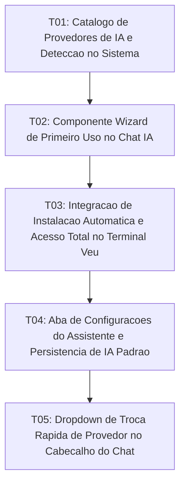

# Tasks: AI Assistant Wizard and Multi-CLI Provider Switcher

**Approved**: 2026-11-07 - user: "aprovado"

## Test Coverage Matrix

| Code Layer | Required Test Type | Coverage Expectation | Location Pattern | Run Command |
| :--- | :--- | :--- | :--- | :--- |
| Providers Metadata & Catalog | unit | Provedores oficiais agy, claude e muse com comandos canônicos | `src/lib/ai/aiProviders.ts` | `node scripts/test_ai_wizard_and_providers.mjs` |
| CLI Detection Backend | integration | Comando Tauri detectando status das 3 CLIs no PATH | `src-tauri/src/lib.rs` | `npm run check:rust` |
| Onboarding Wizard Component | unit | Componente AiWizardView com cartões interativos e trigger de instalação | `src/lib/components/AiWizardView.svelte` | `npm run check` |
| Assistant Settings & Switcher | unit | Aba de configurações, seletor de IA padrão e dropdown no chat | `src/lib/components/AiAssistantPanel.svelte` | `npm run check` |
| Terminal Installation & Full Access | integration | Abertura de sessão dedicada e envio de comandos ao Terminal Veu | `src/App.svelte` | `npm run check` |

## Gate Check Commands

| Gate Level | When to Use | Command |
| :--- | :--- | :--- |
| Quick | After component changes | `npm run check` |
| Full | After provider changes | `npm run check && node scripts/test_ai_wizard_and_providers.mjs` |
| Build | Milestone completion | `npm run build && npm run check:rust` |

## Execution Plan

## Task Breakdown

### T01: Catálogo de Provedores de IA e Detecção no Sistema
**Where**: `src/lib/ai/aiProviders.ts`
**Depends on**: none
**Tests**: `node scripts/test_ai_wizard_and_providers.mjs`
**Gate**: `node scripts/test_ai_wizard_and_providers.mjs`
**Done When**: aiProviders.ts define os metadados canônicos de agy, claude e muse com comandos oficiais de instalação e checagem no PATH.

### T02: Componente Wizard de Primeiro Uso no Chat IA
**Where**: `src/lib/components/AiWizardView.svelte`
**Depends on**: T01
**Tests**: `npm run check`
**Gate**: `npm run check`
**Done When**: AiWizardView.svelte apresenta cartões visuais para agy, claude e muse com badges de plano mensal, estado de instalação e botão para instalar via terminal.

### T03: Integração de Instalação Automática e Acesso Total no Terminal Veu
**Where**: `src/App.svelte`
**Depends on**: T02
**Tests**: `npm run check`
**Gate**: `npm run check`
**Done When**: O acionamento de instalação cria uma aba nomeada no Terminal Veu executando o comando automaticamente com streaming em tempo real e controle total do usuário.

### T04: Aba de Configurações do Assistente e Persistência de IA Padrão
**Where**: `src/lib/components/AiAssistantPanel.svelte`
**Depends on**: T03
**Tests**: `npm run check`
**Gate**: `npm run check`
**Done When**: AiAssistantPanel.svelte inclui aba de configurações permitindo selecionar e persistir a IA padrão no localStorage, reverificar ferramentas e reabrir o wizard.

### T05: Dropdown de Troca Rápida de Provedor no Cabeçalho do Chat
**Where**: `src/lib/components/AiAssistantHeader.svelte`
**Depends on**: T04
**Tests**: `npm run check`
**Gate**: `npm run check`
**Done When**: O cabeçalho do Chat IA disponibiliza um dropdown com as ferramentas instaladas, alternando a execução do runner dinamicamente para o provedor selecionado.

## Checks

Build: `npm run build`
Run typecheck: `npm run check`
Run rustcheck: `npm run check:rust`
Run providercheck: `node scripts/test_ai_wizard_and_providers.mjs`

**C01** - Catálogo de provedores oficiais agy, claude e muse com comandos canônicos (WIZARD-01, PROVIDER-02)
Proof: run providercheck | SUCCESS: Todos os contratos do AI Wizard e Multi-CLI passaram!

**C02** - Componente Wizard de primeiro uso com status e trigger de instalação (WIZARD-02, WIZARD-03)
Proof: run typecheck | svelte-check found 0 errors

**C03** - Acesso total e instalação interativa via Terminal Veu (TERMINAL-01)
Proof: run typecheck | svelte-check found 0 errors

**C04** - Aba de configurações com IA padrão persistida e seletor rápido (CONFIG-01, PROVIDER-01)
Proof: run typecheck | svelte-check found 0 errors

**C05** - Compilação de backend e integração Tauri (TERMINAL-01)
Proof: run rustcheck | Finished
