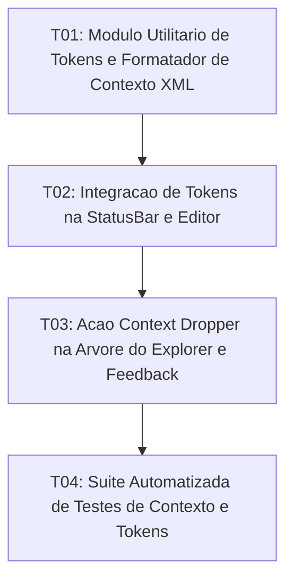

# Tasks: AI Context Dropper and Token Counter

**Approved**: 2026-11-10 - user: "aprovado"

## Test Coverage Matrix

| Code Layer | Required Test Type | Coverage Expectation | Location Pattern | Run Command |
| :--- | :--- | :--- | :--- | :--- |
| Pure Logic / Tokenizer | unit | Estimativa de tokens (~4 chars/token) e empacotador XML de contexto | `src/lib/utils/aiContext.ts` | `npm test` |
| Editor & StatusBar | integration | Emissão de métrica de tokens e renderização no rodapé | `src/lib/components/StatusBar.svelte`, `src/lib/components/Editor.svelte` | `npm run check` |
| Tree Explorer Action | integration | Ação de Context Dropper em arquivos e pastas com feedback | `src/lib/components/FileTreeNode.svelte`, `src/lib/components/Sidebar.svelte` | `npm run check` |
| Regression Suite | regression | Testes automatizados de formatação XML, tokens e recursão | `scripts/test_ai_context_and_tokens.mjs` | `npm test` |

## Gate Check Commands

| Gate Level | When to Use | Command |
| :--- | :--- | :--- |
| Frontend | After UI & store changes | `npm run check` |
| Regression | After logic & script changes | `npm test` |
| Full | Milestone completion | `npm run check && npm test` |

## Execution Plan

## Task Breakdown

### T01: [x] Módulo Utilitário de Tokens e Formatador de Contexto XML
**Where**: `src/lib/utils/aiContext.ts`
**Depends on**: none
**Tests**: `npm run check`
**Gate**: `npm run check`
**Done When**: Funções estimateTokens, formatFileContext, wrapContext e collectContextFiles estão implementadas em TypeScript puro.

### T02: [ ] Integração de Tokens na StatusBar e Editor
**Where**: `src/lib/components/StatusBar.svelte`
**Depends on**: T01
**Tests**: `npm run check`
**Gate**: `npm run check`
**Done When**: O Editor calcula e emite a contagem de tokens atualizada e a StatusBar exibe ~X tokens em tempo real, exibindo 0 quando vazio.

### T03: [ ] Ação Context Dropper na Árvore do Explorer e Feedback
**Where**: `src/lib/components/FileTreeNode.svelte`
**Depends on**: T02
**Tests**: `npm run check`
**Gate**: `npm run check`
**Done When**: Arquivos e pastas possuem botão de ação e atalho de contexto para copiar para o clipboard no formato <context> com aviso na StatusBar.

### T04: [ ] Suíte Automatizada de Testes de Contexto e Tokens
**Where**: `scripts/test_ai_context_and_tokens.mjs`
**Depends on**: T03
**Tests**: `npm test`
**Gate**: `npm test`
**Done When**: Testes automatizados validam estimativa de tokens, vazio, formatação XML e recursão integrados ao executor npm test.

## Checks

Build: `npm run build`
Run typecheck: `npm run check`
Run testsuite: `npm test`

**C01** - Estimativa de tokens em tempo real na StatusBar (TOK-01)
Proof: run typecheck | svelte-check found 0 errors

**C02** - Tratamento de documento vazio com contagem zerada de tokens (TOK-02)
Proof: run testsuite | PASSOU

**C03** - Ação de copiar arquivo único como bloco XML de contexto (CTX-01)
Proof: run testsuite | PASSOU

**C04** - Coleta recursiva de múltiplos arquivos ao copiar pasta como contexto (CTX-02)
Proof: run testsuite | PASSOU

