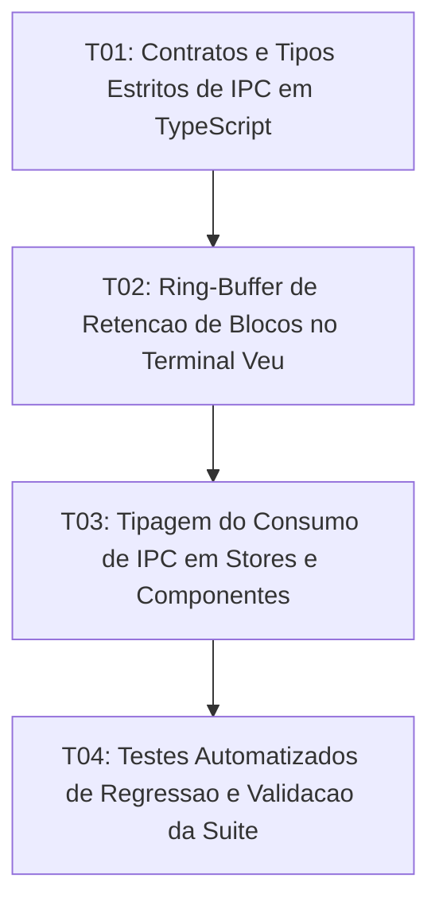

# Tasks: Architecture IPC Contracts, Terminal Ring-Buffer and Svelte 5 Runes

**Approved**: 2026-11-09 - user: "pronto"

## Test Coverage Matrix

| Code Layer | Required Test Type | Coverage Expectation | Location Pattern | Run Command |
| :--- | :--- | :--- | :--- | :--- |
| IPC Contracts | typecheck | Declaração e tipagem completa de comandos Rust no TS | `src/types/ipc.ts` | `npm run check` |
| Terminal Ring-Buffer | unit/integration | Evicção FIFO mantendo limite de 500 blocos sem quebra | `src/stores/terminalStore.ts` | `node scripts/test_ipc_and_ringbuffer.mjs` |
| IPC Consumption | integration | Consumo tipado nos stores e componentes Svelte | `src/stores/terminalStore.ts`, `src/lib/TerminalPanel.svelte` | `npm run check` |
| Regression Suite | integration | Validação completa de regressão do ecossistema | `scripts/run_all_tests.mjs` | `npm test` |

## Gate Check Commands

| Gate Level | When to Use | Command |
| :--- | :--- | :--- |
| Frontend | After TS and Svelte changes | `npm run check` |
| Regression | After store and logic changes | `npm test` |
| Full | Milestone completion | `npm run check && npm test` |

## Execution Plan

## Task Breakdown

### T01: [x] Contratos e Tipos Estritos de IPC em TypeScript
**Where**: `src/types/ipc.ts`
**Depends on**: none
**Tests**: `npm run check`
**Gate**: `npm run check`
**Done When**: Todas as assinaturas de entrada e saída dos comandos Rust (fs_cmd, pty_cmd, ai_cmd, theme_cmd, watcher_cmd) estão declaradas e tipadas sem uso de any.

### T02: Ring-Buffer de Retenção de Blocos no Terminal Veu
**Where**: `src/stores/terminalStore.ts`
**Depends on**: T01
**Tests**: `npm run check`
**Gate**: `npm run check`
**Done When**: A inserção de blocos na timeline do terminal impõe teto de 500 blocos com evicção FIFO dos mais antigos, preservando bloco em streaming e prompt ativo.

### T03: Tipagem do Consumo de IPC em Stores e Componentes
**Where**: `src/stores/terminalStore.ts`
**Depends on**: T02
**Tests**: `npm run check`
**Gate**: `npm run check`
**Done When**: Chamadas invoke consom as interfaces tipadas de src/types/ipc.ts com validação em tempo de compilação do TypeScript sem erros.

### T04: Testes Automatizados de Regressão e Validação da Suíte
**Where**: `scripts/test_ipc_and_ringbuffer.mjs`
**Depends on**: T03
**Tests**: `npm test`
**Gate**: `npm test`
**Done When**: O script test_ipc_and_ringbuffer.mjs valida o teto do ring-buffer de 500 blocos e as tipagens IPC, integrado à suíte de npm test com 100% de sucesso.

## Checks

Build: `npm run build`
Run typecheck: `npm run check`
Run testsuite: `npm test`

**C01** - Tipagem estrita de IPC centralizada e sem any (IPC-01, IPC-02)
Proof: run typecheck | svelte-check found 0 errors

**C02** - Ring-buffer de retenção de 500 blocos no Terminal Veu com evicção FIFO (RING-01, RING-02)
Proof: run testsuite | PASSOU

**C03** - Padronização e compatibilidade de reatividade Svelte 5 (RUNE-01, RUNE-02)
Proof: run testsuite | TODOS OS TESTES PASSARAM COM SUCESSO
