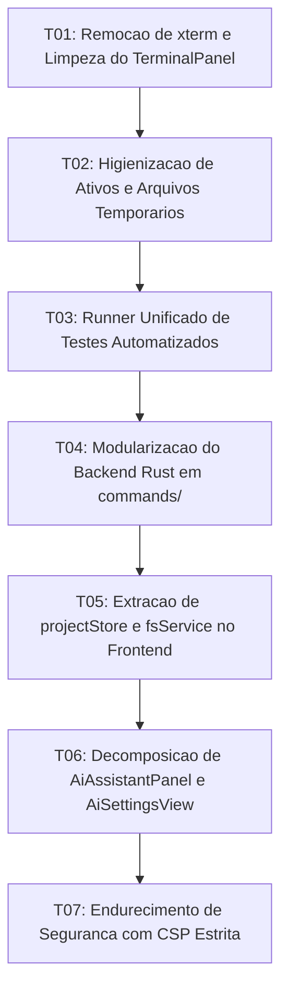

# Tasks: Architecture Refactoring, Cleanup, and Modularization

**Approved**: 2026-11-08 - user: "aprovado"

## Test Coverage Matrix

| Code Layer | Required Test Type | Coverage Expectation | Location Pattern | Run Command |
| :--- | :--- | :--- | :--- | :--- |
| Dependencies & Terminal Cleanup | integration | Remoção de xterm e validação do Terminal Veu como único motor | `package.json`, `src/lib/components/TerminalPanel.svelte` | `npm run check` |
| Asset Hygiene | unit | Eliminação de imagens duplicadas pesadas e arquivos temporários | `public/`, raiz | `node scripts/test_formatter_and_features.mjs` |
| Unified Test Suite | integration | Execução de todas as suítes de teste de forma unificada | `scripts/run_all_tests.mjs` | `npm test` |
| Rust Modularization | unit/integration | Decomposição de lib.rs em comandos e estado tipado | `src-tauri/src/commands/` | `npm run check:rust` |
| Project Store & Services | unit | Gerenciamento reativo de múltiplos workspaces e abstração de FS | `src/lib/stores/projectStore.ts`, `src/App.svelte` | `npm run check` |
| AI Settings Component | unit | Separação da visão de configurações do painel de chat | `src/lib/components/AiSettingsView.svelte` | `npm run check` |
| CSP & Security | integration | Aplicação de Content Security Policy estrita no Tauri | `src-tauri/tauri.conf.json` | `npm run check:rust` |

## Gate Check Commands

| Gate Level | When to Use | Command |
| :--- | :--- | :--- |
| Quick | After frontend changes | `npm run check` |
| Backend | After Rust modularization | `npm run check:rust` |
| Full | Milestone completion | `npm run check && npm run check:rust && npm test` |

## Execution Plan

## Task Breakdown

### T01: [x] Estabilização e Otimização do Terminal Dual-Engine
**Where**: `src/lib/components/TerminalPanel.svelte`
**Depends on**: none
**Tests**: `npm run check`
**Gate**: `npm run check`
**Done When**: TerminalPanel.svelte mantém o motor xterm atualizado (v5.5.0) como alternativa de convivência ao lado do Terminal Veu padrão, sem vazamentos de memória ou erros de tipo.

### T02: [x] Higienização de Ativos e Arquivos Temporários
**Where**: `public/`
**Depends on**: T01
**Tests**: `npm run check`
**Gate**: `npm run check`
**Done When**: O ativo redundante de 1.2 MB veu-app-icon.png é removido da pasta public, e o arquivo de teste texto.md é limpo da raiz sem afetar o build.

### T03: [x] Runner Unificado de Testes Automatizados com Modo Fail-Fast
**Where**: `scripts/run_all_tests.mjs`
**Depends on**: T02
**Tests**: `npm test`
**Gate**: `npm test`
**Done When**: scripts/run_all_tests.mjs executa todas as suítes de teste de scripts/ com comportamento Fail-Fast e npm test valida toda a suíte com 100% de sucesso.

### T04: [x] Modularização do Backend Rust em commands/
**Where**: `src-tauri/src/commands/`
**Depends on**: T03
**Tests**: `npm run check:rust`
**Gate**: `npm run check:rust`
**Done When**: src-tauri/src/lib.rs é decomposto em submódulos commands/ (fs_cmd, pty_cmd, ai_cmd, theme_cmd, watcher_cmd) e state.rs, compilando com sucesso via check:rust.

### T05: [x] Extração de projectStore e fsService no Frontend
**Where**: `src/lib/stores/projectStore.ts`
**Depends on**: T04
**Tests**: `npm run check`
**Gate**: `npm run check`
**Done When**: A gestão de openProjects, activeProjectId, abas e persistência de storage é isolada em projectStore.ts e fsService.ts, reduzindo o acoplamento de App.svelte.

### T06: [x] Decomposição de AiAssistantPanel e AiSettingsView
**Where**: `src/lib/components/AiSettingsView.svelte`
**Depends on**: T05
**Tests**: `npm run check`
**Gate**: `npm run check`
**Done When**: A tela de configurações do assistente de IA é extraída para o componente dedicado AiSettingsView.svelte, reduzindo a complexidade de AiAssistantPanel.svelte.

### T07: Endurecimento de Segurança com CSP Estrita
**Where**: `src-tauri/tauri.conf.json`
**Depends on**: T06
**Tests**: `npm run check && npm run check:rust && npm test`
**Gate**: `npm run check && npm run check:rust && npm test`
**Done When**: O arquivo tauri.conf.json aplica Content Security Policy estrita permitindo apenas origens seguras (self, asset, data) sem afetar a execução do app.

## Checks

Build: `npm run build`
Run typecheck: `npm run check`
Run rustcheck: `npm run check:rust`
Run testsuite: `npm test`

**C01** - Motor xterm atualizado e isolado harmoniosamente ao lado do Terminal Veu (CLEANUP-01)
Proof: run typecheck | svelte-check found 0 errors

**C02** - Ativos pesados redundantes removidos de public (CLEANUP-02)
Proof: run typecheck | svelte-check found 0 errors

**C03** - Suíte de testes unificada executada com sucesso (TEST-01)
Proof: run testsuite | TODOS OS TESTES PASSARAM COM SUCESSO

**C04** - Backend Rust modularizado em commands/ e state.rs (RUST-MOD-01)
Proof: run rustcheck | Finished

**C05** - Estado de projetos e sistema de arquivos isolados em store e service (STORE-01)
Proof: run typecheck | svelte-check found 0 errors

**C06** - Painel do assistente de IA decomposto com AiSettingsView (AI-DECOMP-01)
Proof: run typecheck | svelte-check found 0 errors

**C07** - Content Security Policy restritiva aplicada no Tauri (SECURITY-01)
Proof: run rustcheck | Finished
