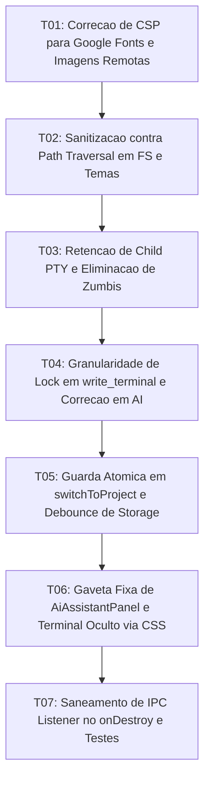

# Tasks: Architecture Remediation and Security Hardening

**Approved**: 2026-11-08 - user: "sim crie a spec de todos os itens levantados ... apos issso incie"

## Test Coverage Matrix

| Code Layer | Required Test Type | Coverage Expectation | Location Pattern | Run Command |
| :--- | :--- | :--- | :--- | :--- |
| Tauri CSP & Font Config | integration | Validação de CSP permitindo Google Fonts e imagens remotas | `src-tauri/tauri.conf.json` | `npm run check:rust` |
| Security Path Sanitization | unit | Extração de file_name e regex de tema contra traversal | `src-tauri/src/commands/fs_cmd.rs`, `theme_cmd.rs` | `npm run check:rust` |
| PTY Child Process Lifecycle | unit/integration | Retenção de handle child e kill explícito em kill_terminal | `src-tauri/src/commands/pty_cmd.rs`, `state.rs` | `npm run check:rust` |
| Concurrency & Lock Refactor | unit | Liberação de lock de terminais antes de operações I/O | `src-tauri/src/commands/pty_cmd.rs`, `ai_cmd.rs` | `npm run check:rust` |
| Project Switch Race Guard | unit | Proteção atômica de tabs e debounce de 500ms no storage | `src/App.svelte`, `src/lib/stores/projectStore.ts` | `npm run check` |
| Drawer Layout & PTY Keepalive | unit/visual | Posicionamento fixo de gaveta de IA e classe hidden no terminal | `src/lib/components/AiAssistantPanel.svelte`, `TerminalPanel.svelte` | `npm run check` |
| IPC Listener Cleanup & Suite | integration | Desinscrição no onDestroy e execução da suíte de testes | `src/App.svelte`, `scripts/run_all_tests.mjs` | `npm test` |

## Gate Check Commands

| Gate Level | When to Use | Command |
| :--- | :--- | :--- |
| Backend | After Rust backend modifications | `npm run check:rust` |
| Frontend | After Svelte frontend changes | `npm run check` |
| Full | Milestone completion | `npm run check && npm run check:rust && npm test` |

## Execution Plan

## Task Breakdown

### T01: [x] Correção de CSP para Google Fonts e Imagens Remotas
**Where**: `src-tauri/tauri.conf.json`
**Depends on**: none
**Tests**: `npm run check:rust`
**Gate**: `npm run check:rust`
**Done When**: A CSP em tauri.conf.json permite https://fonts.googleapis.com, https://fonts.gstatic.com, https:, blob: e asset.localhost em img-src, style-src e font-src sem violações.

### T02: [x] Sanitização contra Path Traversal em FS e Temas
**Where**: `src-tauri/src/commands/fs_cmd.rs`
**Depends on**: T01
**Tests**: `npm run check:rust`
**Gate**: `npm run check:rust`
**Done When**: save_image_asset utiliza Path::file_name() e save_custom_theme valida o nome com regex alfanumérica, impedindo subida de diretório arbitrária.

### T03: [x] Retenção de Child PTY e Eliminação de Processos Zumbis
**Where**: `src-tauri/src/commands/pty_cmd.rs`
**Depends on**: T02
**Tests**: `npm run check:rust`
**Gate**: `npm run check:rust`
**Done When**: TerminalSession retém o handle child do PTY e kill_terminal invoca explicitamente o encerramento do processo filho no Windows.

### T04: [x] Granularidade de Lock em write_terminal e Correção em AI
**Where**: `src-tauri/src/commands/pty_cmd.rs`
**Depends on**: T03
**Tests**: `npm run check:rust`
**Gate**: `npm run check:rust`
**Done When**: write_terminal clona o handle do writer liberando o lock global de state.terminals antes da escrita de I/O, e ai_cmd previne race condition no cancelamento.

### T05: [x] Guarda Atômica em switchToProject e Debounce de Storage
**Where**: `src/App.svelte`
**Depends on**: T04
**Tests**: `npm run check`
**Gate**: `npm run check`
**Done When**: switchToProject utiliza sentinela de carregamento impedindo que reatribuições sobrescrevam abas de projetos anteriores e o salvamento em localStorage tem debounce de 500ms.

### T06: [x] Gaveta Fixa de AiAssistantPanel e Terminal Oculto via CSS
**Where**: `src/lib/components/AiAssistantPanel.svelte`
**Depends on**: T05
**Tests**: `npm run check`
**Gate**: `npm run check`
**Done When**: AiAssistantPanel adota position: fixed conforme AGENTS.md e TerminalPanel utiliza classe .hidden em vez de destruição de componente ao alternar visibilidade.

### T07: Saneamento de IPC Listener no onDestroy e Testes
**Where**: `src/App.svelte`
**Depends on**: T06
**Tests**: `npm run check && npm test`
**Gate**: `npm run check && npm test`
**Done When**: unlistenWatcher é devidamente chamado no onDestroy de App.svelte e a suíte completa de testes npm test passa com 100% de sucesso.

## Checks

Build: `npm run build`
Run typecheck: `npm run check`
Run rustcheck: `npm run check:rust`
Run testsuite: `npm test`

**C01** - CSP ajustada permitindo Google Fonts e imagens remotas (CSP-01, CSP-02)
Proof: run rustcheck | Finished

**C02** - Sanitização de caminhos contra path traversal em fs_cmd e theme_cmd (SEC-01)
Proof: run rustcheck | Finished

**C03** - Encerramento explícito de processo filho PTY em kill_terminal (PTY-01)
Proof: run rustcheck | Finished

**C04** - Granularidade de locks em write_terminal e correção em ai_cmd (LOCK-01)
Proof: run rustcheck | Finished

**C05** - Troca atômica de projetos e debounce de persistência no frontend (SYNC-01, SYNC-02)
Proof: run typecheck | svelte-check found 0 errors

**C06** - AiAssistantPanel posicionado como gaveta fixa e terminal persistente via CSS (DRAWER-01, PTY-02)
Proof: run typecheck | svelte-check found 0 errors

**C07** - Desinscrição explícita de listeners IPC e suíte de testes íntegra (LEAK-01)
Proof: run testsuite | TODOS OS TESTES PASSARAM COM SUCESSO

