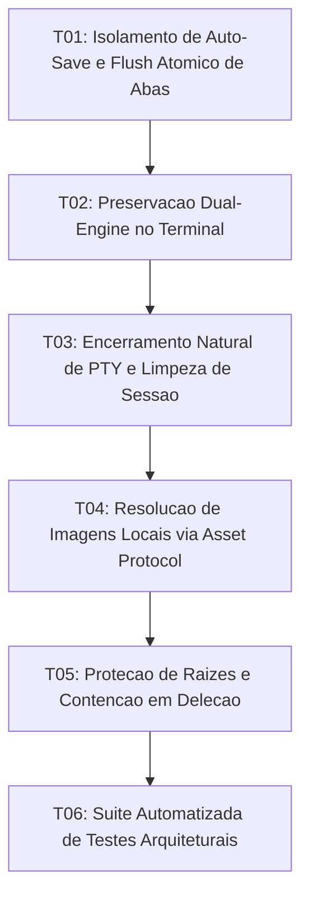

# Tasks: Architecture Resilience, Concurrency and Resource Lifecycle

**Approved**: 2026-11-09 - user: "ok aplique as tasks mas deixe pendente os outros pontos na spec"

## Test Coverage Matrix

| Code Layer | Required Test Type | Coverage Expectation | Location Pattern | Run Command |
| :--- | :--- | :--- | :--- | :--- |
| Concurrency / State | integration | Isolamento de debounce por aba e flush atômico no blur | `src/App.svelte` | `npm run check` |
| Terminal Lifecycle | integration | Preservação dual-engine sem destruição DOM e evento exit | `src/lib/components/TerminalPanel.svelte`, `src-tauri/src/commands/pty_cmd.rs` | `npm test` |
| Asset Protocol | unit/integration | Mapeamento de assets relativos no ProseMirror para Tauri | `src/lib/editor/proseMirrorSetup.ts` | `npm run check` |
| Safety & Contention | unit/integration | Rejeição de raízes e pastas críticas do SO em deleção | `src-tauri/src/commands/fs_cmd.rs` | `npm run test:rust` |
| Full Architecture Suite | regression | Validação completa de regressão e resiliência | `scripts/test_architecture_resilience.mjs` | `npm test` |

## Gate Check Commands

| Gate Level | When to Use | Command |
| :--- | :--- | :--- |
| Frontend | After UI & store changes | `npm run check` |
| Rust Backend | After Rust command changes | `npm run check:rust` |
| Regression | After core logic changes | `npm test` |
| Full | Milestone completion | `npm run check && npm run check:rust && npm test` |

## Execution Plan

## Task Breakdown

### T01: [x] Isolamento de Auto-Save e Flush Atômico de Abas
**Where**: `src/App.svelte`
**Depends on**: none
**Tests**: `npm run check`
**Gate**: `npm run check`
**Done When**: O auto-save é isolado por aba ou documento com cancelamento/flush síncrono ao trocar de aba ou fechar aba com alterações não salvas.

### T02: [ ] Preservação Dual-Engine no Terminal
**Where**: `src/lib/components/TerminalPanel.svelte`
**Depends on**: T01
**Tests**: `npm run check`
**Gate**: `npm run check`
**Done When**: A alternância entre Terminal Veu e xterm.js ocorre via CSS display sem desmontagem de componentes DOM nem perda de timeline.

### T03: [ ] Encerramento Natural de PTY e Limpeza de Sessão
**Where**: `src-tauri/src/commands/pty_cmd.rs`
**Depends on**: T02
**Tests**: `npm run check:rust`
**Gate**: `npm run check:rust`
**Done When**: Ao receber EOF na leitura do PTY, o backend emite evento term-exit e remove a sessão de AppState.terminals.

### T04: [ ] Resolução de Imagens Locais via Asset Protocol
**Where**: `src/lib/editor/proseMirrorSetup.ts`
**Depends on**: T03
**Tests**: `npm run check`
**Gate**: `npm run check`
**Done When**: O ProseMirror mapeia referências relativas de imagem em documentos Markdown para convertFileSrc sem quebras de renderização.

### T05: [ ] Proteção de Raízes e Contenção em Deleção
**Where**: `src-tauri/src/commands/fs_cmd.rs`
**Depends on**: T04
**Tests**: `npm run check:rust`
**Gate**: `npm run check:rust`
**Done When**: O comando delete_entry valida e rejeita caminhos raiz, vazios ou fora dos limites seguros do sistema operacional.

### T06: [ ] Suíte Automatizada de Testes Arquiteturais
**Where**: `scripts/test_architecture_resilience.mjs`
**Depends on**: T05
**Tests**: `npm test`
**Gate**: `npm test`
**Done When**: Script automatizado valida os contratos de resiliência e concorrência, integrado ao executor npm test com 100% de sucesso.

## Checks

Build: `npm run build`
Run typecheck: `npm run check`
Run testsuite: `npm test`

**C01** - Isolamento de auto-save e persistência atômica no ciclo de vida de abas (ARC-01, ARC-02, ARC-03)
Proof: run typecheck | svelte-check found 0 errors

**C02** - Continuidade do terminal dual-engine e ciclo de vida de PTY (ARC-04, ARC-05)
Proof: run testsuite | PASSOU

**C03** - Mapeamento de assets locais e sincronização externa de abas (ARC-06, ARC-07)
Proof: run typecheck | svelte-check found 0 errors

**C04** - Contenção de caminhos e proteção contra deleção de raízes de sistema (ARC-08)
Proof: run testsuite | TODOS OS TESTES PASSARAM COM SUCESSO

