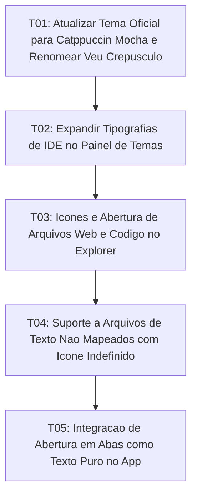

# Tasks: Catppuccin Mocha Official Theme, IDE Fonts and Multi-Format File Support

**Approved**: 2026-11-07 - user: "sim"

## Test Coverage Matrix

| Code Layer | Required Test Type | Coverage Expectation | Location Pattern | Run Command |
| :--- | :--- | :--- | :--- | :--- |
| Default Themes Config | unit | Catppuccin Mocha palette, Roboto font, renamed Veu Crepúsculo | `src/lib/theme/defaultThemes.ts` | `node scripts/test_theme_and_file_support.mjs` |
| IDE Typography Settings | unit | IDE fonts selection list and reactive application | `src/lib/components/ThemeSettings.svelte` | `npm run check` |
| Known File Icons & Reader | unit | Distinctive icons and editable state for HTML/JSON/CSS/JS/TS | `src/lib/components/FileTreeNode.svelte` | `npm run check` |
| Unknown Text Files Support | unit | Generic text editable state with undefined format icon | `src/lib/components/Sidebar.svelte` | `npm run check` |
| Editor Integration | integration | Opening non-markdown files as plain text | `src/App.svelte` | `npm run check` |

## Gate Check Commands

| Gate Level | When to Use | Command |
| :--- | :--- | :--- |
| Quick | After component changes | `npm run check` |
| Full | After theme and file tree changes | `npm run check && node scripts/test_theme_and_file_support.mjs` |
| Build | Milestone completion | `npm run build && npm run check:rust` |

## Execution Plan

## Task Breakdown

### T01: Atualizar Tema Oficial para Catppuccin Mocha e Renomear Veu Crepúsculo
**Where**: `src/lib/theme/defaultThemes.ts`
**Depends on**: none
**Tests**: `node scripts/test_theme_and_file_support.mjs`
**Gate**: `node scripts/test_theme_and_file_support.mjs`
**Done When**: defaultThemes.ts define veumd com as cores Catppuccin Mocha e fonte Roboto como padrão, e renomeia o tema veu para Veu Crepúsculo.

### T02: Expandir Tipografias de IDE no Painel de Temas
**Where**: `src/lib/components/ThemeSettings.svelte`
**Depends on**: T01
**Tests**: `npm run check`
**Gate**: `npm run check`
**Done When**: ThemeSettings.svelte disponibiliza Roboto, JetBrains Mono, Fira Code, Cascadia Code, Source Code Pro, Inter e Merriweather no seletor de fontes com aplicação imediata no root.

### T03: Ícones e Abertura de Arquivos Web e Código no Explorer
**Where**: `src/lib/components/FileTreeNode.svelte`
**Depends on**: T02
**Tests**: `npm run check`
**Gate**: `npm run check`
**Done When**: FileTreeNode.svelte e Sidebar.svelte exibem ícones dedicados e habilitam clique para arquivos HTML, JSON, CSS, JS, TS, JSX, TSX, MJS e CJS.

### T04: Suporte a Arquivos de Texto Não Mapeados com Ícone Indefinido
**Where**: `src/lib/components/Sidebar.svelte`
**Depends on**: T03
**Tests**: `npm run check`
**Gate**: `npm run check`
**Done When**: Arquivos textuais genéricos (.env, .yaml, .toml, scripts) são identificados como editáveis e renderizados com ícone indefinido de formato, mantendo binários bloqueados.

### T05: Integração de Abertura em Abas como Texto Puro no App
**Where**: `src/App.svelte`
**Depends on**: T04
**Tests**: `npm run check`
**Gate**: `npm run check`
**Done When**: App.svelte abre arquivos que não sejam .md com flag isMarkdown: false, permitindo leitura e salvamento de código e texto sem aplicar parser markdown.

## Checks

Build: `npm run build`
Run typecheck: `npm run check`
Run themecheck: `node scripts/test_theme_and_file_support.mjs`

**C01** - Tema oficial Catppuccin Mocha com fonte Roboto e Veu Crepúsculo renomeado (THEME-01, THEME-02, THEME-03)
Proof: run themecheck | SUCCESS: Todos os contratos do tema Catppuccin Mocha e arquivos conhecidos passaram!

**C02** - Seleção expandida de fontes de IDE com atualização imediata no documento (FONT-01, FONT-02)
Proof: run typecheck | svelte-check found 0 errors

**C03** - Ícones e abertura de arquivos web/código (HTML, JSON, CSS, JS, TS) (FILE-01, FILE-02)
Proof: run typecheck | svelte-check found 0 errors

**C04** - Ícone indefinido e leitura de outros arquivos texto com bloqueio de binários (FILE-03, FILE-04)
Proof: run typecheck | svelte-check found 0 errors
