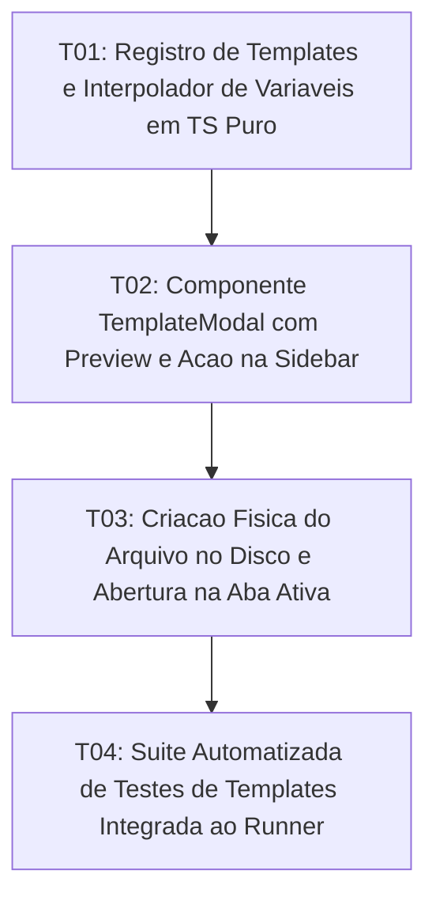

# Tasks: Document Templates & Snippets

**Approved**: 2026-11-11 - user: "aprovado"

## Test Coverage Matrix

| Code Layer | Required Test Type | Coverage Expectation | Location Pattern | Run Command |
| :--- | :--- | :--- | :--- | :--- |
| Template Registry | unit | Catálogo de templates embutidos e interpolação de variáveis dinâmicas | `src/lib/utils/templateRegistry.ts` | `npm test` |
| UI Template Modal | integration | Modal de seleção de templates, preview e botão no cabeçalho do Explorer | `src/lib/components/TemplateModal.svelte`, `src/lib/components/Sidebar.svelte` | `npm run check` |
| Persistence & Tabs | integration | Criação do arquivo no disco via fsService e abertura imediata em nova aba | `src/App.svelte` | `npm run check` |
| Regression Suite | regression | Testes automatizados de interpolação, templates customizados e criação | `scripts/test_templates.mjs` | `npm test` |

## Gate Check Commands

| Gate Level | When to Use | Command |
| :--- | :--- | :--- |
| Frontend | After UI & registry changes | `npm run check` |
| Regression | After script & logic integration | `npm test` |
| Full | Milestone completion | `npm run check && npm test` |

## Execution Plan

## Task Breakdown

### T01: [x] Registro de Templates e Interpolador de Variáveis em TS Puro
**Where**: `src/lib/utils/templateRegistry.ts`
**Depends on**: none
**Tests**: `npm test`
**Gate**: `npm test`
**Done When**: Catálogo embutido de templates (Ata de Reunião, Artigo de Blog, PRD, Diário) e função `interpolateTemplate` implementados com tipagem estrita e zero-bloat.

### T02: [x] Componente `TemplateModal` com Preview e Ação na Sidebar
**Where**: `src/lib/components/TemplateModal.svelte`
**Depends on**: T01
**Tests**: `npm run check`
**Gate**: `npm run check`
**Done When**: Modal exibe cartões de templates com preview, campo de nome do arquivo sugerido e botão de disparo integrado na barra de ferramentas do Explorer (`Sidebar.svelte`).

### T03: [x] Criação Física do Arquivo no Disco e Abertura na Aba Ativa
**Where**: `src/App.svelte`
**Depends on**: T02
**Tests**: `npm run check`
**Gate**: `npm run check`
**Done When**: Ao confirmar no modal, o arquivo é gerado no diretório do projeto com metadados substituídos, atualizando a árvore e abrindo em aba do ProseMirror com foco.

### T04: [x] Suíte Automatizada de Testes de Templates Integrada ao Runner
**Where**: `scripts/test_templates.mjs`
**Depends on**: T03
**Tests**: `npm test`
**Gate**: `npm test`
**Done When**: Testes automatizados validam o catálogo, interpolação de data/hora/título e fluxo de criação física com 100% de sucesso em `npm test`.

## Checks

Build: `npm run build`
Run typecheck: `npm run check`
Run testsuite: `npm test`

**C01** - Modal de seleção de templates com catálogo embutido e suporte a pasta .templates/ (TMPL-01)
Proof: run testsuite | PASSOU

**C02** - Interpolação determinística de variáveis dinâmicas de data, hora e título (TMPL-02)
Proof: run testsuite | PASSOU

**C03** - Criação física do arquivo no disco com metadados e atualização da árvore (TMPL-03)
Proof: run testsuite | PASSOU

**C04** - Abertura imediata do novo documento na aba ativa do editor ProseMirror (TMPL-04)
Proof: run typecheck | svelte-check found 0 errors
