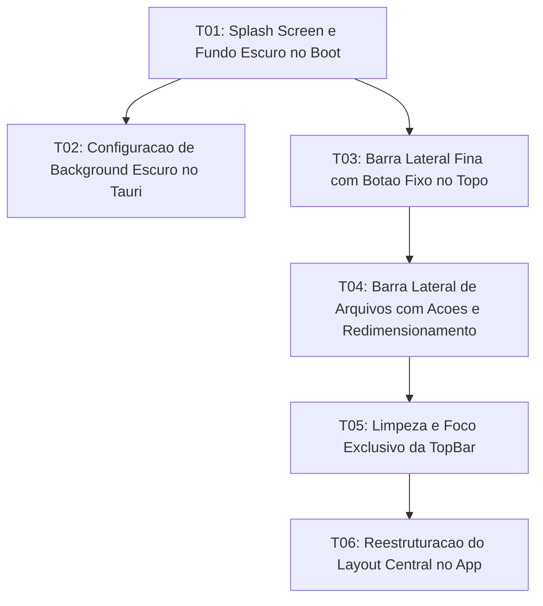

# Tasks: Sidebar Layout de Ponta a Ponta, Redimensionamento e Splash Screen

**Approved**: 2026-11-07 - user: "aprovado"

## Test Coverage Matrix

| Code Layer | Required Test Type | Coverage Expectation | Location Pattern | Run Command |
| :--- | :--- | :--- | :--- | :--- |
| Splash Screen | unit | Initial dark background and glowing logo before app load | `index.html` | `node scripts/test_sidebar_splash.mjs` |
| Tauri Window Config | unit | Dark theme and dark background color in window config | `src-tauri/tauri.conf.json` | `npm run check:rust` |
| Project Activity Bar | unit | Fixed toggle button at the top of the 48px bar | `src/lib/components/ProjectSidebar.svelte` | `npm run check` |
| Full-height File Sidebar | unit | Top header with project actions and draggable resizer | `src/lib/components/Sidebar.svelte` | `npm run check` |
| Formatting TopBar | unit | Clean Word formatting tools without brand logo | `src/lib/components/TopBar.svelte` | `npm run check` |
| Unified App Layout | unit | Full-height sidebar and docked TopBar over center stage | `src/App.svelte` | `npm run check` |

## Gate Check Commands

| Gate Level | When to Use | Command |
| :--- | :--- | :--- |
| Quick | After component changes | `npm run check` |
| Full | After state and layout integration | `npm run check && node scripts/test_sidebar_splash.mjs` |
| Build | Milestone completion | `npm run build && npm run check:rust` |

## Execution Plan

## Task Breakdown

### T01: Splash Screen e Fundo Escuro no Boot do WebView2
**Where**: `index.html`
**Depends on**: none
**Tests**: `node scripts/test_sidebar_splash.mjs`
**Gate**: `node scripts/test_sidebar_splash.mjs`
**Done When**: index.html contém estilo inline com fundo escuro e contêiner #splash-screen com o logo grande centralizado.

### T02: Configuração de Background Escuro no Backend Tauri
**Where**: `src-tauri/tauri.conf.json`
**Depends on**: T01
**Tests**: `npm run check:rust`
**Gate**: `npm run check:rust`
**Done When**: src-tauri/tauri.conf.json possui theme dark e backgroundColor #0e0b16 na janela principal.

### T03: Barra Lateral Fina de Projetos com Botão Fixo de Alternância no Topo
**Where**: `src/lib/components/ProjectSidebar.svelte`
**Depends on**: T01
**Tests**: `npm run check`
**Gate**: `npm run check`
**Done When**: ProjectSidebar.svelte renderiza botão fixo no topo para expandir e recolher a barra lateral de arquivos.

### T04: Barra Lateral de Arquivos de Ponta a Ponta com Ações e Redimensionamento
**Where**: `src/lib/components/Sidebar.svelte`
**Depends on**: T03
**Tests**: `npm run check`
**Gate**: `npm run check`
**Done When**: Sidebar.svelte estende do topo ao rodapé, exibe cabeçalho superior com botão de recolher, Trocar Projeto, Wizard desativado e Lupa, e alça de redimensionamento de 180px a 600px com persistência e duplo clique.

### T05: Limpeza e Foco Exclusivo da TopBar no Documento
**Where**: `src/lib/components/TopBar.svelte`
**Depends on**: T04
**Tests**: `npm run check`
**Gate**: `npm run check`
**Done When**: TopBar.svelte remove o logotipo, o título V.E.U. MD e as ações de projeto migradas, mantendo ferramentas de formatação, Temas e Terminal.

### T06: Reestruturação do Layout Central e Remoção Suave do Splash
**Where**: `src/App.svelte`
**Depends on**: T05
**Tests**: `npm run check`
**Gate**: `npm run check`
**Done When**: App.svelte organiza a barra lateral à esquerda de ponta a ponta e a TopBar sobre o palco central do editor, fazendo o descarte suave do splash screen após a montagem.

## Checks

Build: `npm run build`
Run typecheck: `npm run check`
Run splashcheck: `node scripts/test_sidebar_splash.mjs`
Run rustcheck: `npm run check:rust`

**C01** - Splash screen escuro com logotipo Crepúsculo no carregamento inicial (SPLASH-01)
Proof: run splashcheck | SUCCESS: Todos os contratos de layout, splash screen e barra lateral passaram!

**C02** - Configuração de background escuro e tema dark no Tauri v2 (SPLASH-01)
Proof: run rustcheck | Finished

**C03** - Barra fina de projetos com botão de alternância fixo no topo (SIDEBAR-02)
Proof: run typecheck | svelte-check found 0 errors

**C04** - Barra lateral de arquivos de ponta a ponta com cabeçalho de ações e redimensionamento dinâmico (SIDEBAR-01, SIDEBAR-03)
Proof: run typecheck | svelte-check found 0 errors

**C05** - TopBar limpa concentrada em formatação de texto estilo Word (TOPBAR-01)
Proof: run typecheck | svelte-check found 0 errors

**C06** - Integração completa do layout em App.svelte e descarte do splash (SIDEBAR-01, SPLASH-01)
Proof: run typecheck | svelte-check found 0 errors

