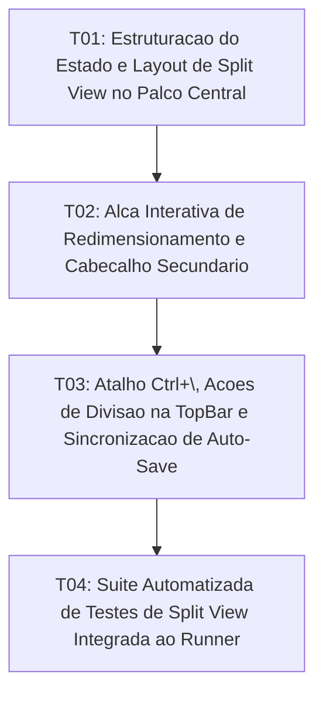

# Tasks: Split View Editor

**Approved**: 2026-11-11 - user: "aprovado"

## Test Coverage Matrix

| Code Layer | Required Test Type | Coverage Expectation | Location Pattern | Run Command |
| :--- | :--- | :--- | :--- | :--- |
| State & Layout | integration | Estados de divisão splitActive, orientation, secondaryTabId e splitRatio | `src/App.svelte` | `npm run check` |
| UI Split Container | integration | Contêiner duplo no palco central, alça de redimensionamento e seletor secundário | `src/App.svelte` | `npm run check` |
| Actions & Shortcuts | integration | Atalho Ctrl+\, botão de divisão na TopBar e fechamento da visualização dividida | `src/App.svelte`, `src/lib/components/TopBar.svelte` | `npm run check` |
| Regression Suite | regression | Testes automatizados de particionamento, preservação de abas e auto-save isolado | `scripts/test_split_view.mjs` | `npm test` |

## Gate Check Commands

| Gate Level | When to Use | Command |
| :--- | :--- | :--- |
| Frontend | After UI & layout changes | `npm run check` |
| Regression | After script & logic integration | `npm test` |
| Full | Milestone completion | `npm run check && npm test` |

## Execution Plan

## Task Breakdown

### T01: [x] Estruturação do Estado e Layout de Split View no Palco Central
**Where**: `src/App.svelte`
**Depends on**: none
**Tests**: `npm run check`
**Gate**: `npm run check`
**Done When**: Estados `splitActive`, `splitOrientation`, `secondaryTabId` e `splitRatio` estão configurados, renderizando dois contêineres de edição independentes no palco central.

### T02: [x] Alça Interativa de Redimensionamento e Cabeçalho Secundário
**Where**: `src/App.svelte`
**Depends on**: T01
**Tests**: `npm run check`
**Gate**: `npm run check`
**Done When**: Alça de separação (`.split-resizer`) permite ajustar a proporção entre os painéis com arraste contínuo do mouse, com barra de título/fechamento do painel secundário.

### T03: [x] Atalho `Ctrl+\`, Ações de Divisão na TopBar e Sincronização de Auto-Save
**Where**: `src/lib/components/TopBar.svelte`
**Depends on**: T02
**Tests**: `npm run check`
**Gate**: `npm run check`
**Done When**: O atalho `Ctrl + \` e o botão na barra superior alternam a divisão, com rotinas de `onChange` e `saveTab` operando de forma independente em cada documento.

### T04: [x] Suíte Automatizada de Testes de Split View Integrada ao Runner
**Where**: `scripts/test_split_view.mjs`
**Depends on**: T03
**Tests**: `npm test`
**Gate**: `npm test`
**Done When**: Testes automatizados validam divisão, atalhos, redimensionamento proporcional e isolamento de persistência, integrados ao runner `npm test`.

## Checks

Build: `npm run build`
Run typecheck: `npm run check`
Run testsuite: `npm test`

**C01** - Divisão do palco central em painéis primário e secundário via atalho e botão (SPLIT-01)
Proof: run testsuite | PASSOU

**C02** - Alça interativa de redimensionamento de largura/altura entre os dois painéis (SPLIT-02)
Proof: run testsuite | PASSOU

**C03** - Edição independente com auto-save isolado por documento nos dois painéis (SPLIT-03)
Proof: run testsuite | PASSOU

**C04** - Restauração fluida para painel único sem descarte de abas abertas (SPLIT-04)
Proof: run typecheck | svelte-check found 0 errors

