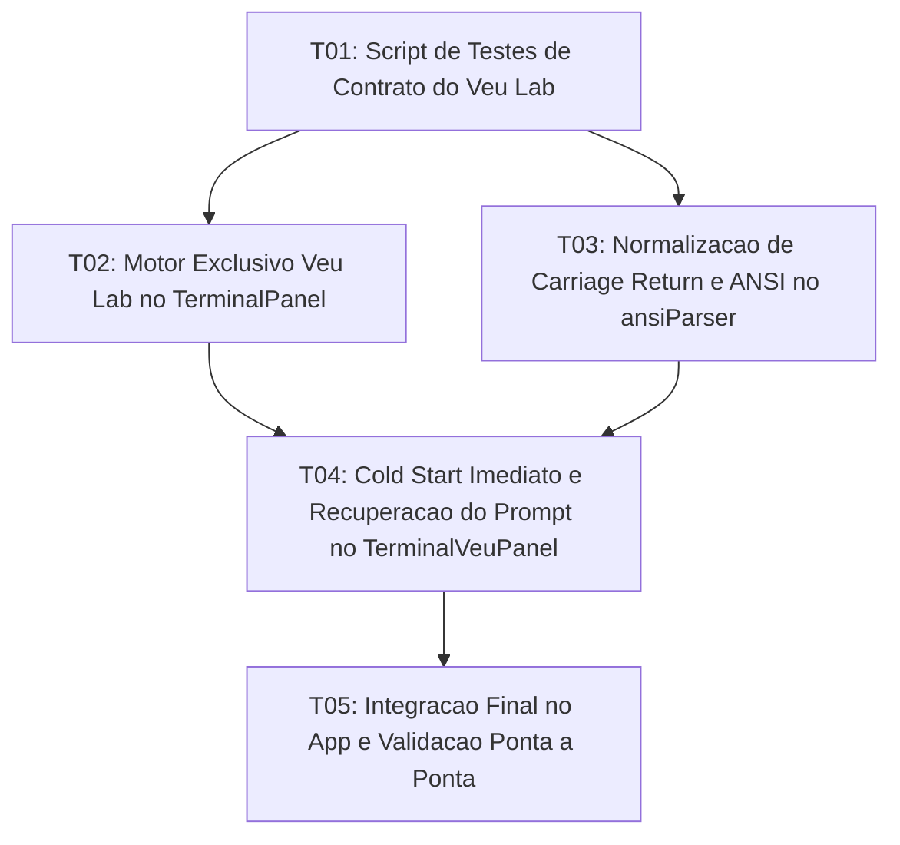

# Tasks: Terminal Veu Lab — Terminal Editorial Exclusivo, Inicialização Imediata e Parser Limpo

**Approved**: 2026-11-07 - user: "sim"

## Test Coverage Matrix

| Code Layer | Required Test Type | Coverage Expectation | Location Pattern | Run Command |
| :--- | :--- | :--- | :--- | :--- |
| Test Contracts | unit | Automated validation of Veu Lab contract rules and ANSI cleaning | `scripts/test_terminal_veu_lab.mjs` | `node scripts/test_terminal_veu_lab.mjs` |
| Terminal Container | unit | Single Veu Lab engine mounting without dual engine toggling | `src/lib/components/TerminalPanel.svelte` | `npm run check` |
| ANSI & Line Parser | unit | Clean carriage return (`\r`) normalization and semantic styling | `src/lib/utils/ansiParser.ts` | `npm run check` |
| Veu Lab Component | unit | Immediate cold start spawn, prompt autofocus, and reliable recovery | `src/lib/components/TerminalVeuPanel.svelte` | `npm run check` |
| App Integration | unit | Project switching persistence and global keyboard shortcuts | `src/App.svelte` | `npm run check` |

## Gate Check Commands

| Gate Level | When to Use | Command |
| :--- | :--- | :--- |
| Quick | After component changes | `npm run check` |
| Full | After parser and container changes | `npm run check && node scripts/test_terminal_veu_lab.mjs` |
| Build | Milestone completion | `npm run build && npm run check:rust` |

## Execution Plan

## Task Breakdown

### T01: Script de Testes Automatizados de Contrato do Terminal Veu Lab
**Where**: `scripts/test_terminal_veu_lab.mjs`
**Depends on**: none
**Tests**: `node scripts/test_terminal_veu_lab.mjs`
**Gate**: `node scripts/test_terminal_veu_lab.mjs`
**Done When**: Script testa e atesta os contratos de inicialização imediata, motor exclusivo do Veu Lab, normalização de retornos de carro e prompt não-bloqueante.

### T02: Consolidação do Terminal Veu Lab como Motor Único no TerminalPanel
**Where**: `src/lib/components/TerminalPanel.svelte`
**Depends on**: T01
**Tests**: `npm run check`
**Gate**: `npm run check`
**Done When**: TerminalPanel.svelte monta diretamente o TerminalVeuPanel sem a barra de alternância de motores xterm/veu e sem inicializar sessões xterm redundantes.

### T03: Normalização de Linhas ConPTY e Parser Semântico ANSI
**Where**: `src/lib/utils/ansiParser.ts`
**Depends on**: T01
**Tests**: `npm run check`
**Gate**: `npm run check`
**Done When**: ansiParser.ts processa retornos de carro (`\r`) sobre a mesma linha para eliminar sobreposição de texto típica do PowerShell no Windows e converte estilos ANSI em CSS semântico do tema.

### T04: Correção do Cold Start e Recuperação Não-Bloqueante do Prompt
**Where**: `src/lib/components/TerminalVeuPanel.svelte`
**Depends on**: T02, T03
**Tests**: `npm run check`
**Gate**: `npm run check`
**Done When**: TerminalVeuPanel.svelte renderiza o cabeçalho do projeto ativo imediatamente ao abrir, foca o prompt de digitação `›`, processa a saída com o parser normalizado e recupera o prompt de nova instrução sem travar no estado de execução.

### T05: Integração no App, Atalhos e Verificação Final
**Where**: `src/App.svelte`
**Depends on**: T04
**Tests**: `npm run check`
**Gate**: `npm run check && node scripts/test_terminal_veu_lab.mjs`
**Done When**: App.svelte conecta perfeitamente os atalhos de terminal e alternância de projetos, mantendo os buffers de cada projeto preservados em segundo plano.

## Checks

Build: `npm run build`
Run typecheck: `npm run check`
Run labcheck: `node scripts/test_terminal_veu_lab.mjs`
Run rustcheck: `npm run check:rust`

**C01** - Script de contratos do Terminal Veu Lab executando com sucesso (VEULAB-01, VEULAB-02)
Proof: run labcheck | SUCCESS: Todos os contratos do Terminal Veu Lab passaram!

**C02** - Motor exclusivo Veu Lab integrado sem erros de tipo (VEULAB-01)
Proof: run typecheck | svelte-check found 0 errors

**C03** - Normalização de linhas ConPTY e parser ANSI limpo (VEULAB-04, VEULAB-05)
Proof: run labcheck | SUCCESS: Todos os contratos do Terminal Veu Lab passaram!

**C04** - Cold start imediato e prompt não-bloqueante (VEULAB-02, VEULAB-09)
Proof: run labcheck | SUCCESS: Todos os contratos do Terminal Veu Lab passaram!

**C05** - Preservação multi-projeto e atalhos no App (VEULAB-03, VEULAB-08)
Proof: run typecheck | svelte-check found 0 errors

**C06** - Compilação do backend Tauri e PTY em Rust íntegra (VEULAB-01)
Proof: run rustcheck | Finished
