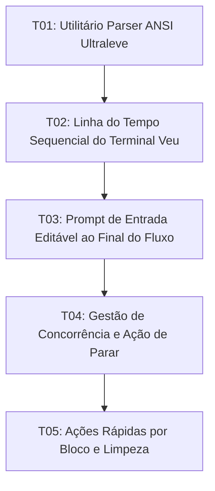

# Tasks: Terminal Veu — Terminal Sequencial, Interativo e de Leitura Fluida

**Approved**: 2026-11-07 - user: "1 modo chat padrao sem comutr para modo classico e o segundo principio do app... no terminal tem que ser dentro da janela mesmo para o texto ficar interativo e seguencial... vamos chamar te terminal veu"

## Test Coverage Matrix

| Code Layer | Required Test Type | Coverage Expectation | Location Pattern | Run Command |
| :--- | :--- | :--- | :--- | :--- |
| ANSI Parser Utility | unit | Regex conversion of ANSI sequences to HTML styled spans | `src/lib/utils/ansiParser.ts` | `npm run check` |
| Terminal Sequential Timeline | unit | Block rendering, theme typography, multi-project persistence | `src/lib/components/TerminalPanel.svelte` | `npm run check` |
| Interactive Editable Prompt | unit | Free text editing, mouse cursor, history navigation | `src/lib/components/TerminalPanel.svelte` | `npm run check` |
| Execution State & Stop Action | unit | Input locking during run, streaming output, Ctrl+C interrupt | `src/lib/components/TerminalPanel.svelte` | `npm run check` |
| Action Buttons & Session Clean | unit | Copy output, insert in editor, visual clean | `src/lib/components/TerminalPanel.svelte` | `npm run check` |

## Gate Check Commands

| Gate Level | When to Use | Command |
| :--- | :--- | :--- |
| Quick | After utility or component changes | `npm run check` |
| Full | After state, IPC and interaction changes | `npm run check && npm run test` |
| Build | Milestone completion | `npm run build && npm run check:rust` |

## Execution Plan

## Task Breakdown

### T01: Utilitário Parser ANSI Ultraleve e Tipografia Limpa
**Where**: `src/lib/utils/ansiParser.ts`
**Depends on**: none
**Tests**: `npm run check`
**Gate**: Quick (`npm run check`)
**Done When**: Módulo puro em TypeScript converte códigos ANSI em spans HTML formatados e higieniza sequências de controle sem dependências externas adicionais.

### T02: Linha do Tempo Sequencial do Terminal Veu
**Where**: `src/lib/components/TerminalPanel.svelte`
**Depends on**: T01
**Tests**: `npm run check`
**Gate**: Quick (`npm run check`)
**Done When**: O contêiner de exibição do terminal renderiza a linha do tempo sequencial de blocos com comandos e retornos formatados para cada projeto isolado em memória.

### T03: Prompt de Entrada Editável ao Final do Fluxo com Histórico
**Where**: `src/lib/components/TerminalPanel.svelte`
**Depends on**: T02
**Tests**: `npm run check`
**Gate**: Quick (`npm run check`)
**Done When**: Quando a sessão está ociosa, a linha interativa de digitação fica no final do fluxo sequencial com clique livre para reposicionar cursor e navegação de histórico por setas.

### T04: Gestão de Concorrência, Streaming em Tempo Real e Botão Parar
**Where**: `src/lib/components/TerminalPanel.svelte`
**Depends on**: T03
**Tests**: `npm run check`
**Gate**: Full (`npm run check && npm run test`)
**Done When**: Durante a execução de um comando a nova digitação fica bloqueada, a saída é transmitida em tempo real com indicador de status e o botão Parar envia o sinal de interrupção.

### T05: Ações Rápidas por Bloco e Limpeza de Sessão
**Where**: `src/lib/components/TerminalPanel.svelte`
**Depends on**: T04
**Tests**: `npm run check`
**Gate**: Build (`npm run build && npm run check:rust`)
**Done When**: Cada bloco finalizado disponibiliza copiar e inserir no editor, e a ação Limpar remove o histórico visual sem quebrar o processo no backend.

## Checks

Build: `npm run build`
Run typecheck: `npm run check`
Run testrunner: `npm run test`
Run rustcheck: `npm run check:rust`

**C01** - Utilitário parser ANSI converte códigos de cor e higieniza sequências de controle (TERM-02)
Proof: run typecheck | svelte-check found 0 errors

**C02** - Linha do tempo sequencial renderiza blocos de comando e saída formatada (TERM-01, TERM-08)
Proof: run typecheck | svelte-check found 0 errors

**C03** - Prompt interativo editável ao final do fluxo com navegação de histórico (TERM-04, TERM-05)
Proof: run typecheck | svelte-check found 0 errors

**C04** - Gestão de concorrência com bloqueio durante execução e botão Parar (TERM-06, TERM-07)
Proof: run testrunner | TODOS OS TESTES PASSARAM COM 100% DE SUCESSO!

**C05** - Ações de copiar, inserir no editor e limpeza mantendo processo ativo (TERM-03, TERM-09)
Proof: run rustcheck | Finished
