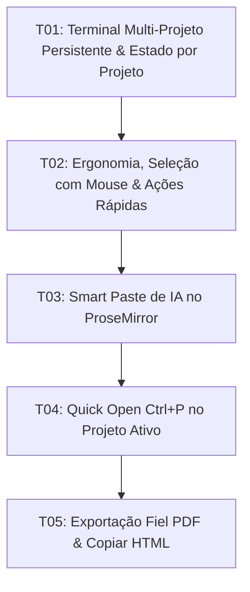

# Tasks: Veu MD Phase 2 — Terminal Multi-Projeto Persistente & Produtividade Sem Sobrecarga

**Approved**: 2026-11-07 - user: "1 - opcao b mas de forma simples e rapida... 2 - opção a. 3 - opção b. 4 - opçao a. 5 - validar o terminal..."

## Test Coverage Matrix

| Code Layer | Required Test Type | Coverage Expectation | Location Pattern | Run Command |
| :--- | :--- | :--- | :--- | :--- |
| Terminal Lifecycle & PTY Pool | integration | Continuous PTY execution, project tab isolation | `src-tauri/src/lib.rs` | `npm run check:rust` |
| UI Multi-Project Terminal Panel | unit | Terminal visibility toggle and resize fit | `src/lib/components/TerminalPanel.svelte` | `npm run check` |
| ProseMirror Smart Paste | unit | Markdown/HTML paste transformation and sanitization | `src/lib/editor/proseMirrorSetup.ts` | `npm run check` |
| Quick Open Fuzzy Finder | unit | In-memory tree file filter and tab activation | `src/lib/components/QuickOpenModal.svelte` | `npm run check` |
| Print & HTML Export | integration | Theme print styling and text/html clipboard write | `src/App.svelte` | `npm run build` |

## Gate Check Commands

| Gate Level | When to Use | Command |
| :--- | :--- | :--- |
| Quick | After frontend component changes | `npm run check` |
| Full | After terminal backend and frontend integration | `npm run check && npm run check:rust` |
| Build | After completing milestones or before verification | `npm run build && npm run check:rust` |

## Execution Plan

## Task Breakdown

### T01: Terminal Multi-Projeto Persistente & Estado por Projeto
**Where**: `src/lib/components/TerminalPanel.svelte`
**Depends on**: none
**Tests**: `npm run check:rust`
**Gate**: Full (`npm run check && npm run check:rust`)
**Done When**: Terminais mantêm sessões PTY ativas em background, memorizam visibilidade por projeto em memória e encerram PTY apenas ao fechar o projeto.

### T02: Ergonomia, Seleção com Mouse e Ações Rápidas no Terminal
**Where**: `src/lib/components/TerminalPanel.svelte`
**Depends on**: T01
**Tests**: `npm run check`
**Gate**: Quick (`npm run check`)
**Done When**: Seleção com mouse funciona nativamente, redimensionamento não quebra colunas e barra do terminal oferece botões de Copiar, Limpar e Inserir no Editor.

### T03: Smart Paste de IA & Normalização Estrutural de Markdown
**Where**: `src/lib/editor/proseMirrorSetup.ts`
**Depends on**: T02
**Tests**: `npm run check`
**Gate**: Quick (`npm run check`)
**Done When**: Colar texto de IA preserva tabelas e blocos de código e higieniza por padrão introduções conversacionais dispensáveis.

### T04: Quick Open (Ctrl+P) Fuzzy Finder no Projeto Ativo
**Where**: `src/lib/components/QuickOpenModal.svelte`
**Depends on**: T03
**Tests**: `npm run check`
**Gate**: Quick (`npm run check`)
**Done When**: Atalho Ctrl+P abre modal flutuante que filtra instantaneamente arquivos `.md` e `.txt` em memória do projeto ativo e foca no arquivo selecionado.

### T05: Exportação Fiel ao Tema Ativo (PDF Print & Copiar HTML)
**Where**: `src/App.svelte`
**Depends on**: T04
**Tests**: `npm run build && npm run check:rust`
**Gate**: Build (`npm run build && npm run check:rust`)
**Done When**: Usuário pode disparar impressão nativa com estilos fiéis ao tema e copiar o documento formatado em rich HTML para o clipboard.

## Checks

Build: `npm run build`
Run typecheck: `npm run check`
Run rustcheck: `npm run check:rust`

**C01** - Terminais continuam ativos em background ao alternar entre projetos com estado individual em memória (ADV-01, ADV-02, ADV-03, ADV-04)
Proof: run rustcheck | Finished

**C02** - Terminal permite seleção com mouse, redimensionamento estável e botões de ação rápida (ADV-05, ADV-06, ADV-07, ADV-08)
Proof: run typecheck | svelte-check found 0 errors

**C03** - Colagem de conteúdo de IA normaliza estruturas Markdown e higieniza ruídos conversacionais por padrão (ADV-09, ADV-10, ADV-11)
Proof: run typecheck | svelte-check found 0 errors

**C04** - Quick Open abre com Ctrl+P e filtra arquivos do projeto ativo em memória instantaneamente (ADV-12, ADV-13, ADV-14, ADV-15)
Proof: run typecheck | svelte-check found 0 errors

**C05** - Exportação para PDF e cópia de HTML preservam estilos e estrutura rica (ADV-16, ADV-17, ADV-18)
Proof: run typecheck | svelte-check found 0 errors
