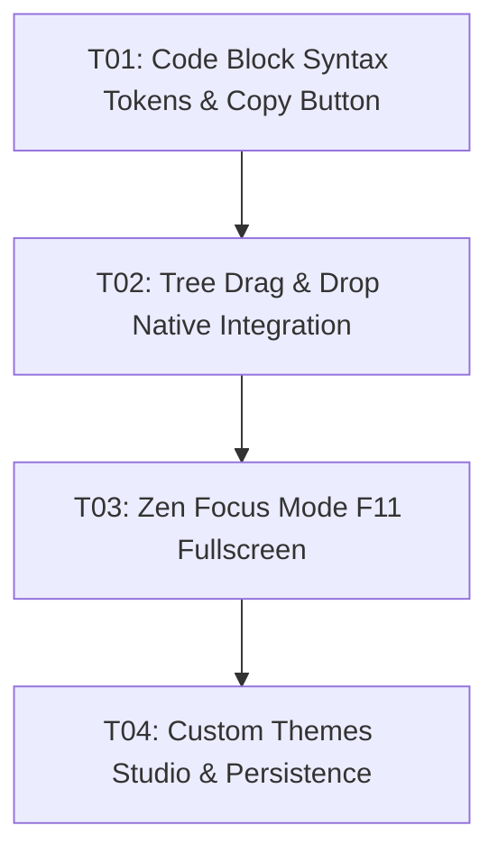

# Tasks: Veu MD Phase 2 — Refinamentos Avançados & Produtividade

**Status**: Planned  
**Date**: 2026-11-07  

---

## Execution Plan

---

## Task Breakdown

### T01: Destaque de Sintaxe e Botão de Cópia em Blocos de Código
- **Where**: `src/lib/editor/codeBlockPlugin.ts` & `src/lib/components/Editor.svelte`
- **Depends on**: none
- **Done When**: Blocos de código exibem tokens coloridos por sintaxe de linguagem e barra superior com botão "Copiar".
- **Gate**: `npm run check`

### T02: Arrastar e Soltar (Drag & Drop) na Árvore Lateral
- **Where**: `src/lib/components/FileTreeNode.svelte` & `src/App.svelte`
- **Depends on**: T01
- **Done When**: Usuário pode arrastar arquivos ou pastas soltando em outras pastas para mover no disco com validação de nós filhos.
- **Gate**: `npm run check`

### T03: Modo Foco / Zen Mode (Escrita sem Distrações)
- **Where**: `src/App.svelte` & `src/lib/components/TopBar.svelte`
- **Depends on**: T02
- **Done When**: Atalho `F11` e `Ctrl+Shift+F` colapsa todas as barras e expande a folha de escrita no centro da tela.
- **Gate**: `npm run check`

### T04: Theme Studio (Criação e Persistência de Temas Customizados no Disco)
- **Where**: `src/lib/components/ThemeSettings.svelte` & `src/lib/theme/themeStore.ts`
- **Depends on**: T03
- **Done When**: Usuário pode criar novos temas com nomes próprios e salvá-los no disco via `save_custom_theme` e recarregá-los com `load_custom_themes`.
- **Gate**: `npm run check && npm run check:rust && npm run build`
