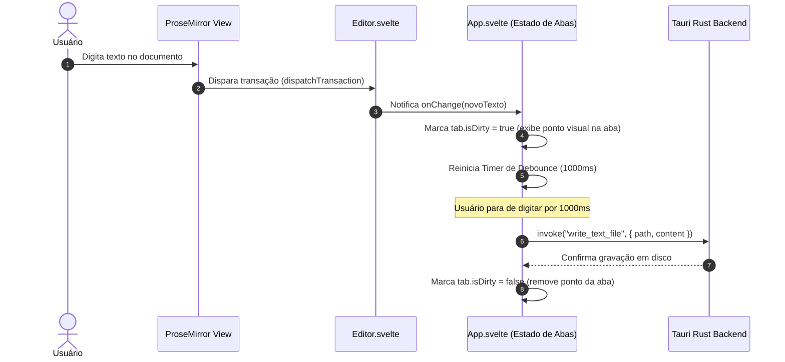
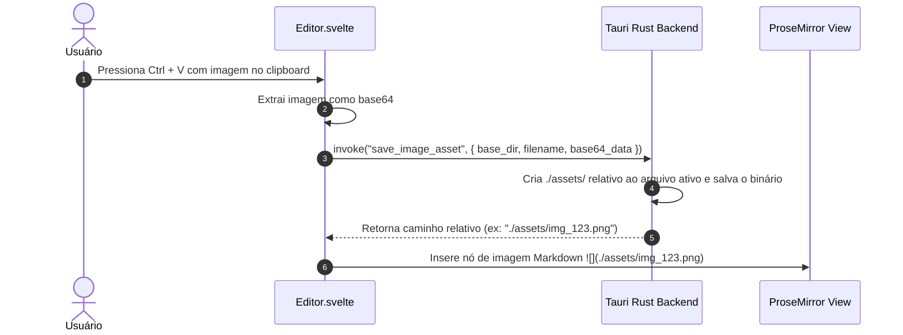
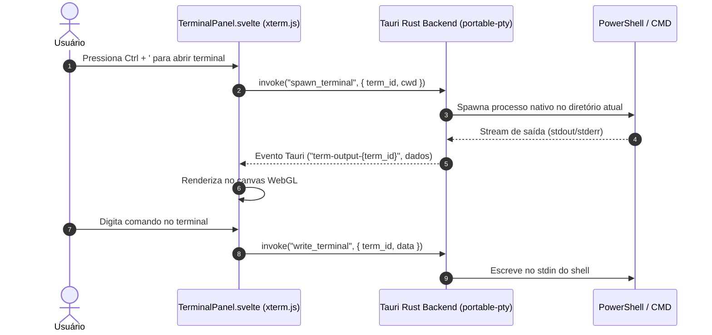

# Architecture & Technical Design: Veu MD Core (Phase 1 MVP)

**Spec**: `.specs/features/veu-md-core/spec.md`  
**Status**: Approved  
**Date**: 2026-11-06  

---

## 1. Visão Geral da Arquitetura e Limites de Responsabilidade

O **Veu MD** foi concebido em 4 camadas desacopladas com fronteiras estritas. O objetivo desta arquitetura é garantir **manutenibilidade a longo prazo, zero acoplamento indevido** e eliminação de dúvidas sobre "onde cada parte do código reside".

```mermaid
flowchart TD
    subgraph UI_Layer["Camada 1: Interface & Shell Desktop (Svelte 5 + TypeScript)"]
        App["App.svelte (Orquestrador de Abas, Layout & Atalhos Globais)"]
        Sidebar["Sidebar.svelte (Árvore de Pastas & Outline)"]
        TabBar["TabBar.svelte (Gestão de Abas & Dirty Indicator)"]
        TopBar["TopBar.svelte (Barra Superior Estilo Word)"]
        StatusBar["StatusBar.svelte (Palavras, Leitura, Status)"]
        FloatingMenu["FloatingMenu.svelte (Menu Flutuante na Seleção)"]
        SlashMenu["SlashMenu.svelte (Menu de Blocos ao Digitar / ou #)"]
        ThemeDrawer["ThemeSettings.svelte (Painel Lateral de Cores)"]
        TermUI["TerminalPanel.svelte (xterm.js WebGL Canvas)"]
    end

    subgraph Editor_Engine["Camada 2: Motor WYSIWYG & Serialização (ProseMirror Core)"]
        EditorWrapper["Editor.svelte (Montagem do View e Ciclo de Vida DOM)"]
        PMSchema["proseMirrorSetup.ts (Schema, Nodes, Marks, Tabelas)"]
        PMSerializer["Serializer/Parser GFM (Markdown puro bidirecional)"]
        PMPlugins["Plugins ProseMirror (InputRules, History, Keymap)"]
    end

    subgraph Theme_Engine["Camada 3: Motor de Temas GPU (CSS Custom Properties :root)"]
        ThemeStore["themeStore.ts (Observer de temas & injeção no DOM :root)"]
        Presets["defaultThemes.ts (Dark, Light, Sepia presets)"]
        CSSVars["app.css (.ProseMirror classes consumindo var(--veu-*))"]
    end

    subgraph Native_Backend["Camada 4: Backend de Sistema em Rust (Tauri v2 Core)"]
        FSModule["Gerenciador de Arquivos & Pastas Nativo (.md e .txt)"]
        PTYModule["Gerenciador de Sessões PTY (portable-pty)"]
        WatcherModule["Monitor de Disco em Background (notify)"]
        ThemesFS["Persistência de Temas JSON em Disco (~/.config/VeuMD/)"]
    end

    %% Relações e Fluxos
    App --> Sidebar & TabBar & TopBar & StatusBar & ThemeDrawer & TermUI
    App --> EditorWrapper
    EditorWrapper --> PMSchema & PMSerializer & PMPlugins
    TopBar & FloatingMenu & SlashMenu -->|Comandos ProseMirror| EditorWrapper
    ThemeDrawer --> ThemeStore
    ThemeStore --> CSSVars
    Sidebar & App -->|Tauri IPC invoke| FSModule
    TermUI <-->|Tauri IPC streaming event| PTYModule
    WatcherModule -->|Event disk-changed| App
    ThemeDrawer -->|Tauri IPC invoke| ThemesFS
```

---

## 2. Onde Vai Cada Parte (Mapa de Diretórios e Fronteiras)

Para garantir que novos desenvolvedores ou agentes nunca fiquem em dúvida sobre onde colocar cada funcionalidade:

| Responsabilidade | Localização Exata | O Que Fica Aqui | O Que NUNCA Deve Ficar Aqui |
| :--- | :--- | :--- | :--- |
| **Definições de Tipos** | `src/lib/types.ts` | Interfaces de dados universais (`FileNode`, `TabItem`, `ThemeConfig`, etc.) | Lógica de execução, estados reativos |
| **Motor ProseMirror** | `src/lib/editor/proseMirrorSetup.ts` | Definição de Nodes, Marks, Plugins ProseMirror, Serializador GFM e Parser | Manipulação de layout Svelte, chamadas Tauri |
| **Editor Component** | `src/lib/components/Editor.svelte` | Ciclo de vida do `EditorView`, listener de transações e ponte de eventos | Gerenciamento de múltiplas abas, árvore de arquivos |
| **Orquestrador de Abas** | `src/App.svelte` & `src/lib/components/TabBar.svelte` | Array de abas abertas, aba ativa, dirty state e timer de debounce (1000ms) | Criação de nós ProseMirror diretos |
| **Navegação & Pastas** | `src/lib/components/Sidebar.svelte` | Exibição em árvore, seleção de ícones, filtro de busca, criação de arquivos/pastas | Edição de texto, parser de Markdown |
| **Formatação & Menus** | `TopBar.svelte`, `FloatingMenu.svelte`, `SlashMenu.svelte` | Disparadores visuais que executam comandos ProseMirror no `EditorView` ativo | I/O de disco, gravação de arquivos |
| **Theming GPU** | `src/lib/theme/themeStore.ts` & `src/app.css` | Mapeamento direto das variáveis CSS no `:root` (`--veu-h1-color`, etc.) | Re-renderização forçada de componentes Svelte |
| **Terminal Integrado** | `src/lib/components/TerminalPanel.svelte` | Instância de `xterm.js`, addon WebGL/Fit e listener de eventos do PTY | Comandos de manipulação do editor de texto |
| **Backend Nativo Rust** | `src-tauri/src/lib.rs` | Comandos Tauri IPC (PTY spawn/write, FS read/write, Image assets save, Watcher) | Layout de tela, regras CSS |

---

## 3. Fluxos de Dados e Gerenciamento de Estado

### 3.1. Ciclo de Edição e Auto-Save (Debounce de 1000ms)

### 3.2. Colagem de Imagens do Clipboard (`Ctrl + V`)

### 3.3. Streaming do Terminal Integrado (PTY Nativo)

### 3.4. Motor de Cores e Temas (Custo Zero de CPU)

* **Princípio**: O editor ProseMirror atribui elementos semânticos HTML nativos (`h1`, `h2`, `strong`, `em`, `blockquote`, `pre code`, `table`).
* **Estilização**: O arquivo [app.css](file:///w:/_Projetos/Veu%20MD/src/app.css) referencia variáveis CSS puras (`var(--veu-h1-color)`, `var(--veu-bg-editor)`, etc.).
* **Atualização em Tempo Real**: Ao arrastar um seletor de cor no [ThemeSettings.svelte](file:///w:/_Projetos/Veu%20MD/src/lib/components/ThemeSettings.svelte), a função `applyThemeToDOM` atualiza a propriedade correspondente no `document.documentElement.style`.
* **Resultado de Performance**: O compositor de tela da GPU atualiza o pixel em menos de 0.1ms sem destruir nem reconstruir a árvore de nós do editor.

---

## 4. Análise de Riscos, Débitos e Mitigações

| Risco / Ponto de Atenção | Impacto Potencial | Mitigação Arquitetural Implementada |
| :--- | :--- | :--- |
| **Saturação de I/O de Disco** | Digitação rápida gravando arquivo no disco a cada letra | Debounce de 1000ms isolado por aba em `App.svelte`. Apenas uma escrita ocorre após a pausa. |
| **Vazamento de Memória no Terminal** | Fechar a janela sem encerrar processos filhos do PowerShell | Comando `kill_terminal` chamado no ciclo de vida `onDestroy` do componente Svelte e no encerramento da janela Tauri. |
| **Incompatibilidade de Markdown Delimiters** | Usuário ver tags de formatação cruas durante digitação | Esquema de Nós e Marcas do ProseMirror configurado com visual DOM puro (`toDOM`), deixando os caracteres de sintaxe exclusivamente para a serialização GFM. |
| **Arquivo sem Caminho em Disco** | Dúvida sobre onde gravar `./assets/` | Regra estrita de criação prévia: qualquer documento no workspace já possui caminho físico no disco (`novo_arquivo.md` por padrão). |

---

## 5. Conformidade com Invariantes do Projeto

1. **WYSIWYG Estilo Word**: Isolado na camada 2 (`proseMirrorSetup.ts` + `Editor.svelte`).
2. **Serialização GFM Pura**: Isolado no serializador ProseMirror, sem modificações manuais de strings via regex.
3. **Desempenho Zero VDOM**: Svelte 5 manipula cirurgicamente os elementos da casca visual; o editor interno é gerenciado pelo motor ProseMirror nativo.
4. **Segurança de Tipos**: Compartilhamento do contrato `types.ts` entre todos os componentes.

