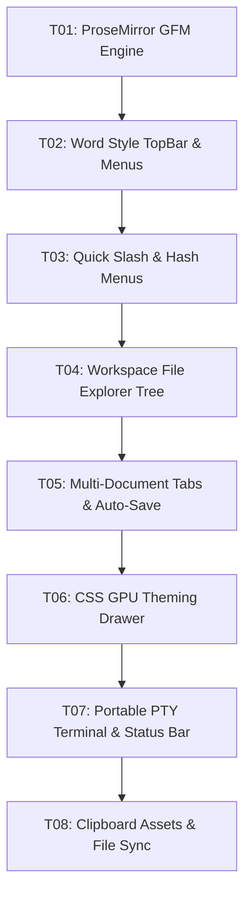

# Tasks: Veu MD Core Engine & Workspace (MVP)

**Approved**: 2026-11-06 - user: "aprovado, continue"

## Test Coverage Matrix

> Generated from codebase, project guidelines, and spec - confirm before Execute. Guidelines found: `GEMINI.md`, `package.json`, `Cargo.toml`.

| Code Layer | Required Test Type | Coverage Expectation | Location Pattern | Run Command |
| :--- | :--- | :--- | :--- | :--- |
| Editor & Markdown Engine | unit | All branches; 1:1 to spec ACs; GFM serialization and parsing | `src/lib/editor/*.ts` | `npm run check` |
| UI & Visual Formatting | integration | Component rendering, event dispatching, and reactivity | `src/lib/components/*.svelte` | `npm run check` |
| Theme & GPU CSS Properties | unit | CSS custom properties on `:root` and JSON theme schemas | `src/lib/theme/*.ts` | `npm run check` |
| Rust Backend & PTY Terminal | integration | Tauri IPC channels, PTY process spawn, and file watcher | `src-tauri/src/*.rs` | `npm run check:rust` |
| Application Bundle | build | Zero-error compilation and bundling | `src/` | `npm run build` |

## Gate Check Commands

> Deterministic command gates executed before commit and transition.

| Gate Level | When to Use | Command |
| :--- | :--- | :--- |
| Quick | After single component or type changes | `npm run check` |
| Full | After tasks integrating frontend and backend | `npm run check && npm run check:rust` |
| Build | After completing milestones or before release | `npm run build && npm run check:rust` |

## Execution Plan

## Task Breakdown

### T01: ProseMirror GFM Engine & Markdown Serializer
**Where**: `src/lib/editor/proseMirrorSetup.ts`
**Depends on**: none
**Tests**: `npm run check`
**Gate**: Quick (`npm run check`)
**Done When**: ProseMirror schema defines headings, lists, tables, marks and serializes cleanly to standard GFM on save.

### T02: Word Style TopBar & Selection Bubble Menu
**Where**: `src/lib/components/TopBar.svelte`
**Depends on**: T01
**Tests**: `npm run check`
**Gate**: Quick (`npm run check`)
**Done When**: TopBar and bubble selection menu control text formatting without raw markdown delimiters on screen.

### T03: Quick Slash and Hash Heading Menus
**Where**: `src/lib/components/SlashMenu.svelte`
**Depends on**: T02
**Tests**: `npm run check`
**Gate**: Quick (`npm run check`)
**Done When**: Typing `#` triggers heading selector and `/` triggers block menu in active document.

### T04: Workspace File Explorer Tree & Icon Mapping
**Where**: `src/lib/components/Sidebar.svelte`
**Depends on**: T03
**Tests**: `npm run check`
**Gate**: Quick (`npm run check`)
**Done When**: File tree renders hierarchical folders with distinct icons, file filtering, and default `novo_arquivo.md` creation.

### T05: Multi-Document Tabs & 1000ms Auto-Save
**Where**: `src/lib/components/TabBar.svelte`
**Depends on**: T04
**Tests**: `npm run check`
**Gate**: Quick (`npm run check`)
**Done When**: Tabs display open documents with dirty dot indicator, 1000ms debounced auto-save, and Ctrl+S persistence.

### T06: Real-Time CSS GPU Theming Drawer & Presets
**Where**: `src/lib/components/ThemeSettings.svelte`
**Depends on**: T05
**Tests**: `npm run check`
**Gate**: Quick (`npm run check`)
**Done When**: Theme drawer adjusts CSS custom properties on document root with zero CPU cost and supports JSON export/import.

### T07: Portable PTY Native Terminal & Status Bar
**Where**: `src/lib/components/TerminalPanel.svelte`
**Depends on**: T06
**Tests**: `npm run check:rust`
**Gate**: Full (`npm run check && npm run check:rust`)
**Done When**: Retractable terminal session spawns in current workspace with streaming xterm.js WebGL canvas.

### T08: Clipboard Assets & External Change Notification
**Where**: `src/lib/components/Editor.svelte`
**Depends on**: T07
**Tests**: `npm run check`
**Gate**: Build (`npm run build && npm run check:rust`)
**Done When**: Pasting image via Ctrl+V writes PNG to `./assets/` and external file changes reload with status bar notice.

## Checks

Build: `npm run build`
Run typecheck: `npm run check`
Run rustcheck: `npm run check:rust`

**C01** - Headings, bold, italic, and tables render visually without markdown delimiters (CORE-01, AC-001)
Proof: run typecheck | svelte-check found 0 errors

**C02** - Saving active document serializes ProseMirror state into standard GFM markdown (CORE-02, AC-002)
Proof: run typecheck | svelte-check found 0 errors

**C03** - Opening a text file displays plain text without rich markdown transformations (CORE-03, AC-003)
Proof: run typecheck | svelte-check found 0 errors

**C04** - File tree renders hierarchical folders with distinct file icons (CORE-04, AC-004)
Proof: run typecheck | svelte-check found 0 errors

**C05** - Clicking an item in the tree opens only markdown and text files (CORE-05, AC-005)
Proof: run typecheck | svelte-check found 0 errors

**C06** - Explorer creates default `novo_arquivo.md` when no name is provided (CORE-06, AC-006)
Proof: run typecheck | svelte-check found 0 errors

**C07** - Explorer provides actions to create folders, delete, and search files (CORE-07, AC-007)
Proof: run typecheck | svelte-check found 0 errors

**C08** - Opening an editable file displays a distinct tab with title and icon (CORE-08, AC-008)
Proof: run typecheck | svelte-check found 0 errors

**C09** - Modified tabs show a visual dirty indicator (CORE-09, AC-009)
Proof: run typecheck | svelte-check found 0 errors

**C10** - Auto-save persists document after 1000ms debounce (CORE-10, AC-010)
Proof: run typecheck | svelte-check found 0 errors

**C11** - Pressing Ctrl+S persists document to disk immediately and clears dirty indicator (CORE-11, AC-011)
Proof: run typecheck | svelte-check found 0 errors

**C12** - Changing tag color immediately updates CSS custom property on root element (CORE-12, AC-012)
Proof: run typecheck | svelte-check found 0 errors

**C13** - Theme settings supports Dark/Light/Sepia presets and JSON export/import (CORE-13, AC-013)
Proof: run typecheck | svelte-check found 0 errors

**C14** - Terminal panel runs interactive pseudo-terminal in project directory (CORE-14, AC-014)
Proof: run rustcheck | Finished

**C15** - Terminal renders streaming output with xterm.js WebGL canvas (CORE-15, AC-015)
Proof: run rustcheck | Finished

**C16** - Top toolbar offers formatting for headings, marks, and lists (CORE-16, AC-016)
Proof: run typecheck | svelte-check found 0 errors

**C17** - Floating bubble menu appears on text selection (CORE-17, AC-017)
Proof: run typecheck | svelte-check found 0 errors

**C18** - Typing `#` at empty block displays heading menu (CORE-18, AC-018)
Proof: run typecheck | svelte-check found 0 errors

**C19** - Typing `/` in empty block displays slash menu (CORE-19, AC-019)
Proof: run typecheck | svelte-check found 0 errors

**C20** - Pasting image with Ctrl+V writes to `./assets/` and inserts markdown link (CORE-20, AC-020)
Proof: run typecheck | svelte-check found 0 errors

**C21** - External modifications reload content with status bar notification (CORE-21, AC-021)
Proof: run rustcheck | Finished
