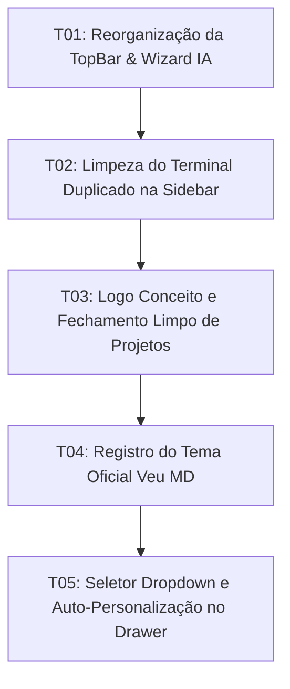

# Tasks: Veu MD Phase 2 — Refinamento de Layout, Identidade Visual & Ergonomia de Interface

**Approved**: 2026-11-07 - user: "vamos trablahar um pouco no layout entao pontos a ajustar... analise os pontos crie a spec e inicie o processo"

## Test Coverage Matrix

| Code Layer | Required Test Type | Coverage Expectation | Location Pattern | Run Command |
| :--- | :--- | :--- | :--- | :--- |
| TopBar Layout & Actions | unit | Save/Print position, Wizard trigger, Quick Open button | `src/lib/components/TopBar.svelte` | `npm run check` |
| Sidebar Explorer Toolbar | unit | Clean actions toolbar without duplicate terminal | `src/lib/components/Sidebar.svelte` | `npm run check` |
| Project Activity Bar & Logo | unit | Concept logo glyph, clean project avatars, red close action | `src/lib/components/ProjectSidebar.svelte` | `npm run check` |
| Themes Presets Configuration | unit | Official Veu MD theme registration | `src/lib/theme/defaultThemes.ts` | `npm run check` |
| Theme Drawer Settings UI | unit | Dropdown selector and auto-custom switch | `src/lib/components/ThemeSettings.svelte` | `npm run check` |

## Gate Check Commands

| Gate Level | When to Use | Command |
| :--- | :--- | :--- |
| Quick | After component changes | `npm run check` |
| Full | After themes and structural UI changes | `npm run check && npm run check:rust` |
| Build | Milestone completion | `npm run build && npm run check:rust` |

## Execution Plan

## Task Breakdown

### T01: Reorganização da TopBar e Gatilho Wizard IA
**Where**: `src/lib/components/TopBar.svelte`
**Depends on**: none
**Tests**: `npm run check`
**Gate**: Quick (`npm run check`)
**Done When**: Botões de Salvar e Imprimir estão posicionados após Undo/Redo no grupo de formatação, e o topo esquerdo possui os botões de Varinha Mágica (Wizard) e Busca Rápida sem os botões redundantes de criação de arquivo e salvamento.

### T02: Limpeza do Terminal Duplicado na Barra do Explorer
**Where**: `src/lib/components/Sidebar.svelte`
**Depends on**: T01
**Tests**: `npm run check`
**Gate**: Quick (`npm run check`)
**Done When**: Barra de ferramentas do Explorer exibe apenas Novo Arquivo, Nova Pasta, Atualizar e Fechar Pasta, sem o botão redundante de Abrir no Terminal.

### T03: Logo Conceito e Ergonomia de Fechar Projetos
**Where**: `src/lib/components/ProjectSidebar.svelte`
**Depends on**: T02
**Tests**: `npm run check`
**Gate**: Quick (`npm run check`)
**Done When**: Barra de atividades de projetos exibe o glifo conceito da logo Veu MD no topo, remove o X sobreposto nos avatares e apresenta o botão de fechar projeto com destaque em vermelho vivo no hover.

### T04: Registro do Tema Oficial Veu MD
**Where**: `src/lib/theme/defaultThemes.ts`
**Depends on**: T03
**Tests**: `npm run check`
**Gate**: Quick (`npm run check`)
**Done When**: Tema oficial "Veu MD" está registrado com a paleta Crepúsculo Editorial Obsidian (`#0e0b16`, `#f472b6`, `#c084fc`, `#7c3aed`).

### T05: Seletor Dropdown e Auto-Personalização no Drawer de Temas
**Where**: `src/lib/components/ThemeSettings.svelte`
**Depends on**: T04
**Tests**: `npm run check`
**Gate**: Full (`npm run check && npm run check:rust`)
**Done When**: O painel de temas usa um seletor `<select>` com opção "Personalizado" e qualquer alteração de cor ou layout muda automaticamente a seleção para "Personalizado".

## Checks

Build: `npm run build`
Run typecheck: `npm run check`
Run rustcheck: `npm run check:rust`

**C01** - TopBar exibe Salvar/Imprimir junto à formatação e botões de Wizard e Busca no topo esquerdo (REF-01, REF-02, REF-03, REF-04)
Proof: run typecheck | svelte-check found 0 errors

**C02** - Explorer na Sidebar não possui botão duplicado de terminal (REF-05, REF-06)
Proof: run typecheck | svelte-check found 0 errors

**C03** - ProjectSidebar exibe logo conceito e ação de fechar com destaque em vermelho sem sobreposição (REF-07, REF-08, REF-09, REF-10)
Proof: run typecheck | svelte-check found 0 errors

**C04** - Tema oficial Veu MD registrado na biblioteca de temas (REF-11, REF-12)
Proof: run typecheck | svelte-check found 0 errors

**C05** - Seletor Dropdown ativo e comutação automática para Personalizado funcional (REF-13, REF-14)
Proof: run rustcheck | Finished
