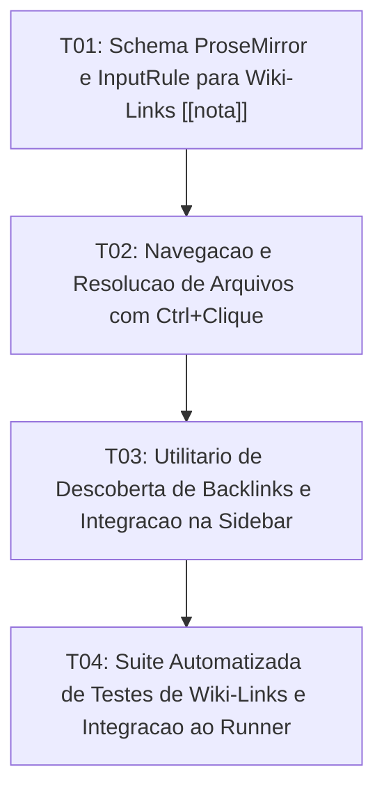

# Tasks: Wiki-Links & Backlinks

**Approved**: 2026-11-11 - user: "ok implemente"

## Test Coverage Matrix

| Code Layer | Required Test Type | Coverage Expectation | Location Pattern | Run Command |
| :--- | :--- | :--- | :--- | :--- |
| Schema & Parser | unit | Schema de mark `wiki_link` no ProseMirror e serialização bidirecional | `src/lib/editor/` | `npm test` |
| Link Navigation | integration | Resolução de caminho por nome de nota e abertura de aba | `src/App.svelte` | `npm run check` |
| Backlinks Discovery | unit | Varredura de ocorrências de menções ao arquivo ativo no workspace | `src/lib/utils/backlinkScanner.ts` | `npm test` |
| Regression Suite | regression | Testes de conversão, navegação e listagem de backlinks | `scripts/test_wiki_links.mjs` | `npm test` |

## Gate Check Commands

| Gate Level | When to Use | Command |
| :--- | :--- | :--- |
| Frontend | After UI & schema changes | `npm run check` |
| Regression | After script & logic integration | `npm test` |
| Full | Milestone completion | `npm run check && npm test` |

## Execution Plan

## Task Breakdown

### T01: [x] Schema ProseMirror e InputRule para Wiki-Links `[[nota]]`
**Where**: `src/lib/editor/proseMirrorSetup.ts`, `src/lib/editor/schema.ts`
**Depends on**: none
**Tests**: `npm run check`
**Gate**: `npm run check`
**Done When**: O editor ProseMirror reconhece `[[texto]]` transformando em uma marca visual interativa sem colchetes brutos no WYSIWYG.

### T02: [x] Navegação e Resolução de Arquivos com Ctrl+Clique
**Where**: `src/lib/editor/Editor.svelte`, `src/App.svelte`
**Depends on**: T01
**Tests**: `npm run check`
**Gate**: `npm run check`
**Done When**: Clicar com `Ctrl` em um wiki-link localiza a nota no projeto ativo e abre no editor; se não existir, oferece criação.

### T03: [x] Utilitário de Descoberta de Backlinks e Integração na Sidebar
**Where**: `src/lib/utils/backlinkScanner.ts`, `src/lib/components/Sidebar.svelte`
**Depends on**: T02
**Tests**: `npm test`
**Gate**: `npm test`
**Done When**: O painel lateral (aba Sumário/Conexões) exibe a lista de arquivos que contêm links para o documento ativo.

### T04: [x] Suíte Automatizada de Testes de Wiki-Links e Integração ao Runner
**Where**: `scripts/test_wiki_links.mjs`
**Depends on**: T03
**Tests**: `npm test`
**Gate**: `npm test`
**Done When**: Testes validam o parsing de wiki-links, navegação e cálculo de backlinks com 100% de aprovação em `npm test`.

## Checks

Build: `npm run build`
Run typecheck: `npm run check`
Run testsuite: `npm test`

**C01** - Conversão e renderização rica de wiki-links no ProseMirror sem caracteres brutos (WIKI-01)
Proof: run testsuite | PASSOU

**C02** - Resolução e navegação imediata ao arquivo alvo ao clicar com Ctrl (WIKI-02)
Proof: run typecheck | svelte-check found 0 errors

**C03** - Criação sob demanda de notas inexistentes referenciadas em links (WIKI-03)
Proof: run typecheck | svelte-check found 0 errors

**C04** - Listagem reativa de referências reversas (Backlinks) no painel lateral (WIKI-04)
Proof: run testsuite | PASSOU

