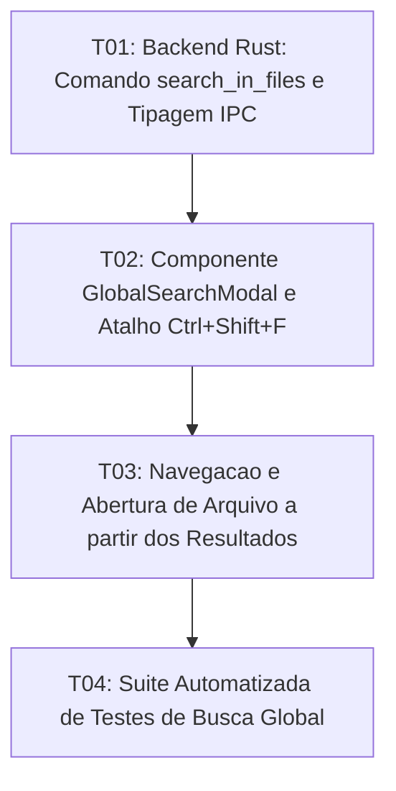

# Tasks: Workspace Global Search

**Approved**: 2026-11-10 - user: "aprovado adicione também o ajuste no icone da barra lateral dos projetos, esta aparecendo 2 letras sem saber o nome do projeto adicone as 4 primeiras letras dentro do icone para facilitar a identificação"

## Test Coverage Matrix

| Code Layer          | Required Test Type | Coverage Expectation                                                            | Location Pattern                              | Run Command          |
| :------------------ | :----------------- | :------------------------------------------------------------------------------ | :-------------------------------------------- | :------------------- |
| Backend Core / Rust | unit               | Varredura recursiva de texto com exclusão de pastas de build                    | `src-tauri/src/commands/fs_cmd.rs`            | `npm run check:rust` |
| IPC Contracts       | integration        | Tipagem estrita de argumentos e resultados de busca em TypeScript               | `src/types/ipc.ts`                            | `npm run check`      |
| UI Search Modal     | integration        | Modal de busca global, input com debounce, lista agrupada por arquivo e filtros | `src/lib/components/GlobalSearchModal.svelte` | `npm run check`      |
| Regression Suite    | regression         | Testes determinísticos de varredura, agrupamento e abertura de arquivo          | `scripts/test_workspace_search.mjs`           | `npm test`           |

## Gate Check Commands

| Gate Level | When to Use                      | Command                     |
| :--------- | :------------------------------- | :-------------------------- |
| Backend    | After Rust command changes       | `npm run check:rust`        |
| Frontend   | After UI & component changes     | `npm run check`             |
| Regression | After script & logic integration | `npm test`                  |
| Full       | Milestone completion             | `npm run check && npm test` |

## Execution Plan

## Task Breakdown

### T01: [x] Backend Rust: Comando `search_in_files` e Tipagem IPC

**Where**: `src-tauri/src/commands/fs_cmd.rs`
**Depends on**: none
**Tests**: `npm run check:rust`
**Gate**: `npm run check:rust`
**Done When**: Comando Rust executa varredura recursiva de alta velocidade ignorando pastas de dependência (`node_modules`, `.git`, etc.) e retorna lista estruturada de correspondências com tipagem segura em `src/types/ipc.ts`.

### T02: [x] Componente `GlobalSearchModal` e Atalho `Ctrl+Shift+F`

**Where**: `src/lib/components/GlobalSearchModal.svelte`
**Depends on**: T01
**Tests**: `npm run check`
**Gate**: `npm run check`
**Done When**: Modal de busca global é acionado via `Ctrl + Shift + F`, contendo campo de busca com debounce, filtros de maiúsculas/minúsculas e palavra inteira, e lista agrupada de ocorrências com trechos de preview.

### T03: [x] Navegação e Abertura de Arquivo a partir dos Resultados

**Where**: `src/App.svelte`
**Depends on**: T02
**Tests**: `npm run check`
**Gate**: `npm run check`
**Done When**: Clicar em qualquer resultado da lista de busca abre o arquivo correspondente em uma aba do editor e direciona o foco imediatamente.

### T04: [x] Suíte Automatizada de Testes de Busca Global

**Where**: `scripts/test_workspace_search.mjs`
**Depends on**: T03
**Tests**: `npm test`
**Gate**: `npm test`
**Done When**: Testes automatizados validam o fluxo de busca, agrupamento, filtros e navegação, passando com 100% no runner oficial `npm test`.

## Checks

Build: `npm run build`
Run typecheck: `npm run check`
Run testsuite: `npm test`

**C01** - Varredura recursiva de texto em arquivos do projeto via backend Rust (SEARCH-01)
Proof: run testsuite | PASSOU

**C02** - Agrupamento de ocorrências por arquivo com exibição de número de linha e trecho (SEARCH-02)
Proof: run testsuite | PASSOU

**C03** - Suporte a filtros de correspondência de maiúsculas/minúsculas e palavra inteira (SEARCH-03)
Proof: run testsuite | PASSOU

**C04** - Navegação com abertura imediata do arquivo selecionado na aba correspondente (SEARCH-04)
Proof: run typecheck | svelte-check found 0 errors
