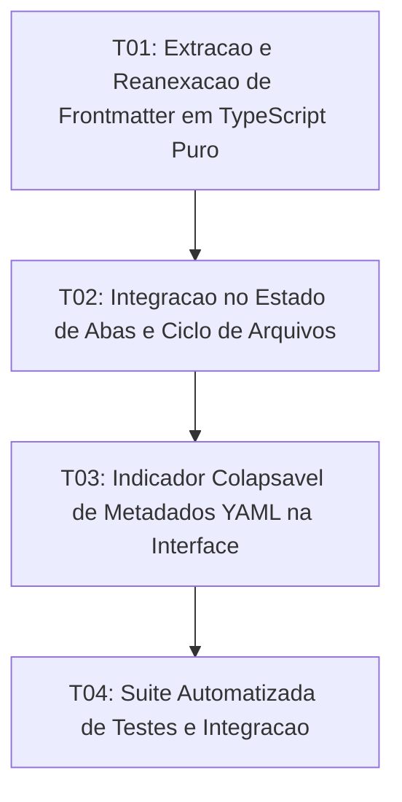

# Tasks: YAML Frontmatter Handling

**Approved**: 2026-11-10 - user: "aprovado"

## Test Coverage Matrix

| Code Layer | Required Test Type | Coverage Expectation | Location Pattern | Run Command |
| :--- | :--- | :--- | :--- | :--- |
| Pure Logic / Parsing | unit | Extração de frontmatter, tolerância CRLF/LF e reanexação | `src/lib/utils/frontmatter.ts` | `npm test` |
| Editor & Tab State | integration | Isolamento no carregamento e reconstituição na persistência | `src/App.svelte` | `npm run check` |
| UI Component | integration | Banner colapsável e visualizador discreto de metadados | `src/lib/components/FrontmatterBanner.svelte` | `npm run check` |
| Regression Suite | regression | Testes de ponta a ponta e roundtrip de frontmatter no disco | `scripts/test_yaml_frontmatter.mjs` | `npm test` |

## Gate Check Commands

| Gate Level | When to Use | Command |
| :--- | :--- | :--- |
| Frontend | After UI & store changes | `npm run check` |
| Regression | After logic & script changes | `npm test` |
| Full | Milestone completion | `npm run check && npm test` |

## Execution Plan

## Task Breakdown

### T01: [x] Extração e Reanexação de Frontmatter em TypeScript Puro
**Where**: `src/lib/utils/frontmatter.ts`
**Depends on**: none
**Tests**: `npm run check`
**Gate**: `npm run check`
**Done When**: Funções de extração, reanexação e resumo de frontmatter estão implementadas com tipagem estrita e zero dependências externas.

### T02: [x] Integração no Estado de Abas e Ciclo de Arquivos
**Where**: `src/App.svelte`
**Depends on**: T01
**Tests**: `npm run check`
**Gate**: `npm run check`
**Done When**: TabItem suporta frontmatter; openFile extrai frontmatter para a aba e saveTab reconstitui o cabeçalho YAML intacto antes da gravação em disco.

### T03: [x] Indicador Colapsável de Metadados YAML na Interface
**Where**: `src/lib/components/FrontmatterBanner.svelte`
**Depends on**: T02
**Tests**: `npm run check`
**Gate**: `npm run check`
**Done When**: O componente FrontmatterBanner renderiza badge discreto e painel expansível no topo do editor sem vazar tokens brutos para o ProseMirror.

### T04: [ ] Suíte Automatizada de Testes e Integração
**Where**: `scripts/test_yaml_frontmatter.mjs`
**Depends on**: T03
**Tests**: `npm test`
**Gate**: `npm test`
**Done When**: Testes automatizados cobrem extração com CRLF/LF, reanexação fiel em disco e fluxo sem frontmatter integrados ao executor npm test.

## Checks

Build: `npm run build`
Run typecheck: `npm run check`
Run testsuite: `npm test`

**C01** - Extração e isolamento de frontmatter delimitado por triple-dash (YAML-01)
Proof: run testsuite | PASSOU

**C02** - Indicador discreto e colapsável de metadados sem tokens no corpo (YAML-02)
Proof: run typecheck | svelte-check found 0 errors

**C03** - Reanexação fiel de frontmatter na persistência em disco (YAML-03)
Proof: run testsuite | PASSOU

**C04** - Preservação do fluxo limpo em documentos sem frontmatter (YAML-04)
Proof: run testsuite | PASSOU

