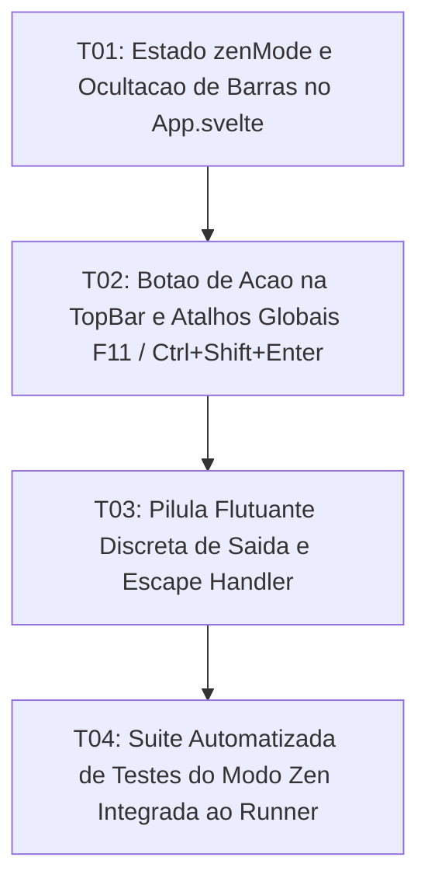

# Tasks: Zen Mode / Distraction-Free

**Approved**: 2026-11-11 - user: "aprovado"

## Test Coverage Matrix

| Code Layer | Required Test Type | Coverage Expectation | Location Pattern | Run Command |
| :--- | :--- | :--- | :--- | :--- |
| Layout & States | integration | Alternância de estado `zenMode` e classes CSS imersivas | `src/App.svelte` | `npm run check` |
| UI Controls | unit | Botão de alternância na TopBar e atalhos F11 / Ctrl+Shift+Enter | `src/lib/components/TopBar.svelte` | `npm run check` |
| Floating Indicator | unit | Pílula flutuante de saída rápida com dica de atalho Escape | `src/App.svelte` | `npm run check` |
| Regression Suite | regression | Testes de ativação, persistência e restauração do Modo Zen | `scripts/test_zen_mode.mjs` | `npm test` |

## Gate Check Commands

| Gate Level | When to Use | Command |
| :--- | :--- | :--- |
| Frontend | After UI & layout changes | `npm run check` |
| Regression | After script & logic integration | `npm test` |
| Full | Milestone completion | `npm run check && npm test` |

## Execution Plan

## Task Breakdown

### T01: [x] Estado `zenMode` e Ocultação de Barras no `App.svelte`
**Where**: `src/App.svelte`
**Depends on**: none
**Tests**: `npm run check`
**Gate**: `npm run check`
**Done When**: A ativação de `zenMode` adiciona a classe `.zen-mode-active` ocultando barras e expandindo o editor de forma fluida.

### T02: [x] Botão de Ação na `TopBar` e Atalhos Globais (`F11` / `Ctrl+Shift+Enter`)
**Where**: `src/lib/components/TopBar.svelte`, `src/App.svelte`
**Depends on**: T01
**Tests**: `npm run check`
**Gate**: `npm run check`
**Done When**: O botão de Modo Zen é disponibilizado na TopBar e os atalhos de teclado comutam o estado instantaneamente.

### T03: [x] Pílula Flutuante Discreta de Saída e Escape Handler
**Where**: `src/App.svelte`
**Depends on**: T02
**Tests**: `npm run check`
**Gate**: `npm run check`
**Done When**: Uma pílula sutil translúcida no topo permite sair com um clique ou pressionando `Escape`.

### T04: [x] Suíte Automatizada de Testes do Modo Zen Integrada ao Runner
**Where**: `scripts/test_zen_mode.mjs`
**Depends on**: T03
**Tests**: `npm test`
**Gate**: `npm test`
**Done When**: Testes automatizados validam estados, atalhos e classes do Modo Zen com 100% de sucesso em `npm test`.

## Checks

Build: `npm run build`
Run typecheck: `npm run check`
Run testsuite: `npm test`

**C01** - Ocultação total e fluida de barras circundantes via estado reativo (ZEN-01)
Proof: run testsuite | PASSOU

**C02** - Palco central com centralização imersiva e largura tipográfica ideal (ZEN-02)
Proof: run testsuite | PASSOU

**C03** - Pílula flutuante discreta com ação de saída e contagem de palavras (ZEN-03)
Proof: run typecheck | svelte-check found 0 errors

**C04** - Restauração instantânea do layout anterior via Escape ou atalho (ZEN-04)
Proof: run testsuite | PASSOU

