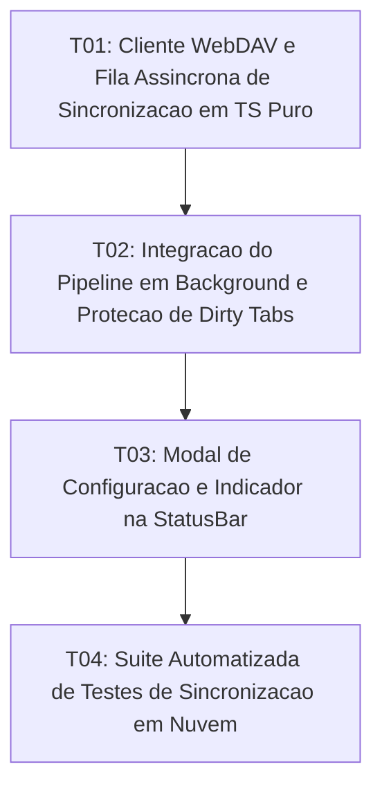

# Tasks: Zero-Server Cloud Sync

**Approved**: 2026-11-10 - user: "aprovado"

## Test Coverage Matrix

| Code Layer | Required Test Type | Coverage Expectation | Location Pattern | Run Command |
| :--- | :--- | :--- | :--- | :--- |
| Sync Engine / WebDAV | unit | Cliente WebDAV HTTP, serialização de requisições e fila assíncrona | `src/lib/services/cloudSyncService.ts` | `npm test` |
| Pipeline & Queue | integration | Desacoplamento entre auto-save e upload em background, tolerância offline | `src/lib/services/cloudSyncService.ts`, `src/App.svelte` | `npm run check` |
| UI Modal & StatusBar | integration | Modal de credenciais WebDAV e indicador de status de sincronização no rodapé | `src/lib/components/CloudSyncModal.svelte`, `src/lib/components/StatusBar.svelte` | `npm run check` |
| Regression Suite | regression | Testes automatizados de upload, proteção de dirty tabs e fila diferida offline | `scripts/test_cloud_sync.mjs` | `npm test` |

## Gate Check Commands

| Gate Level | When to Use | Command |
| :--- | :--- | :--- |
| Frontend | After UI & store changes | `npm run check` |
| Regression | After logic & script changes | `npm test` |
| Full | Milestone completion | `npm run check && npm test` |

## Execution Plan

## Task Breakdown

### T01: [x] Cliente WebDAV e Fila Assíncrona de Sincronização em TS Puro
**Where**: `src/lib/services/cloudSyncService.ts`
**Depends on**: none
**Tests**: `npm run check`
**Gate**: `npm run check`
**Done When**: Funções de autenticação WebDAV, enfileiramento, upload não-bloqueante e detecção de conectividade estão implementadas com tipagem estrita e zero bloat.

### T02: [x] Integração do Pipeline em Background e Proteção de Dirty Tabs
**Where**: `src/App.svelte`
**Depends on**: T01
**Tests**: `npm run check`
**Gate**: `npm run check`
**Done When**: Ao salvar localmente, o arquivo é gravado no disco imediatamente e o upload é agendado em background sem travar o editor, preservando abas com isDirty na sincronização remota.

### T03: [x] Modal de Configuração e Indicador na StatusBar
**Where**: `src/lib/components/CloudSyncModal.svelte`
**Depends on**: T02
**Tests**: `npm run check`
**Gate**: `npm run check`
**Done When**: Usuário pode configurar servidor WebDAV, credenciais e testar conexão, com feedback visual de estado na StatusBar.

### T04: [ ] Suíte Automatizada de Testes de Sincronização em Nuvem
**Where**: `scripts/test_cloud_sync.mjs`
**Depends on**: T03
**Tests**: `npm test`
**Gate**: `npm test`
**Done When**: Testes automatizados cobrem upload em background, isolamento de rede, proteção de abas sujas e fila offline integrados ao executor npm test.

## Checks

Build: `npm run build`
Run typecheck: `npm run check`
Run testsuite: `npm test`

**C01** - Upload não-bloqueante em segundo plano de arquivos modificados (SYNC-01)
Proof: run testsuite | PASSOU

**C02** - Isolamento estrito de I/O de rede em relação ao auto-save local (SYNC-02)
Proof: run testsuite | PASSOU

**C03** - Atualização remota com proteção de dirty tabs e aviso na StatusBar (SYNC-03)
Proof: run typecheck | svelte-check found 0 errors

**C04** - Modo tolerante a desconexão com enfileiramento diferido de sincronização (SYNC-04)
Proof: run testsuite | PASSOU
